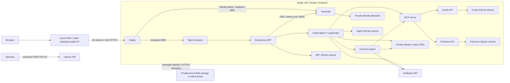

# CardServicing Azure operations

This is the operational source of truth for the single-VM Azure demo. Run commands
from Windows PowerShell 5.1 or PowerShell 7 in the repository root. No cloud
resources are created by reading this guide or running the local tests.

## A. Prerequisites

Install Azure CLI, Git, Windows OpenSSH Client (`ssh`, `scp`, `ssh-keygen`), `tar`,
Python 3.10+ and Docker Desktop with a running **Linux** engine. The existing
deployment runs isolated Linux image/runtime preflight locally before provisioning.
Docker is needed on the workstation for create/redeploy, not normal lifecycle operations.

```powershell
winget install --exact --id Microsoft.AzureCLI
# Reopen VS Code after installation so its terminal inherits PATH.
az --version
git --version
ssh -V
tar --version
python --version
docker version
docker compose version

cd A:\PrincipalEngineer\CardServicing
az login
az account list --output table
$subscriptionId = '<your-subscription-UUID>'
az account set --subscription $subscriptionId
az account show --query '{id:id,name:name,state:state,tenant:tenantId}' --output table
```

Use the Microsoft account associated with your Azure subscription. If your Gmail
address is already a Microsoft account, sign in with that address; a Gmail mailbox
alone does not create an Azure subscription. Check the tenant and subscription
list after login. See [Microsoft account setup](https://support.microsoft.com/en-us/accounts-billing/manage/how-to-create-a-new-microsoft-account)
and [Azure CLI installation](https://learn.microsoft.com/en-us/cli/azure/install-azure-cli-windows).

The scripts reuse a valid login, call `az login` if no session is available, select
the requested subscription and verify that it is enabled. Every subsequent Azure
CLI request explicitly includes the subscription. Use an account allowed to create
Compute, Network and Storage resources and scoped role assignments: for example,
Contributor plus Role Based Access Control Administrator at the intended scope.
Required resource providers must be registered. Check regional VM family quota and
availability for 4 vCPU / 16 GiB; subscription offers can restrict B-series SKUs.

### Secure model credentials and SSH

A real Anthropic API key and accessible model are required by the existing app.
There is no silent stub fallback. **No separate key-file setup command is required.**
The single create script prompts for the key with hidden input when the configured
file is missing, validates its format, saves it with current-user-only Windows file
permissions and continues deployment. If a saved key exists, it asks
`An Anthropic key is saved. Change it? [y/N]`. Enter **Y** to paste a replacement
in the hidden prompt, or **N/Enter** to reuse it. A missing file always triggers
the key prompt. Replacement is atomic after validation; an empty/invalid entry
stops before provisioning and preserves the old key. Rerun create and paste the
key without quotes. No separate key-update command is required.

The default file is `~/.secrets/cardservicing-anthropic-key.txt`; override its path
with `-AnthropicKeyFile` if needed. The script does not change permissions on other
files in your secrets directory. Never paste the key in a command argument,
configuration JSON, Git or a support log. The saved key is plaintext protected by
your Windows account ACL; workstation security and disk encryption still matter.
No secrets are placed in cloud-init or Azure Run Command.

Create generates a dedicated unencrypted Ed25519 key in the ACL-restricted ignored
`.azure/<deployment-id>/` directory for unattended SSH. Keep this directory secure
and retain it across sessions. Azure Run Command supplies the trusted SSH host key;
SSH enforces strict verification. The remote upload directory has mode 700, and
root-only runtime files have mode 600. Bootstrap generates service, database and
identity secrets and reuses them on redeployment. Docker administrators/root can
read container environment secrets; this is a dedicated demo VM trust boundary.

Create automatically detects your public IPv4 address using two independent
HTTPS IP services and restricts SSH to that address followed by `/32`. It displays
the detected CIDR and continues without a separate PowerShell window. An explicit
`-SshSourceCidr` overrides detection; saved deployments retain their configured
CIDR. Only `/24` through `/32` are accepted; SSH is never opened globally.

**To obtain your public IPv4 CIDR yourself**, run this exact command in PowerShell:

```powershell
"$(Invoke-RestMethod 'https://api.ipify.org')/32"
```

For example, a result of `203.0.113.25/32` is the complete value to paste into a
CIDR prompt or supply with `-SshSourceCidr`. If either lookup fails, returns IPv6/
a private address, or the services disagree, create falls back to an explicit
CIDR prompt. Check your VPN/proxy and use your approved public IPv4 address.

This restriction protects **SSH administration only**. Anyone with application
access can open the public HTTPS URL from an office laptop or another network;
their IP does not need to be in the SSH rule. `/32` identifies one internet egress
IP, not a particular laptop. If your administration connection changes, obtain
its new CIDR using the command above and rerun create with `-SshSourceCidr`.

## B. Quick command reference

```powershell
cd A:\PrincipalEngineer\CardServicing
$subscriptionId = az account show --query id --output tsv
```

| Operation | Exact command | Data |
| --- | --- | --- |
| Create/deploy | `.\scripts\azure-create.ps1 -SubscriptionId $subscriptionId` | Creates or reuses owned infrastructure and volumes |
| Stop/deallocate | `.\scripts\azure-stop.ps1 -SubscriptionId $subscriptionId` | Preserved |
| Start | `.\scripts\azure-start.ps1 -SubscriptionId $subscriptionId` | Preserved; runs synthetic smoke workflows |
| Status | `.\scripts\azure-status.ps1 -SubscriptionId $subscriptionId` | Preserved |
| Update/redeploy | `.\scripts\azure-create.ps1 -SubscriptionId $subscriptionId` | Rebuilds current checkout; preserves volumes |
| Preview deletion | `.\scripts\azure-destroy.ps1 -SubscriptionId $subscriptionId -WhatIf` | No Azure deletion |
| Destroy permanently | `.\scripts\azure-destroy.ps1 -SubscriptionId $subscriptionId` | Permanently deleted after typed group confirmation |

## C. First deployment

1. Install/check tools, login and select the subscription as above. Have your
   Anthropic API key ready to paste into the masked prompt. SSH CIDR is detected automatically.
2. Review costs in Azure's pricing calculator and Cost Management. The single
   `Standard_B4ms` VM, 128-GiB Standard SSD, static Standard IPv4 and private Blob
   telemetry incur charges. No AKS, managed database, paid domain, budget, Logic
   App, action group or automatic deletion service is provisioned.
3. Run the single create command. It detects your public IPv4 CIDR and prompts
   securely for a missing Anthropic key:

   ```powershell
   .\scripts\azure-create.ps1 -SubscriptionId $subscriptionId
   ```

4. Configuration is saved at `.azure/cardservicing-<scope-hash>/deployment.json`.
   The stable deployment ID, DNS label and storage name derive from subscription
   and resource group; retries use the same names. Keep this file and SSH key.
   The default group is `rg-cardservicing-demo`, VM `vm-cardservicing-demo`, region
   `australiaeast`, Ubuntu 24.04 LTS, 128-GiB Standard SSD OS disk.
5. Expect a provisioning cost warning, Linux preflight, dedicated group/network/
   VM creation, identity and Blob configuration, trusted SSH, Docker installation,
   sequential image builds, identity setup, Qdrant policy ingestion and Caddy.
   Builds and embedding downloads may take substantial time on burstable CPUs.
6. Azure assigns `<dns-label>.australiaeast.cloudapp.azure.com`. No manual DNS
   records or purchased domain are required. The VM verifies DNS before Caddy
   starts. Caddy obtains a trusted certificate and redirects HTTP to HTTPS.
   Keycloak `/realms/*`, `/resources/*` and `/admin/*` share this hostname; the
   application keeps its existing `/auth/*` callbacks and `/api/*` BFF routes.
7. Smoke verification checks trusted HTTPS, exact OIDC issuer, real Keycloak
   Authorization Code/PKCE login, secure session/CSRF, synthetic registration,
   banking writes, blocking/unblocking/replacement, model orchestration, internal
   dependencies, restart persistence and managed-identity telemetry. Only after
   success does create print `Application: https://...`.
8. Open that URL in a browser. Use the application registration flow for a new
   **synthetic** customer and complete account/card actions. Keycloak realm
   self-registration stays disabled; the app's registration is a separate existing
   flow. Do not change identity architecture to merge these flows.

Failures throw terminating PowerShell errors (nonzero when invoked using
`powershell -File` / `pwsh -File`). Resources remain for diagnosis. Fix the cause
and rerun create with the same subscription/group and saved state. There is no
automatic rollback/deletion. Current checkout source is packaged using an explicit
allowlist; local `.env`, databases, Git, virtualenv and credentials are excluded.

## D. Daily operations and data

Create is for initial infrastructure or application updates. It performs a build
and bootstrap and can interrupt service. Back up before code/image/policy upgrades.
Stop gracefully stops containers and deallocates compute, waiting for
`PowerState/deallocated`. If graceful shutdown fails, stop returns an error rather
than claiming deallocation; fix SSH/service issues and rerun it. Start starts the
existing VM, waits for running state, restores Docker/Compose and runs smoke tests.
`-RestartContainers` explicitly cycles the application containers.

Committed SQLite databases, identity MariaDB, Qdrant, generated secrets and Caddy
certificate state live in named volumes/config on the persistent managed OS disk,
never the Azure temporary disk. Systemd and container restart policies restore
services after reboot. Conversations, locks and PII bindings can be process-local;
an in-progress chat may need restarting. This is a single-node demo without HA.
Smoke tests create new synthetic records and restart service processes; run them
when a brief interruption is acceptable. Destroy removes all group data, including
VM-only backups. Download needed backups before destruction.

## E. Cost management and verified teardown

| State | What remains billable |
| --- | --- |
| Running or stopped but allocated | VM compute, disks, public IP, storage and usage |
| Deallocated | Persistent disks, reserved static public IP, Blob storage/operations; separately retained backups/monitoring |
| Group deletion verified | Group resources removed; independent resources and delayed billing still need review |

Deallocation releases compute allocation; it does not remove attached storage.
See [Azure VM states and billing](https://learn.microsoft.com/en-us/azure/virtual-machines/states-billing).
Check **Azure Portal > Cost Management + Billing > Cost analysis**, select the
subscription and review daily costs for the application group. There is no
automatic budget or spending cap; you control when the resources are stopped or
deleted. All newly provisioned application resources stay in the dedicated group.

Destroy checks the ownership ID and expected resource names/types, lists every
resource, warns about permanent loss and asks you to type the exact resource group
name. `-WhatIf` skips both the deletion and typed prompt, but still reads Azure
inventory. It deletes the entire dedicated group, waits up to 30 minutes and
checks group absence. Application/deployment-tagged resources elsewhere in the
selected subscription are reported, never deleted, and cause failure. If the group
is already absent the remainder scan still runs. Do not remove local state before
you have verified teardown.

```powershell
az group exists --name rg-cardservicing-demo --subscription $subscriptionId
az resource list --subscription $subscriptionId --tag application=cardservicing-demo --output table
```

Tags cannot discover untagged independent backups or resources in other
subscriptions. Review those manually, including Recovery Services vaults,
snapshots, Log Analytics and any previously created monitoring resources. The
scripts create none of those. Deletion verification is an ARM inventory check,
not a promise of zero future charges or immediate billing-system reconciliation.

## F. Troubleshooting

**`Set-Acl` / `SeSecurityPrivilege` during local setup:** the scripts now update
only the access-permission (DACL) section through .NET, preserving ownership and
audit settings. This applies to deployment state and newly saved API-key files.
Rerun the same create command in your normal PowerShell terminal; no audit
privilege assignment or administrator workaround is needed for this fix. Your
account still needs ordinary permission to manage access on its deployment files.
The ACL/setup regression suite passed **29 tests**, including repeated directory
and file permission updates, unchanged ownership and current-user-only key access.

Set diagnostic variables from the saved adapter configuration (select the correct
file if you have multiple deployments):

```powershell
Get-ChildItem .azure -Recurse -Filter deployment.json | Select-Object FullName
$configPath = '.azure/cardservicing-YOUR_SCOPE_HASH/deployment.json'
$c = Get-Content -Raw $configPath | ConvertFrom-Json
$rg = $c.ResourceGroup
$vm = $c.VmName
$ip = az network public-ip show -g $rg -n "$vm-ip" --subscription $subscriptionId --query ipAddress -o tsv
$knownHosts = Join-Path (Split-Path $configPath) 'known_hosts'
$sshOptions = @('-i',$c.SshPrivateKey,'-o','IdentitiesOnly=yes','-o','StrictHostKeyChecking=yes','-o',"UserKnownHostsFile=$knownHosts")
$target = "$($c.AdminUsername)@$ip"
```

**CLI, authentication or wrong subscription:**

```powershell
Get-Command az -ErrorAction SilentlyContinue
winget install --exact --id Microsoft.AzureCLI
# Reopen VS Code; then:
az --version
az login
az account list -o table
az account set --subscription $subscriptionId
az account show --subscription $subscriptionId -o table
```

**Permissions, quota or VM provisioning:**

```powershell
az vm list-usage --location $c.Location --subscription $subscriptionId -o table
az vm list-skus --location $c.Location --size $c.VmSize --all --subscription $subscriptionId -o table
az vm get-instance-view -g $rg -n $vm --subscription $subscriptionId -o json
az monitor activity-log list -g $rg --status Failed --subscription $subscriptionId -o table
az provider show --namespace Microsoft.Compute --subscription $subscriptionId --query registrationState -o tsv
```

Ask the subscription administrator to grant required roles, register providers or
increase quota. For an unavailable size, rerun create with `-VmSize` selecting an
available >=4-vCPU/16-GiB SKU. Existing VM resizing is not automated: changing the
saved size only affects a new VM. Never destroy data just to change a VM size.

**SSH:** verify your current egress CIDR and that the VM is running. Never disable
host key checking. Start/create refresh the host key through authenticated Azure.

If an older invocation stays at `Waiting for SSH: attempt 1` for minutes, stop
that invocation with Ctrl+C until the PowerShell prompt returns, then rerun the
updated script. Readiness probes now detach terminal input and enforce a
20-second per-attempt process timeout within the five-minute wait. Only that
probe's own timed-out child is terminated. Other scripted remote commands also
detach terminal input; file transfers and their SSH protocol remain unchanged.
The fix's readiness probe connected to the running VM in 1.1 seconds; local
tests cover stdin closure, exit-code handling, retries and termination of a
deliberately hung fake probe.

The existing application can remain healthy while deployment waits here. Its
running model is unchanged until source/configuration upload and container
recreation at stage 8. A saved Haiku setting alongside a running Sonnet container
therefore indicates the new deployment has not applied its configuration yet.

```powershell
az network nsg rule list -g $rg --nsg-name "$vm-nsg" --subscription $subscriptionId -o table
Test-NetConnection $ip -Port 22
ssh @sshOptions $target 'true'
# If your approved source changed, update it and redeploy:
.\scripts\azure-create.ps1 -SubscriptionId $subscriptionId -SshSourceCidr 'YOUR.NEW.PUBLIC.IP/32'
```

**Docker installation, container startup and logs:**

```powershell
ssh @sshOptions $target 'sudo systemctl status docker --no-pager'
ssh @sshOptions $target 'sudo journalctl -u docker -n 80 --no-pager'
ssh @sshOptions $target 'sudo systemctl status cardservicing --no-pager'
ssh @sshOptions $target 'sudo bash /opt/cardservicing/app/infra/azure/control.sh status'
ssh @sshOptions $target 'cd /opt/cardservicing/app && sudo docker compose --env-file /opt/cardservicing/state/.env.azure -f compose.azure.yaml logs --tail 80 frontend experience identity cards-agent fincrime-agent qdrant'
ssh @sshOptions $target 'df -h /var/lib/docker; free -h'
```

Review logs locally; do not publish credentials or customer data. Never dump
`docker inspect` environment arrays, `.env` or private signing keys into tickets.
Fix package/network/disk errors and rerun create. Bootstrap uses signed Docker apt
packages and repeatable source transfer; it is not cloud-init, so cloud-init logs
are not the application deployment log.

**`No module named card_chat.policy` during ingestion:** a previous bootstrap
extracted source under a private umask and preserved root-only directory modes
inside the container image. The updated bootstrap normalizes only the allowlisted
source directories/files before building, while keeping `/opt/cardservicing/state`
and persistent volumes private. It checks the policy CLI as the non-root app user
before ingesting policies. Rerun the same create command to upload the fix and
rebuild affected image layers; keep the VM, volumes and saved configuration.

**Waiting at `vm list-skus`:** the default `Standard_B4ms` now uses its known
4-vCPU/16-GiB specification without querying the SKU catalogue. Custom sizes still
receive a CPU/RAM check. Azure validates regional availability and quota during VM
creation, and a catalogue listing alone cannot guarantee capacity. An older running
script must finish or be stopped before rerunning the updated script.

**Caddy, frontend, DNS and OIDC:**

```powershell
Resolve-DnsName $c.AppDomain
Test-NetConnection $c.AppDomain -Port 443
curl.exe --fail --show-error "https://$($c.AppDomain)/health"
curl.exe --fail --show-error "https://$($c.IdentityDomain)/realms/cards/.well-known/openid-configuration"
ssh @sshOptions $target 'cd /opt/cardservicing/app && sudo docker compose --env-file /opt/cardservicing/state/.env.azure -f infra/azure/compose.proxy.yaml logs --tail 80 proxy'
```

DNS must resolve only to the VM static IP; ports 80/443 must be reachable for TLS.
Do not bypass TLS verification. Confirm discovery's issuer is exactly
`https://<hostname>/realms/cards` and the Keycloak browser client callback matches
the app HTTPS origin. Existing deployments refuse changed public identity/storage
settings; changing URLs needs a deliberate realm/callback migration, not merely
editing a hostname. A DNS label collision needs a different `-DnsLabel` before
initial identity setup. Same-origin routing preserves `/auth/callback` for the BFF.

**Qdrant and full readiness:**

**PowerShell `Where-Object ... status cannot be resolved`:** Windows PowerShell
5.1 can wrap `ConvertFrom-Json` arrays when they are collected directly from a
pipeline. The updated checker explicitly flattens and validates each report row,
prints the names of failed checks and preserves remote checker failures. This
error alone does not mean the containers are down; inspect the actual reported
checks. Updated login and isolation probes avoid double-opening an HTTP client
and count only the ten application services when Caddy shares their Compose project.

**Anthropic `NotFoundError` / HTTP 404:** the configured model may no longer be
available to your key. The deployment default is now `claude-haiku-5-5`, matching
the local `.env`. Saved older Azure Sonnet 4.5/4.6 defaults are migrated to Haiku
on the next create run when no `-ModelId` override is provided. Other custom
saved selections are retained. An explicit `-ModelId` always takes precedence:

```powershell
.\scripts\azure-create.ps1 -SubscriptionId $subscriptionId -ModelId 'claude-haiku-5-5'
```

This reuses the existing VM/volumes and updates the model configuration. Choose
N/Enter at the saved-key prompt if the key itself is unchanged. Do not rotate an
otherwise valid key merely because a model ID is unavailable. Model availability
is account-specific; the running deployment's read-only models query confirmed
`claude-haiku-5-5` is available to its current key and matches the local `.env` model selection. See [Anthropic model IDs](https://platform.claude.com/docs/en/about-claude/models/model-ids-and-versions).

```powershell
ssh @sshOptions $target 'cd /opt/cardservicing/app && sudo docker compose --env-file /opt/cardservicing/state/.env.azure -f compose.azure.yaml logs --tail 80 qdrant cards-agent'
.\infra\azure\smoke-test.ps1 -ConfigPath $configPath
Get-Content (Join-Path (Split-Path $configPath) 'smoke-report.json')
```

Qdrant is internal; no public port 6333 is expected. Check policy ingestion,
embedding downloads and approved policy versions. Rerun create to retry ingestion.
Do not erase volumes as a readiness fix.

**Deletion failure:** inspect failed activity events and any locks. Remove only
locks you understand and own, then rerun destroy. It verifies ownership again.

```powershell
az lock list -g $rg --subscription $subscriptionId -o table
az resource list -g $rg --subscription $subscriptionId -o table
az monitor activity-log list -g $rg --status Failed --subscription $subscriptionId -o table
.\scripts\azure-destroy.ps1 -SubscriptionId $subscriptionId -WhatIf
```

## G. Architecture



## H. Security, backup and restore

Only HTTP/HTTPS and source-restricted SSH are allowed inbound. Application APIs,
agents, MCP, MariaDB and Qdrant are not directly public. Frontend/Keycloak bind to
loopback backends; Caddy is the sole public application entry. Banking policy,
audience/signature checks, delegation and CSRF remain enforced. Use synthetic data.
Blob telemetry uses VM managed identity and a container-scoped role assignment;
shared-key and anonymous Blob access are disabled. No extra monitoring service is
added. Resources receive `application=cardservicing-demo`,
`managed-by=cardservicing-scripts` and the stable `cardservicingDeployment` tag.

Use the established encrypted offline backup tools before updates or destruction.
Install `age`/`age-keygen` locally, keep the private identity separate and retain the
exact source release corresponding to the backup:

```powershell
age-keygen -o "$HOME/.secrets/cardservicing-backup.agekey"
.\infra\azure\backup.ps1 -ConfigPath $configPath -AgeRecipient 'YOUR_PUBLIC_AGE1_RECIPIENT' -OutputDirectory .azure/backups
# Replaces persistent state; obtain DeploymentId from the saved configuration.
.\infra\azure\restore.ps1 -ConfigPath $configPath -BackupFile '.azure/backups/YOUR_BACKUP.tar.gz.age' -AgeIdentityFile "$HOME/.secrets/cardservicing-backup.agekey" -ConfirmRestoreDeployment $c.DeploymentId
```

Backup stops all writers and encrypts SQLite/WAL, identity/MariaDB, Qdrant, Caddy
and configuration state before download. It causes downtime. Restore checks the
deployment ID, source hash and volume set, creates an encrypted safety backup and
then replaces data. Interrupted restore may need manual recovery; this is not HA
or a cross-deployment migration tool. Losing the age identity loses recovery.
Download backups off the VM before deletion. VM-local backup files disappear with
the disk; downloaded backups and local keys remain and must be secured separately.

## I. Script reference

All public adapters live in `scripts/` and reuse `infra/azure/` helpers. Missing
state, mismatched ownership, failed native commands and failed required health
checks terminate execution. Scope is subscription + resource group; keep it stable.

| Script | Required | Optional / defaults | Behavior / example |
| --- | --- | --- | --- |
| `scripts/azure-create.ps1` | `SubscriptionId` | `ResourceGroup=rg-cardservicing-demo`, `Location=australiaeast`, `VmName=vm-cardservicing-demo`, `VmSize=Standard_B4ms`, `DnsLabel=cardservicing-<hash>`, `SshSourceCidr=automatic detection, prompt on failure`, `AnthropicKeyFile=~/.secrets/cardservicing-anthropic-key.txt`, `ModelId=claude-haiku-5-5`, `AcmeEmail=operator@<hostname>` | Create/redeploy current source; volumes preserved. `.\scripts\azure-create.ps1 -SubscriptionId $subscriptionId` |
| `scripts/azure-stop.ps1` | `SubscriptionId` | `ResourceGroup` as above | Graceful stop + verified deallocation; preserves data. `.\scripts\azure-stop.ps1 -SubscriptionId $subscriptionId` |
| `scripts/azure-start.ps1` | `SubscriptionId` | `ResourceGroup`, `RestartContainers` switch | Existing VM only; starts and verifies, preserves data. `.\scripts\azure-start.ps1 -SubscriptionId $subscriptionId` |
| `scripts/azure-status.ps1` | `SubscriptionId` | `ResourceGroup` | Resource/power/container status; no data changes. `.\scripts\azure-status.ps1 -SubscriptionId $subscriptionId` |
| `scripts/azure-destroy.ps1` | `SubscriptionId` | `ResourceGroup`, `WhatIf`, common `Confirm` | Typed RG confirmation, permanent group deletion, remainder checks. `.\scripts\azure-destroy.ps1 -SubscriptionId $subscriptionId -WhatIf` |

Create saves explicit overrides for later commands; omitted values on rerun retain
the saved configuration. `Location` supports Azure region names; the DNS suffix
uses that region. VM size overrides must meet the 4-vCPU/16-GiB minimum. VM name
and region changes are refused for an existing adapter deployment. The
fallback ACME contact is not a real monitored mailbox: use `-AcmeEmail` with your
address if you need CA notifications. The shared-hostname Caddy profile does not
require an ACME email. Generated SSH key path, admin user (`azureuser`), telemetry
container (`telemetry`) and disk size (`128`) can be configured through the saved
JSON before provisioning, using the advanced entrypoints below.

The established advanced entrypoints accept **mandatory `-ConfigPath`** instead of
subscription defaults and support existing deployments using two owned domains:

| Script under `infra/azure/` | Other parameters and behavior |
| --- | --- |
| `deploy.ps1` | Preflight, provision/reuse, deploy and smoke-test the application; no budget or automatic teardown |
| `start.ps1` | Optional `-RestartContainers`; starts and health-checks the existing application |
| `stop.ps1` | Optional `-ServicesOnly` (VM remains allocated and billable); default deallocates |
| `status.ps1` | Lists resources and live status |
| `destroy.ps1` | `-WhatIf`; always typed RG confirmation for actual deletion. Legacy `ConfirmDestroyDeployment` / `DeletePersistentData` parameters remain accepted but do not bypass typed confirmation |
| `smoke-test.ps1` | Runs synthetic public/internal/persistence/security/telemetry tests, writes `smoke-report.json`; changes synthetic data and briefly restarts services |
| `backup.ps1` | Required `-AgeRecipient`; optional `-OutputDirectory .azure/backups`; offline encrypted snapshot/download |
| `restore.ps1` | Required `-BackupFile`, `-AgeIdentityFile`, `-ConfirmRestoreDeployment`; replaces data, then starts/verifies |
| `validate.ps1` | **No ConfigPath** or other parameters; isolated Linux Docker build/runtime tests; never calls Azure |

Example for each advanced lifecycle/verification command:

```powershell
.\infra\azure\validate.ps1
.\infra\azure\deploy.ps1 -ConfigPath $configPath
.\infra\azure\status.ps1 -ConfigPath $configPath
.\infra\azure\stop.ps1 -ConfigPath $configPath
.\infra\azure\start.ps1 -ConfigPath $configPath -RestartContainers
.\infra\azure\smoke-test.ps1 -ConfigPath $configPath
.\infra\azure\destroy.ps1 -ConfigPath $configPath -WhatIf
```

Helper `.ps1`/`.sh`/`.py` files and Caddy/Compose files are internal implementation;
do not run privileged bootstrap/control helpers outside this deployment. Existing
custom JSON configurations are not automatically adopted by the new adapters.
Use their original `-ConfigPath` to avoid creating a second deployment identity.
For a VM deployed with an older version of this automation, rerun its original
`infra/azure/deploy.ps1 -ConfigPath ...` once to apply resource ownership tags and
install the updated remote lifecycle helpers before using the new start/stop checks.

## J. Common scenarios

- **First deployment:** complete prerequisites, then run create
  with your subscription. The script detects SSH CIDR and prompts for a missing API key. Wait for the final HTTPS URL.
- **Stop tonight:** run stop. Confirm the deallocated message; disk/IP/Blob costs
  continue. No data is removed.
- **Start tomorrow:** run start with the same subscription/group. Open the printed
  URL after smoke checks pass.
- **Changed application code:** download a backup, then rerun create from the
  updated checkout. Source is rebuilt; volumes and generated credentials persist.
- **Permanently remove infrastructure:** download any needed backups, run destroy
  with `-WhatIf`, then run it normally and type `rg-cardservicing-demo` (or your
  configured group). Review remainders and Cost Management afterwards.
- **Failed halfway:** preserve `.azure` and the group. Review the error/logs, fix
  quota, credentials, network or readiness, and rerun the same create command.
  Never point at a shared group or remove ownership tags to bypass a refusal.

## K. Visible deployment progress and manual deletion

Run just this command:

```powershell
.\scripts\azure-create.ps1 -SubscriptionId $subscriptionId
```

The terminal prints timestamped stages, the exact subscription/resource group,
Azure operation start/completion messages and elapsed times. It uses these stages:

| Stage | Work | Where it runs |
| --- | --- | --- |
| 1/9 | Check tools, load configuration, detect SSH CIDR if needed | Your computer |
| 2/9 | Prompt for a missing API key and prepare SSH credentials | Your computer |
| 3/9 | Verify login, subscription and VM sizing | No SKU catalogue query for default Standard_B4ms; custom sizes are checked |
| 4/9 | Build and validate the Linux Docker stack | Your computer; no new Azure resources yet |
| 5/9 | Create or reuse the dedicated application group | Azure; resources can appear from here |
| 6/9 | Create/reuse networking, public IP/DNS and VM | Azure |
| 7/9 | Configure managed identity, private Blob storage and permissions | Azure |
| 8/9 | Upload source, install Docker and deploy containers | The Azure VM |
| 9/9 | Verify HTTPS, authentication, APIs and banking workflows | VM and public endpoint |

First-time local image/model downloads and builds can take a long time. Local
Docker output streams immediately; silent operations print a `Still running`
message every 15 seconds, identifying the operation and elapsed time. During
stage 4, portal refreshes will not show newly created application resources.
Azure operations can also take several minutes; their names and completion times
are printed. `Azure operation completed: vm run-command invoke` confirms only
that VM Run Command finished (normally fetching the SSH host key). It does not
mean deployment is complete. The next SSH readiness wait now prints attempts and
elapsed time, followed by stage 8 source upload/deployment and stage 9 checks. Remote bootstrap prints installation/build/configuration milestones.
A final application URL is printed only after required health checks pass.

An already-running PowerShell invocation does not pick up edited script code;
these logging changes apply on the next run. Keep the current terminal open so
its output/error is preserved. Do not start a second create concurrently with an
existing create. After a failed run, fix the reported issue and rerun the same
command; named resources and persistent volumes are reused.

### Delete manually in Azure Portal

When finished with the showcase, open **Resource groups > rg-cardservicing-demo
> Delete resource group**, review its resources and type the group name to confirm.
This permanently removes the VM, disks, IP, networking, application databases,
identity and Qdrant volumes, and telemetry storage. Download any backups first.
Verify that the group disappears, then check Cost Management for retained resources
and delayed charges. Deallocation alone retains billable disks/IP/storage.
The existing `azure-destroy.ps1` remains available as an optional manual command;
there is no scheduled or budget-triggered deletion.

### One-time cleanup from the cancelled budget attempt

Removing code does **not** remove resources that an earlier script already created.
In the same subscription, manually delete **rg-cardservicing-cost-control** if it
exists. This removes its old Logic App, action groups, metric alerts and deployment
records; keeping them can leave charges or old automation in place. Review and
remove any `budget-cardservicing-quarterly` under the application's Cost Management
Budgets if it exists before retrying deployment. No new budget is created by the
updated scripts, and no notification email/billing-currency prompt is needed.

The cancelled feature may also have left custom IAM roles named
`CardServicing budget teardown <deployment-id>` and
`CardServicing group existence read <deployment-id>`, plus their assignments.
They are free RBAC metadata. Remove only these deployment-owned assignments/roles
in subscription **Access control (IAM)** if present; remove assignments before
custom role definitions. Their deployment ID is in the saved deployment JSON.
The updated deployment does not manage these old controls or delete outside
resources. The optional destroy command reports application-tagged resources
remaining outside the app group for your manual review.

## Validation evidence and remaining gates

The deployment/report/setup suites passed **50 local tests**, including reuse of
saved configuration from the cancelled budget attempt, progress/heartbeat behavior,
exit-code preservation, interruption cleanup and secret-safe console output.
This includes a real Linux container regression using an already-cached Cards
Agent image with networking disabled: restrictive extraction reproduced the policy
import failure, and the exact patched bootstrap restored non-root policy imports
while preserving private state permissions. It also verifies that the default VM
size skips SKU enumeration and undersized custom overrides are rejected.
The focused Linux permission regression was validated separately. The updated
report suite checks Windows PowerShell array flattening, malformed report refusal,
OIDC client lifetime and service-scoped container isolation. Targeted live checks
confirmed login, policy retrieval and isolation; full model-backed smoke verification
still requires updating the unavailable model and rerunning deployment/checks.
The later SSH wait fix passed **46 focused SSH/deployment/setup tests** (including
four SSH child-process/retry tests), plus a live readiness probe. No model calls,
container restarts or infrastructure changes were made to test that wait fix.

Run local tests with:

```powershell
.venv\Scripts\python.exe -m pytest tests/test_azure_automation.py tests/test_azure_setup_prompts.py -q
```

These cover PowerShell syntax, local setup, masked key provisioning/ACLs, IP lookup
fallback, ownership refusal, backup compatibility, health-evidence validation,
mocked deletion, and local progress heartbeats/exit-code/cancellation behavior.
They use fake keys and mock external services; they never provision/delete Azure
resources. The cancelled budget feature and its tests have been removed.
Changed Python and shell files also receive syntax/whitespace checks. PowerShell
7 is supported in code but was not available for a separate runtime test here.

The full Linux Docker preflight validates real Compose builds, both Caddy profiles,
Keycloak/MariaDB persistence, JWKS/token/issuer behavior, Nginx and internal
prerequisites. **The full preflight was not rerun for this change; the focused
Linux source-permissions regression described above was executed.** Existing historical evidence is in
`infra/azure/VALIDATION.md`; it is not evidence of this deployment's cloud success.

No live Azure provisioning/deletion, public certificate issuance or VM stop/start
cycle was executed during implementation. Those require an authorized live run.
The deployed smoke command automates trusted HTTPS, OIDC login, registration,
account/card actions including replacement, RAG, process-restart persistence,
isolation and Blob telemetry. Start also verifies the previous successful smoke
customer's saved login/card selection before generating a new smoke customer and
saves `resume-report.json`. This exercises persistence across deallocation when
used after stop; that live cycle was not executed here. Manually compare a synthetic
customer's banking details across stop/start for browser acceptance as well.
Browser rendering, interactive navigation and
Keycloak UI behavior require manual browser acceptance even after HTTP smoke
passes. Do not claim cloud success from local/mocked tests alone.

Azure DNS label configuration follows the [Azure public IP CLI](https://learn.microsoft.com/en-us/cli/azure/network/public-ip).
TLS behavior follows [Caddy automatic HTTPS](https://caddyserver.com/docs/automatic-https).

## Implementation file inventory

- New public adapters: `scripts/azure-create.ps1`, `azure-stop.ps1`,
  `azure-start.ps1`, `azure-destroy.ps1`, `azure-status.ps1` and shared
  `scripts/azure-common.ps1`.
- Reused/enhanced engine: `infra/azure/common.ps1`, `deploy.ps1`, `start.ps1`,
  `stop.ps1`, `destroy.ps1`, `smoke-test.ps1`, `bootstrap.sh`, `control.sh`,
  `configure.py`, `smoke.py` and `validate_local.py`.
- Proxy configuration: updated `infra/azure/Caddyfile`; added
  `infra/azure/Caddyfile.single`. Existing Azure and local application Compose
  configurations were preserved.
- Documentation: this new root guide, root `README.md`, `docs/azure-compose.md`
  and the `infra/azure/README.md` pointer. Validation: extended
  `tests/test_azure_automation.py`.

The cancelled budget integration, templates/workflow and dedicated budget tests
have been removed. Existing unrelated deployment/application work was preserved.
The deployment retains automatic CIDR detection, masked key setup and private ACLs.
