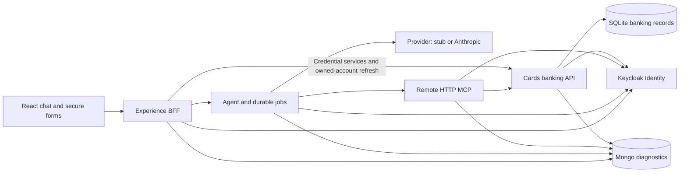

# Architecture and technology stack

Use [README](../README.md) for current [Docker](../README.md#1-run-and-debug-using-local-docker-containers) and [native](../README.md#2-run-and-debug-natively-on-your-computer) prerequisites, configuration, run/debug commands and switching steps. Architecture and API behavior are shared by both modes; process locations and persistence paths differ.

## Runtime boundaries

| Component | Responsibility | Entry point |
| --- | --- | --- |
| React/TypeScript/Vite | Chat, direct actions, private forms, review and confirmation | `frontend/src/main.tsx` |
| Experience FastAPI | Cookie session, Origin/CSRF checks, login/registration facade, signed delegation and agent proxy | `card_chat.experience:app` |
| Agent FastAPI | Intent orchestration, caller-scoped private bindings, durable reviews/jobs and confirmed execution | `card_chat.main:app` |
| Provider-neutral agent | Calls configured model and checks proposed tool membership | `card_chat.agent.CardServicingAgent` |
| Provider | Hosted Anthropic Messages or limited deterministic stub | `card_chat.provider` |
| Official SDK MCP server | Catalogue-derived tool registration and shared HTTP execution adapter | `card_chat.mcp_server:app` |
| Cards FastAPI / BankingService | Credential verification, customer/account/card ownership and banking APIs | `card_servicing.main:app`, `banking.py` |
| SQLiteCardStore | Card generation, atomic retry/existing-card decisions and additive migrations | `card_servicing.persistence` |
| MongoTelemetry | Queued redacted operational events/traces, TTL and safe fallback | `card_servicing.telemetry`, `card_chat.observability` |
| Keycloak | OIDC service identity, plus optional original browser OIDC sign-in | `identity` Compose service or native/external instance |

All application service hops are independent HTTP processes. Agent connects to MCP through Streamable HTTP; it does not spawn a child or use stdin/stdout pipes. Backend tools are compiled from the versioned catalogue and local OpenAPI; discovered schemas must match. The model selects an eligible capability, not an arbitrary REST URL.

## Data and trusted decisions

SQLite schema version 3 stores customers, owned accounts, cards, card/account links, account retry records, original card snapshots and issuance-decision snapshots. Python provides SQLite access; no separate server/CLI installation is required. Existing data is preserved by additive initialization migrations.

`issue_idempotent` serializes ownership, operation-key lookup, existing-card checks and creation with `BEGIN IMMEDIATE`. Ordinary fresh-key requests return an existing card; explicit reviewed additional issuance creates another. Matching retries return the original outcome; conflicting reuse returns 409. Both public issuance paths use that policy. See [card issuance](card-issuance.md).

Experience has its own SQLite session database. Agent's journal stores conversation bindings, drafts, reviews, accepted operations and outcomes. Exact private values remain in trusted state; credentials do not enter the journal or model. See [customer banking](customer-banking.md), [SQLite persistence](card-persistence.md) and [model privacy](model-privacy.md).

MongoDB holds `application_logs` and `request_traces`, not accounts/cards. It is enabled by default in the full Compose stack, which provides a persistent Mongo container. Native mode can use Docker Mongo, a configured native Community Server, or `stdout`/`none` with no Mongo instance. Runtime logging failure does not block banking; the adapter falls back safely. Compose requires Mongo health during initial full-stack startup. See [Mongo logging](mongodb-logging.md).

## Security and model boundary

Username/password registration generates a customer UUID and salted scrypt hash. The BFF rotates a random HttpOnly cookie session, checks Origin/CSRF for writes, expires sessions and deletes them on logout. Credentials travel only through secure forms to the credential service.

Service access tokens and signed customer delegation remain separate. Database ownership is rechecked in the Cards service; neither the model nor a stale delegated account list can grant account access. The provider receives sanitized intent and scoped opaque references rather than raw identifiers, tool results or credentials. State-changing proposals require an explicit reviewed snapshot and confirmation.

The default stub is credential-free and supports only a few deterministic intents. Rich language interpretation uses Anthropic. Direct selections, form submissions and confirmations do not need model calls.

## Deployment and observability

Docker mode runs five application containers plus Identity and Mongo. Frontend 8080, Identity 8081 and Mongo host port 27018 are loopback published. Debug mode additionally maps four Python listeners to 5681-5684; container APIs use internal port 8000. Container source is an image snapshot and needs rebuilding after edits.

Native mode runs Vite and four Python processes on Windows. Its preparation starts missing local Docker dependencies, unless compatible native/external dependencies are already available. With console logging and native Identity, no Docker is required. Startup probes bypass proxies for loopback URLs.

Docker named volumes and native `data/local/` SQLite files are separate. Mongo credentials and Identity keys must stay consistent with their volumes. Redis/RabbitMQ in the older infrastructure Compose file are provisioned learning dependencies, not part of the current banking path.

## Further references

[HTTP contracts and identity](http-stack.md), [end-to-end trace](chat-end-to-end.md), [catalogue](tool-catalogue.md), [health checks](health-checks.md), [adapter configuration](infrastructure-adapters.md), [SVG diagrams](diagrams/index.html), and [Docker attach reference](docker-debugging.md).
