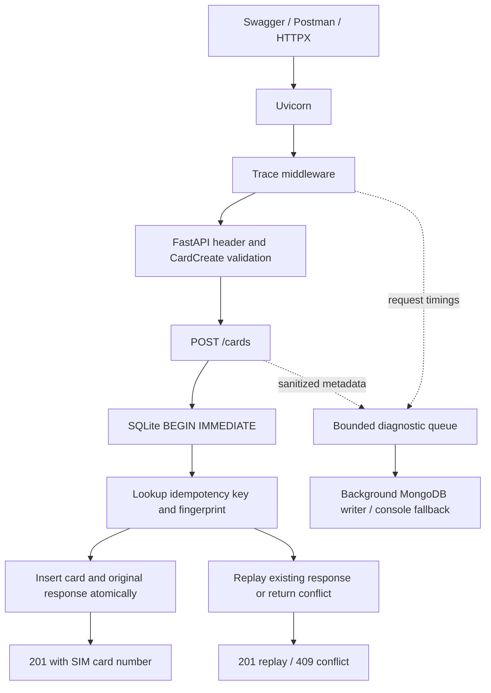

# Architecture and technology stack

Card issuance now serializes ownership, replay and existing-card decisions in one SQLite transaction. Schema version 3 preserves decision snapshots; see [card issuance](card-issuance.md).

The full stack now includes a persistent MongoDB diagnostics service. All Python HTTP layers reuse the existing redacted telemetry adapter; Agent/model/MCP structured metrics also reach Mongo. See [MongoDB logging](mongodb-logging.md).

The current customer/account/card extension is documented in [Customer banking](customer-banking.md), including architecture and database diagrams. Registration/password verification bypass the model; direct and conversational banking share Agent/MCP tools and Cards banking services. The Cards database is authoritative for registered customer ownership.

Current application architecture: [Independent HTTP stack](http-stack.md).
Model data isolation and optional caching: [Private model context](model-privacy.md)
and [sequence diagram](diagrams/07-private-inputs-and-model-context.svg).
React, Experience, Agent, remote MCP and Cards now run separately with Keycloak,
durable Agent jobs and caller-bound confirmation. The generated
[sequence diagrams](diagrams/01-startup-and-discovery.svg) trace that flow.
The earlier adapter/infrastructure notes below are retained; run/debug commands
for the current stack are in the linked guide.

API startup validates configuration and selects its adapters. `CARD_STORE=sqlite`
and `TELEMETRY_SINK=mongo` preserve defaults; stdout/none telemetry need no Mongo.
HTTP code consumes `CardStorePort` and `StorageUnavailable`, while SQLite owns
provider exception translation. Explicit injected instances take precedence.
See [adapter configuration and same-build reproduction](infrastructure-adapters.md).

The chat workflow has a [detailed end-to-end trace](chat-end-to-end.md),
[standalone SVG diagrams](diagrams/index.html), and version-controlled
[diagram definitions](diagrams/card-chat-flows.json). Regenerate with
`python scripts/render_chat_diagrams.py` when the implementation changes.

MCP tools are now registered from a versioned [tool catalogue](tool-catalogue.md)
and compiled from OpenAPI operations. Claude sees all eligible discovered tools
using automatic tool choice before review. Confirmation executes a validated
snapshot directly through the shared HTTP handler; it makes no model call.

This API-first local learning project implements simulated card origination.
The compatibility card-only route assumes legacy accounts exist. Registered customer
operations validate account ownership in SQLite; see the current banking guide.
Swagger, Postman or the separate HTTPX client calls the API directly. An optional
[browser chat demo](chat-demo.md) adds FastAPI chat → stdio MCP → HTTPX → REST.
The chat process calls hosted Claude through a provider adapter; the API remains
an independent process. The current HTTP Agent persists drafts, confirmation snapshots and operations in its SQLite journal.

| Component | Role and current status |
| --- | --- |
| Python 3.10+, Python 3.13 slim Docker image | Application language and container runtime |
| FastAPI, Uvicorn, Pydantic | HTTP, validation, dependency injection and OpenAPI |
| HTTPX | Separate client, mock transport tests |
| pytest, pytest-cov, GitHub Actions | API/client/storage verification |
| SQLite, built-in sqlite3 | Authoritative cards, status reference and durable idempotency |
| MongoDB 8 / PyMongo | Asynchronous operational logs and timing traces |
| Redis 8 / redis client | Disposable future read cache; provisioned and smoke-tested only |
| RabbitMQ 4 management / Pika | Future events; provisioned with transport smoke check only |
| Docker Compose, VS Code, debugpy | Host/container development and debugging |

## Current request flow



Validation returns 422 without mutation; SQL errors return 503. Names and account
numbers are normalized before fingerprinting. A UUID-based SIM card number and
creation timestamp are persisted once and replayed on retries. Card creation assumes
the account exists. Redis and RabbitMQ are outside this request path.
A later outbox should commit CardCreated events with the
card, publish to RabbitMQ with confirms, and use idempotent consumers for MongoDB
projections/notifications. Cache-aside reads should fall back to SQLite and use TTLs.
Neither the cache nor the best-effort diagnostic queue replaces durable idempotency.

## Code map

| Location | Responsibility |
| --- | --- |
| src/card_servicing/main.py | Factory, lifespan, wiring, trace middleware, health and item CRUD exercises |
| cards.py / models.py / config.py | Origination route, validated contract, future policy extension |
| store.py / persistence.py / idempotency.py | Memory/SQLite stores, schema, atomic retries, canonical identity |
| telemetry.py | Sanitized async MongoDB diagnostics |
| src/api_client | HTTPX client and card demo |
| tests | API, validation, concurrency, durability, health, client and diagnostics |
| scripts | Infrastructure setup/check, Docker startup, OpenAPI export |
| Dockerfile / compose*.yaml / .vscode | Non-root image, isolated infrastructure and debugger |
| docs/cards.openapi.json | Generated card-only API contract |

## Isolation and configuration

Compose project/image `card-servicing` has separate named volumes. SQLite uses
`data/cards.db`; MongoDB uses `card_servicing`. Fresh credentials are generated
from `.env.example`. Host ports: API 8010,
Docker API 8011, debugger 5679, MongoDB 27018, Redis 6380, AMQP 5673, management 15673.
Container ports remain 8000, 5678, 27017, 6379, 5672 and 15672 respectively.
The container uses service DNS names. All published ports bind to localhost.

The normal factory reads root `.env` with environment overrides. SQLite is the
readiness dependency; telemetry is optional. Tests use injected isolated stores.
CARD_CACHE_TTL_SECONDS documents a future cache setting and is not yet consumed.
The same built image can be promoted with environment-specific configuration.
Dependency ranges and image tags can resolve to newer versions on rebuild;
a reproducible lockfile is not yet provided.
See [persistence](card-persistence.md), [infrastructure](local-infrastructure.md)
and [Docker debugging](docker-debugging.md).

## API and production engineering learning scope

This is the broader learning scope. Validation, card origination storage, durable
idempotency, local diagnostics, Docker debugging, and basic liveness/readiness are
implemented; the remaining topics are planned. Introduce components to address a
concrete requirement and record significant decisions
with alternatives, failure modes, operational costs, and scaling triggers.

| Area | Considerations and exercises |
| --- | --- |
| API contracts | Resource design, HTTP semantics, validation, consistent error responses, pagination, versioning, backward compatibility, and OpenAPI contract checks |
| Data correctness | Validated card identifiers, transaction boundaries, concurrency, durable idempotency, constraints, migrations, and recovery |
| Downstream calls | Explicit timeouts, bounded retries with jitter, retry budgets, circuit breakers, connection limits, backpressure, and failure isolation; retry side effects only with safe idempotency |
| Authentication | Local OAuth 2.0/OpenID Connect exercises, appropriate client flows, token signature/issuer/audience/expiry validation, key rotation, and service identities |
| Authorization | Least privilege, scopes/roles, resource ownership, tenant isolation, and negative tests for cross-user and cross-tenant access |
| Security and audit | Secret management, payload limits, sensitive-data redaction, abuse controls, and access-controlled audit records distinct from diagnostic logs |
| Observability | Structured logs, correlation IDs, metrics, distributed traces, latency/error objectives, alerts, and actionable runbooks |
| Verification | Unit, persistence, integration, contract, and load tests; inject broker, database, cache, and downstream failures and verify recovery |
| Delivery and operations | Reproducible configuration, CI checks, health/readiness probes, graceful shutdown, migrations, backup/restore, rollback, and capacity planning |

### API gateway responsibilities

Add a local gateway after direct API behavior is established. Explore routing,
TLS termination, request size limits, rate limiting, token validation, and request
correlation. Compare gateway authentication with application validation based on
the trust boundary. The application must enforce business authorization and
resource ownership; gateway checks alone cannot decide who may access a card.
Prevent clients from spoofing trusted identity headers and consider direct access
paths that bypass the gateway.

Redis may later support rate limiting, but define the behavior during Redis failure
explicitly. Keep durable card idempotency in SQLite. Choose the gateway and
local identity provider when implementing this increment, based on learning needs
and local resource requirements.

## Run, debug, and test the implemented application

For a new checkout, start with [the README](../README.md). Install
`.[dev,infra,chat]`, configure ignored `.env`, and choose **Debug Chat + API** in
VS Code. The compound starts the host API on 8010 and chat on 8020. Wait for both
startup messages and open `http://127.0.0.1:8020`. With `TELEMETRY_SINK=stdout`, no
Docker services are required. Configurations live in `.vscode/launch.json`.
Use the separate modes below when you want only the API or a container API.

For Docker, run `scripts/start-docker-api.ps1 -DebugApi -Build`, attach using
**Attach to Docker API**, and open <http://127.0.0.1:8011/docs>. Rebuild after source
changes because the image contains a snapshot; restarting alone does not update
code. See [Docker debugging](docker-debugging.md) and the
[stop/start reference](local-infrastructure.md#daily-commands).

Run without a debugger from the project root:

```powershell
.\.venv\Scripts\python.exe -m uvicorn card_servicing.main:app --reload --port 8010
```

For breakpoints, stop that server, choose **Debug API** in VS Code, and press
F5. The current debug configuration does not enable automatic reload; save and
restart debugging after code changes. Open `http://127.0.0.1:8010/docs` to submit
requests, or `/openapi.json` to inspect the live specification.

Run the existing automated tests without starting a server:

```powershell
.\.venv\Scripts\python.exe -B -m pytest -v -p no:cacheprovider
```

Automated tests already use temporary SQLite files and injected/mocked telemetry
without requiring Docker. They cover validation, restart persistence, idempotency
conflicts/concurrency/rollback, telemetry failures, readiness, catalogue validation,
model-proposed actions and real MCP/HTTP dispatch with a stub model. CI also checks
`scripts/export_cards_openapi.py --check` and
`scripts/render_chat_diagrams.py --check`. These checks do not rewrite documents.
`scripts/check_infra.py` separately exercises real local services. Automated
business-event delivery and Redis cache integration tests belong to future increments.

## Implementation increments

1. Implemented: WSL 2/Docker Desktop, Compose infrastructure, API image, host and
   container debugging, and recurring SQLite readiness checks. Liveness remains
   independent of storage; Compose reports health but does not route traffic or
   automatically restart unhealthy containers.
2. Implemented: replace card memory storage in the normal app with SQLite;
   verify restart persistence, transaction rollback, and validated card identifiers.
   Asynchronous MongoDB operational logs and local request timing traces are also
   implemented; these are best effort, separate from durable business events.
3. Add a card lookup endpoint and review API contracts and error handling.
4. Implemented: required client idempotency keys, atomic saved responses, conflict
   detection, and concurrency/restart/rollback tests. Retry with the same key after
   a timeout; account values are readable in SQLite and hashed only in logs.
5. Add the transactional outbox, RabbitMQ publishing, and MongoDB projection
   consumer; test duplicate delivery and crashes around publication/acknowledgement.
6. Add a simulated notification consumer, bounded retries, dead letter handling,
   replay, and event schema compatibility exercises.
7. Add Redis caching for reads and test expiry, invalidation, and database fallback.
8. Exercise downstream timeouts, retry policies, circuit breakers, and backpressure.
9. Add authentication, application authorization, and tenant isolation tests.
10. Add a local API gateway and test routing, rate limits, and trust boundaries.
11. Extend existing local request timing/log correlation to distributed tracing,
    service objectives, load/failure exercises, and operational runbooks; review scaling tradeoffs,
    SQLite concurrency limits, and when a server database would be justified.
12. Optionally compare Kafka and saga orchestration/choreography, then consider
    a frontend once the API and downstream learning goals are met.

This learning scaffold does not yet implement authentication, authorization,
settlement, a financial ledger, or production-grade audit controls.

## Reference documentation

- [SQLite's embedded, serverless architecture](https://www.sqlite.org/serverless.html)
- [MongoDB Community Edition with Docker](https://www.mongodb.com/docs/manual/administration/install-community-docker/)
- [Redis documentation](https://redis.io/docs/latest/)
