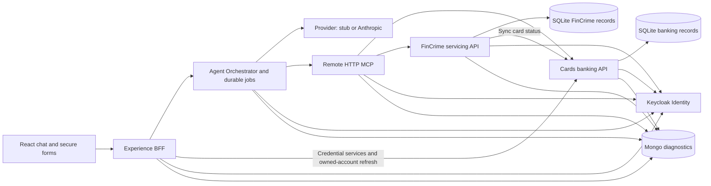

# Architecture and technology stack

Use [setup guide](getting-started.md) for current [Docker](getting-started.md#1-run-and-debug-using-local-docker-containers) and [native](getting-started.md#2-run-and-debug-natively-on-your-computer) prerequisites, configuration, run/debug commands and switching steps. Architecture and API behavior are shared by both modes; process locations and persistence paths differ.

## Runtime boundaries



| Component | Responsibility | Entry point |
| --- | --- | --- |
| React/TypeScript/Vite | Chat, direct actions, private forms, review and confirmation | `frontend/src/main.tsx` |
| Experience FastAPI | Cookie session, Origin/CSRF checks, login/registration facade, signed delegation and agent proxy | `card_chat.experience:app` |
| Agent FastAPI | Multi-agent intent orchestration, caller-scoped private bindings, durable reviews/jobs and confirmed execution | `card_chat.main:app` |
| Agent Orchestrator | Routes turns between specialized agents and enforces cross-agent dependency rules (e.g. pre-issuance blocking check) | `card_chat.agent.AgentOrchestrator` |
| Card Servicing Agent | Specializes in customer accounts, card viewing, and new card issuance | `card_chat.agent.CardServicingAgent` |
| FinCrime Agent | Specializes in risk protection, fraud mitigation, and card blocking | `card_chat.agent.FinCrimeAgent` |
| Provider | Hosted Anthropic Messages or limited deterministic stub | `card_chat.provider` |
| Official SDK MCP server | Catalogue-derived tool registration and shared HTTP execution adapter | `card_chat.mcp_server:app` |
| Cards FastAPI / BankingService | Credential verification, customer/account/card ownership and banking APIs | `card_servicing.main:app`, `banking.py` |
| SQLiteCardStore | Card generation, atomic retry/existing-card decisions, status updates and additive migrations | `card_servicing.persistence` |
| FinCrime FastAPI / Service | Independent card blocking API, customer authorization, audit logging and Cards DB synchronization | `fincrime_servicing.main:app`, `service.py` |
| SQLiteFinCrimeStore | Independent persistence for blocked cards, financial crime audit logs and idempotency snapshots | `fincrime_servicing.persistence` |
| MongoTelemetry | Queued redacted operational events/traces, TTL and safe fallback | `card_servicing.telemetry`, `card_chat.observability` |
| Keycloak | OIDC service identity, plus optional original browser OIDC sign-in | `identity` Compose service or native/external instance |

All application service hops are independent HTTP processes. Agent connects to MCP through Streamable HTTP; it does not spawn a child or use stdin/stdout pipes. Backend tools are compiled from the versioned catalogue and local OpenAPI; discovered schemas must match. The model selects an eligible capability, not an arbitrary REST URL.

## Multi-agent orchestration and card blocking

The system supports multi-agent coordination between the **Card Servicing Agent** and the **FinCrime Agent**, governed by an **Agent Orchestrator**.

```mermaid
sequenceDiagram
    autonumber
    actor Customer as React UI / Customer
    participant BFF as Experience BFF
    participant Orch as Agent Orchestrator
    participant FinCrimeAgent as FinCrime Agent
    participant CardsAgent as Cards Agent
    participant MCP as MCP Streamable HTTP
    participant FinCrimeAPI as FinCrime Service API
    participant CardsAPI as Cards Banking API
    participant FinCrimeDB as [(FinCrime SQLite)]
    participant CardsDB as [(Cards SQLite)]

    Note over Customer,CardsDB: 1. Card Blocking Customer Journey
    Customer->>BFF: "Block my card ending in 1234"
    BFF->>Orch: Forward turn with EdDSA customer delegation & cards
    Orch->>FinCrimeAgent: Route intent to FinCrime Agent
    FinCrimeAgent-->>Orch: Propose block_card(card_id='selected_card_...')
    Orch-->>BFF: Action Review: "Block card: Card reference: ****1234. Confirm action"
    BFF-->>Customer: Display review and confirmation button
    Customer->>BFF: Confirm action
    BFF->>Orch: Confirm execution
    Orch->>MCP: Call tool block_card(card_id, reason)
    MCP->>FinCrimeAPI: POST /fincrime/cards/{card_id}/block
    FinCrimeAPI->>FinCrimeDB: Insert blocked_cards, audit_log, idempotency (BEGIN IMMEDIATE)
    FinCrimeAPI->>CardsAPI: POST /banking/cards/{card_id}/block (Sync status)
    CardsAPI->>CardsDB: UPDATE cards SET status='blocked' (BEGIN IMMEDIATE)
    CardsAPI-->>FinCrimeAPI: 200 OK (status: blocked)
    FinCrimeAPI-->>MCP: 200 OK (CardBlockResult)
    MCP-->>Orch: Tool success
    Orch-->>BFF: "Block card succeeded. Card reference: SIM-...; Status: blocked."
    BFF-->>Customer: Updated chat & [BLOCKED] badge in My Cards

    Note over Customer,CardsDB: 2. Cross-Agent Pre-Issuance Rejection Policy
    Customer->>BFF: "I would like a new card" (for blocked account)
    BFF->>Orch: Forward message
    Orch->>CardsAgent: Route to Cards Agent
    CardsAgent-->>Orch: Propose issue_card(account_number)
    Orch->>FinCrimeAPI: Check account status: GET /fincrime/accounts/{acc}/status
    FinCrimeAPI->>FinCrimeDB: SELECT 1 FROM blocked_cards WHERE account_number=?
    FinCrimeDB-->>FinCrimeAPI: Blocked card found
    FinCrimeAPI-->>Orch: has_blocked_cards = True
    Orch-->>BFF: Intercept: "Cannot issue new card while an existing card for this account is blocked."
    BFF-->>Customer: Explanatory rejection message

    Note over Customer,CardsDB: 3. Card Unblocking Customer Journey
    Customer->>BFF: "Unblock my card ending in 1234"
    BFF->>Orch: Forward turn with EdDSA customer delegation & cards
    Orch->>FinCrimeAgent: Route intent to FinCrime Agent
    FinCrimeAgent-->>Orch: Propose unblock_card(card_id='selected_card_...')
    Orch-->>BFF: Action Review: "Unblock card: Card reference: ****1234. ATTENTION: Unblocking this card will restore its active status and re-enable new card issuance on this account. Confirm with the button below."
    BFF-->>Customer: Display review and confirmation button
    Customer->>BFF: Confirm action
    BFF->>Orch: Confirm execution
    Orch->>MCP: Call tool unblock_card(card_id, reason)
    MCP->>FinCrimeAPI: POST /fincrime/cards/{card_id}/unblock
    FinCrimeAPI->>FinCrimeDB: UPDATE blocked_cards SET status='unblocked', audit_log (BEGIN IMMEDIATE)
    FinCrimeAPI->>CardsAPI: POST /banking/cards/{card_id}/unblock (Sync status)
    CardsAPI->>CardsDB: UPDATE cards SET status='created' (BEGIN IMMEDIATE)
    CardsAPI-->>FinCrimeAPI: 200 OK (status: created)
    FinCrimeAPI-->>MCP: 200 OK (CardBlockResult)
    MCP-->>Orch: Tool success
    Orch-->>BFF: "Unblock card succeeded. Card reference: SIM-...; Status: created."
    BFF-->>Customer: Updated chat & status restored in My Cards
```

### Roles and Responsibilities

1. **Agent Orchestrator (`card_chat.agent.AgentOrchestrator`)**:
   - Inspects caller context and customer conversation history to route turns to the appropriate specialized agent.
   - Enforces cross-agent business rules: when card issuance is proposed, the orchestrator coordinates with the FinCrime subsystem to ensure the target account has no active blocked cards before presenting reviews or executing issuance.
2. **Card Servicing Agent (`card_chat.agent.CardServicingAgent`)**:
   - Focuses strictly on core banking journeys: account opening, viewing accounts and cards, and standard card issuance.
3. **FinCrime Agent (`card_chat.agent.FinCrimeAgent`)**:
   - Focuses on risk management, fraud protection, and card lifecycle security (`block_card`, `unblock_card`).
   - Resolves card references from natural language expressions like "ending in 1234" against customer-delegated card holdings, validating that only blocked cards can be unblocked and only active cards can be blocked.
4. **FinCrime Backend Service (`fincrime_servicing`)**:
   - Completely independent domain and persistence layer storing card block and unblock records, customer audit logs, and idempotency keys in `fincrime.db`.
   - Authorizes requests against customer delegation, records audit events, and synchronizes the card's status in the authoritative Cards database.
5. **Cards Banking Service (`card_servicing`)**:
   - Enforces the cross-agent rule at the database level: `issue_idempotent()` rejects new card creation on accounts containing a blocked card with HTTP 400 (`Cannot issue a new card while an existing card for this account is blocked.`). Replaying prior completed issuance keys remains safe and idempotent.
6. **MCP Server Agent-Tool Access Policy (`card_chat.mcp_server`)**:
   - Configuration-driven tool access control: tools configure their permitted agents in `tools.json` (`"agents": ["cards_agent"]` or `"agents": ["fincrime_agent"]`), configurable also via `MCP_AGENT_TOOLS`.
   - Cards Agent has access exclusively to Card APIs (`create_card`, `issue_card`, `view_cards`, `view_accounts`, `create_account`).
   - FinCrime Agent has access exclusively to FinCrime APIs (`block_card`, `unblock_card`).
   - MCP Server exposes `GET /mcp/agents/{agent_name}/tools` and validates the calling agent identity passed via request context `meta['agent']`, rejecting unauthorized cross-agent tool calls with HTTP 403.

## Data and trusted decisions

SQLite schema version 3 stores customers, owned accounts, cards, card/account links, account retry records, original card snapshots and issuance-decision snapshots. Python provides SQLite access; no separate server/CLI installation is required. Existing data is preserved by additive initialization migrations.

`issue_idempotent` serializes ownership, operation-key lookup, existing-card checks and creation with `BEGIN IMMEDIATE`. Ordinary fresh-key requests return an existing card; explicit reviewed additional issuance creates another. Matching retries return the original outcome; conflicting reuse returns 409. Both public issuance paths use that policy. See [card issuance](card-issuance.md).

Experience has its own SQLite session database. Agent's journal stores conversation bindings, drafts, reviews, accepted operations and outcomes. Exact private values remain in trusted state; credentials do not enter the journal or model. See [customer banking](customer-banking.md), [SQLite persistence](card-persistence.md) and [model privacy](model-privacy.md).

MongoDB holds `application_logs` and `request_traces`, not accounts/cards. It is enabled by default in the full Compose stack, which provides a persistent Mongo container. Native mode can use Docker Mongo, a configured native Community Server, or `stdout`/`none` with no Mongo instance. Runtime logging failure does not block banking; the adapter falls back safely. Compose requires Mongo health during initial full-stack startup. See [Mongo logging](mongodb-logging.md).

## Security and model boundary

Username/password registration generates a customer UUID and salted scrypt hash. The BFF rotates a random HttpOnly cookie session, checks Origin/CSRF for writes, expires sessions and deletes them on logout. Credentials travel only through secure forms to the credential service.

Service access tokens and signed customer delegation remain separate. Database ownership is rechecked in the Cards service; neither the model nor a stale delegated account list can grant account access. The provider receives sanitized intent and scoped opaque references rather than raw identifiers, tool results or credentials. State-changing proposals require an explicit reviewed snapshot and confirmation.

The default stub is credential-free and supports only a few deterministic intents. Rich language interpretation uses Anthropic. Direct selections, form submissions and confirmations do not need model calls.

## Deployment and observability

Docker mode runs seven application containers (`card-servicing-frontend`, `card-servicing-experience`, `card-servicing-agent`, `fincrime-agent`, `card-servicing-mcp`, `cards-api`, `fincrime-api`) plus Identity (`card-servicing-identity`) and Mongo (`card-servicing-mongodb`). Frontend 8080, Identity 8081 and Mongo host port 27018 are loopback published. Debug mode additionally maps six Python listeners to 5681-5686 (Experience: 5681, Cards Agent: 5682, MCP: 5683, Cards API: 5684, FinCrime API: 5685, FinCrime Agent: 5686); container APIs use internal port 8000. Container source is an image snapshot and needs rebuilding after edits.

Native mode runs Vite and six Python microservices on Windows (Cards API: 8010, FinCrime API: 8025, MCP Server: 8030, FinCrime Agent: 8022, Cards Agent: 8021, Experience BFF: 8020, Frontend: 8080). Its preparation starts missing local Docker dependencies, unless compatible native/external dependencies are already available. With console logging and native Identity, no Docker is required. Startup probes bypass proxies for loopback URLs.

Docker named volumes (`cards_data`, `fincrime_data`, `agent_data`, `experience_data`, `mongodb_data`) and native `data/local/` SQLite files are separate. Mongo credentials and Identity keys must stay consistent with their volumes. Redis/RabbitMQ in the older infrastructure Compose file are provisioned learning dependencies, not part of the current banking path.

## Further references

[HTTP contracts and identity](http-stack.md), [end-to-end trace](chat-end-to-end.md), [catalogue](tool-catalogue.md), [health checks](health-checks.md), [adapter configuration](infrastructure-adapters.md), [SVG diagrams](diagrams/index.html), and [Docker attach reference](docker-debugging.md).
