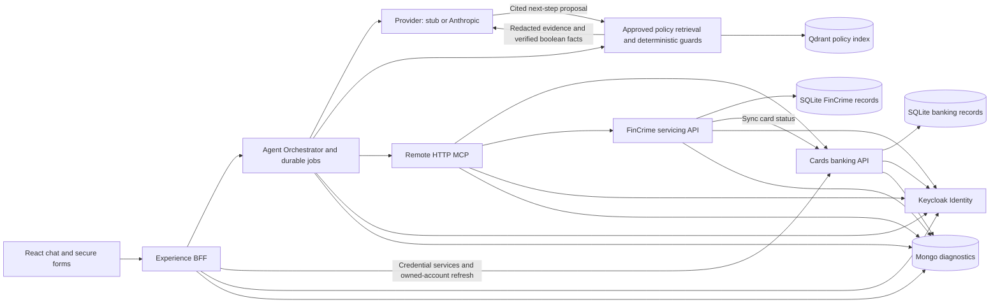
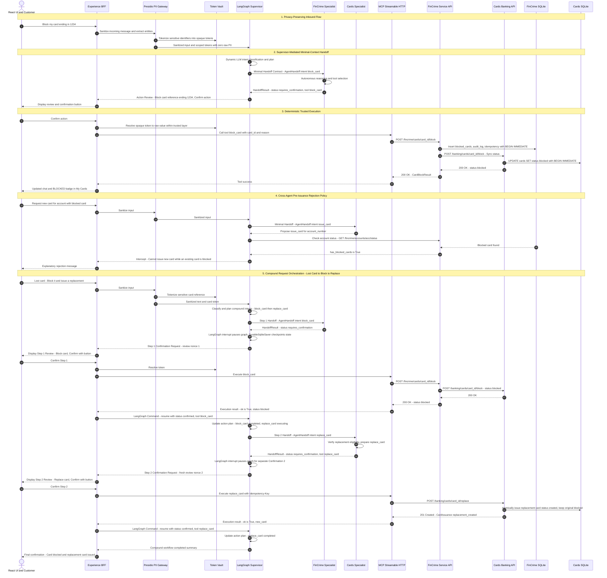

# Architecture and technology stack

This document and its embedded diagrams are maintained manually. CI does not generate or update them.

The [conversational card block and replacement walkthrough](card-block-and-replacement-walkthrough.md) provides a comprehensive, step-by-step presentation guide with flowcharts, sequence diagrams, prompts, and code links for audience walkthroughs.

The [overseas lost-card planning flow](overseas-policy-planning.md) extends the
same graph with model-generated policy search and a cited ordered plan. Card
blocking retains the existing MCP/API security boundary; assistance checks are
explicitly synthetic and human handoff is manual.

Use [setup guide](getting-started.md) for current [Docker](getting-started.md#1-run-and-debug-using-local-docker-containers) and [native](getting-started.md#2-run-and-debug-natively-on-your-computer) prerequisites, configuration, run/debug commands and switching steps. Architecture and API behavior are shared by both modes; process locations and persistence paths differ.

## Runtime boundaries

| Component | Responsibility | Entry point |
| --- | --- | --- |
| React/TypeScript/Vite | Chat, direct actions, private forms, review and confirmation | `frontend/src/main.tsx` |
| Experience FastAPI | Cookie session, Origin/CSRF checks, login/registration facade, signed delegation and agent proxy | `card_chat.experience:app` |
| Agent FastAPI | Multi-agent intent orchestration, caller-scoped private bindings, durable reviews/jobs and confirmed execution | `card_chat.main:app` |
| Agent Orchestrator | Routes turns between specialized agents and enforces cross-agent dependency rules (e.g. pre-issuance blocking check) | `card_chat.agent.AgentOrchestrator` |
| Card Servicing Agent | Specializes in customer accounts, card viewing, and new card issuance | `card_chat.agent.CardServicingAgent` |
| FinCrime Agent | Specializes in risk protection, fraud mitigation, and card blocking | `card_chat.agent.FinCrimeAgent` |
| Provider | Hosted Anthropic Messages, cited policy next-step recommendations, or explicit offline stub | `card_chat.provider` |
| Official SDK MCP server | Catalogue-derived tool registration and shared HTTP execution adapter | `card_chat.mcp_server:app` |
| Cards FastAPI / BankingService | Credential verification, customer/account/card ownership and banking APIs | `card_servicing.main:app`, `banking.py` |
| SQLiteCardStore | Card generation, atomic retry/existing-card decisions, status updates and additive migrations | `card_servicing.persistence` |
| FinCrime FastAPI / Service | Independent card blocking API, customer authorization, audit logging and Cards DB synchronization | `fincrime_servicing.main:app`, `service.py` |
| SQLiteFinCrimeStore | Independent persistence for blocked cards, financial crime audit logs and idempotency snapshots | `fincrime_servicing.persistence` |
| MongoTelemetry | Queued redacted operational events/traces, TTL and safe fallback | `card_servicing.telemetry`, `card_chat.observability` |
| Keycloak | OIDC service identity, plus optional original browser OIDC sign-in | `identity` Compose service or native/external instance |

All application service hops are independent HTTP processes. Agent connects to MCP through Streamable HTTP; it does not spawn a child or use stdin/stdout pipes. Backend tools are compiled from the versioned catalogue and local OpenAPI; discovered schemas must match. The model selects an eligible capability, not an arbitrary REST URL.

## Multi-agent orchestration and card blocking

The system supports multi-agent coordination between the **Card Servicing Agent** and the **FinCrime Agent**, governed by an **LLM-Powered LangGraph Supervisor Agent** and protected by a centralized **Microsoft Presidio PII Gateway & Token Vault**.

### Roles and Responsibilities

1. **LangGraph Supervisor Agent (`card_chat.orchestration.SupervisorAgent`)**:
   - Replaces hardcoded keyword routing with LLM-based intent classification, dynamic delegation, and compound workflow planning.
   - Dispatches explicit, structured, minimal-context `AgentHandoff` contracts without forwarding entire chat transcripts.
   - Resumes execution dynamically when receiving specialist `HandoffResult` contracts to complete subsequent compound steps.
   - Implements bounded reasoning loops (`MAX_SUPERVISOR_ITERATIONS`) to prevent runaway execution.
2. **Card Servicing Agent (`card_chat.agent.CardServicingAgent` / `CardsSpecialistNode`)**:
   - Specialist handling customer account lifecycle, viewing accounts and cards, and card issuance.
   - Strictly enforces declarative MCP tool access policies (`tools.json`).
3. **FinCrime Agent (`card_chat.agent.FinCrimeAgent` / `FinCrimeSpecialistNode`)**:
   - Risk management and fraud mitigation specialist handling card lifecycle security (`block_card`, `unblock_card`).
   - Runs locally or as an isolated microservice over HTTP (`RemoteFinCrimeAgent`) with explicit failure handling and no silent fallback.
4. **LangGraph Workflow Persistence (`card_chat.orchestration.persistence.DurableSqliteSaver`)**:
   - Custom `BaseCheckpointSaver` implementation storing workflow state and channel values in SQLite (`agent.db`).
   - Uses stable, customer-scoped thread identifiers (`f"{owner}:{cid}"`) to persist multi-agent workflows, tool proposals, and human confirmation pauses across service restarts and multiple turns.
5. **Presidio PII Gateway & Token Vault (`card_chat.pii`)**:
   - Centralized privacy gateway intercepting customer input and tokenizing sensitive identifiers into opaque references (`selected_account_...`) before any external model call.
   - Custom recognizers for Australian BSB, Account Number, TFN (with ATO modulo 11 algorithm), Medicare, and Credit Card numbers.
   - `InMemoryTokenVault` providing session-isolated and owner-scoped reversible token resolution within the trusted backend layer.
   - Enforces fail-closed outbound PII validation (`verify_outbound`) at all external LLM invocations, immediately blocking payloads if unmasked credentials or sensitive identifiers are detected.
6. **Card Blocking & Replacement Policy**:
   - Distinguishes **temporary customer freezes** (which can be unblocked by the customer) from **permanent compromises** (lost, stolen, fraud).
   - Permanently compromised cards can never be unblocked; attempting to do so returns HTTP 400 with an explicit security notice.
   - Accounts with permanently compromised cards remain eligible for replacement card issuance, while temporary freezes require resolution before new cards can be originated.
7. **MCP Server Agent-Tool Access Policy (`card_chat.mcp_server`)**:
   - Configuration-driven tool access control: tools configure permitted agents in `tools.json` (`"agents": ["cards_agent"]` or `"agents": ["fincrime_agent"]`).
   - Validates calling agent identity passed via request context `meta['agent']`, rejecting unauthorized cross-agent tool calls with HTTP 403.
8. **Compound Resumable Workflow Lifecycle & Human-in-the-Loop Resumption**:
   - **State Machine Transitions**: Tracks ordered action plan items across statuses: `pending` -> `awaiting_confirmation` -> `executing` -> `completed` / `failed` / `cancelled`.
   - **Intentional Interrupts**: Pauses before any state-changing financial operation using LangGraph `interrupt(...)`. State is checkpointed durably to `agent.db` via `DurableSqliteSaver`.
   - **Resumption with Authoritative Results**: Resumes via `workflow.ainvoke(Command(resume=payload))` using verified API results (`ok=True`, structured outcome) rather than model assumptions.
   - **Domain Ownership & Compromise Invariants**: FinCrime retains exclusive risk ownership (`block_card`); Cards retains issuance ownership (`replace_card`). Original compromised cards remain permanently blocked; replacement card origination generates a distinct card with `replacement_created` outcome without automatically unblocking compromised cards.
   - **Idempotency & Anti-Replay**: Each confirmation is gated by a cryptographically random single-use review nonce. Retries and duplicate confirmations leverage `Idempotency-Key` headers and database operation journal serialization (`BEGIN IMMEDIATE`).

## Data and trusted decisions

SQLite schema version 3 stores customers, owned accounts, cards, card/account links, account retry records, original card snapshots and issuance-decision snapshots. Python provides SQLite access; no separate server/CLI installation is required. Existing data is preserved by additive initialization migrations.

`issue_idempotent` serializes ownership, operation-key lookup, existing-card checks and creation with `BEGIN IMMEDIATE`. Ordinary fresh-key requests return an existing card; explicit reviewed additional issuance creates another. Matching retries return the original outcome; conflicting reuse returns 409. Both public issuance paths use that policy. See [card issuance](card-issuance.md).

Experience has its own SQLite session database. Agent's journal stores conversation bindings, drafts, reviews, accepted operations and outcomes. Exact private values remain in trusted state; credentials do not enter the journal or model. See [customer banking](customer-banking.md), [SQLite persistence](card-persistence.md) and [model privacy](model-privacy.md).

MongoDB holds `application_logs` and `request_traces`, not accounts/cards. It is enabled by default in the full Compose stack, which provides a persistent Mongo container. Native mode can use Docker Mongo, a configured native Community Server, or `stdout`/`none` with no Mongo instance. Runtime logging failure does not block banking; the adapter falls back safely. Compose requires Mongo health during initial full-stack startup. See [Mongo logging](mongodb-logging.md).

## Security and model boundary

Username/password registration generates a customer UUID and salted scrypt hash. The BFF rotates a random HttpOnly cookie session, checks Origin/CSRF for writes, expires sessions and deletes them on logout. Credentials travel only through secure forms to the credential service.

Service access tokens and signed customer delegation remain separate. Database ownership is rechecked in the Cards service; neither the model nor a stale delegated account list can grant account access. The provider receives sanitized intent and scoped opaque references rather than raw identifiers, tool results or credentials. State-changing proposals require an explicit reviewed snapshot and confirmation.

The default stub is credential-free and supports only a few deterministic intents. Rich language interpretation uses Anthropic. Direct selections, form submissions and reviewed banking writes do not need model calls. A successful block can trigger a separate model-grounded follow-up recommendation; cached replays do not regenerate it.

## Deployment and observability

Docker mode runs seven application containers (`card-servicing-frontend`, `card-servicing-experience`, `card-servicing-agent`, `fincrime-agent`, `card-servicing-mcp`, `cards-api`, `fincrime-api`) plus Identity (`card-servicing-identity`) and Mongo (`card-servicing-mongodb`). Frontend 8080, Identity 8081 and Mongo host port 27018 are loopback published. Debug mode additionally maps six Python listeners to 5681-5686 (Experience: 5681, Cards Agent: 5682, MCP: 5683, Cards API: 5684, FinCrime API: 5685, FinCrime Agent: 5686); container APIs use internal port 8000. Container source is an image snapshot and needs rebuilding after edits.

Native mode runs Vite and six Python microservices on Windows (Cards API: 8010, FinCrime API: 8025, MCP Server: 8030, FinCrime Agent: 8022, Cards Agent: 8021, Experience BFF: 8020, Frontend: 8080). Its preparation starts missing local Docker dependencies, unless compatible native/external dependencies are already available. With console logging and native Identity, no Docker is required. Startup probes bypass proxies for loopback URLs.

Docker named volumes (`cards_data`, `fincrime_data`, `agent_data`, `experience_data`, `mongodb_data`) and native `data/local/` SQLite files are separate. Mongo credentials and Identity keys must stay consistent with their volumes. Redis/RabbitMQ in the older infrastructure Compose file are provisioned learning dependencies, not part of the current banking path.

## Further references

[HTTP contracts and identity](http-stack.md), [end-to-end trace](chat-end-to-end.md), [catalogue](tool-catalogue.md), [health checks](health-checks.md), [adapter configuration](infrastructure-adapters.md), and [Docker attach reference](docker-debugging.md).

Policy-grounded follow-up design and testing: [policy-grounded next steps](policy-grounded-next-steps.md).
