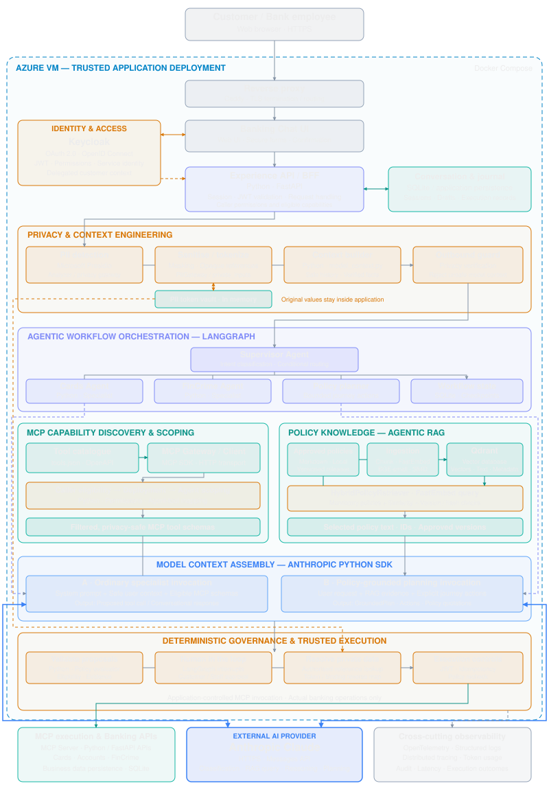
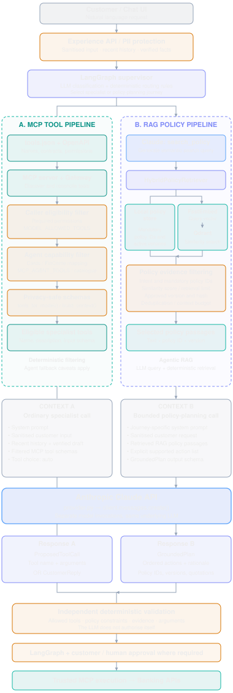
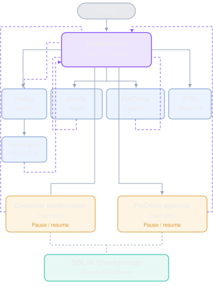
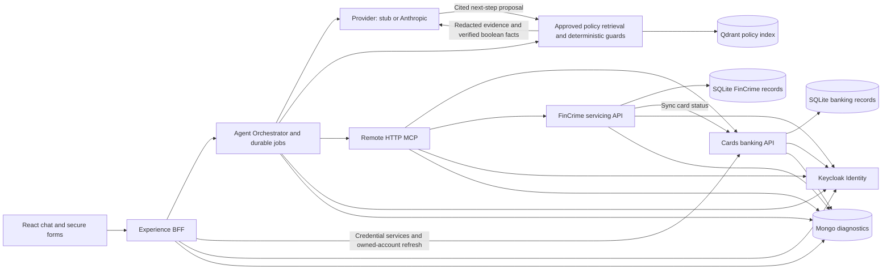

### End To End Architecture

### Agentic AI Pattern

### Agent Orchestration

## Preserved System Runtime and Deployment Specifications

The following specifications detail the existing runtime environment, multi-agent sequence mechanics, persistence models, and deployment topologies.

### Runtime Boundaries

---