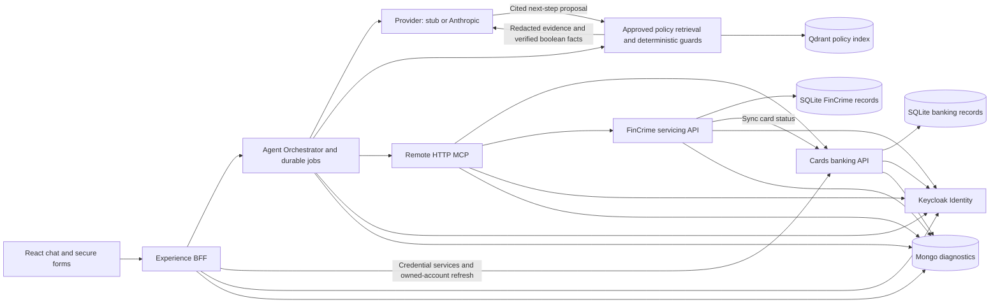

### End To End Architecture

### Agentic AI Pattern

## 11. Preserved System Runtime and Deployment Specifications

The following specifications detail the existing runtime environment, multi-agent sequence mechanics, persistence models, and deployment topologies.

### Runtime Boundaries

| Component | Responsibility | Entry point |
| --- | --- | --- |
| React/TypeScript/Vite | Chat, direct actions, private forms, review and confirmation | `frontend/src/main.tsx` |
| Experience FastAPI | Cookie session, Origin/CSRF checks, login/registration facade, signed delegation and agent proxy | `card_chat.experience:app` |
| Agent FastAPI | Multi-agent intent orchestration, caller-scoped private bindings, durable reviews/jobs and confirmed execution | `card_chat.main:app` |
| Agent Orchestrator | Routes turns between specialized agents and enforces cross-agent dependency rules (e.g. pre-issuance blocking check) | `card_chat.agent.AgentOrchestrator` |
| Card Servicing Agent | Specializes in customer accounts, card viewing, and new card issuance | `card_chat.agent.CardServicingAgent` |
| FinCrime Agent | Specializes in risk protection, fraud mitigation, and card blocking | `card_chat.agent.FinCrimeAgent` |
| Provider | Hosted Anthropic Messages, cited policy next-step recommendations, or explicit offline stub | `card_chat.provider` |
| Official SDK MCP server | Catalogue-derived tool registration and shared HTTP execution adapter | `card_chat.mcp_server:app` |
| Cards FastAPI / BankingService | Credential verification, customer/account/card ownership and banking APIs | `card_servicing.main:app`, `banking.py` |
| SQLiteCardStore | Card generation, atomic retry/existing-card decisions, status updates and additive migrations | `card_servicing.persistence` |
| FinCrime FastAPI / Service | Independent card blocking API, customer authorization, audit logging and Cards DB synchronization | `fincrime_servicing.main:app`, `service.py` |
| SQLiteFinCrimeStore | Independent persistence for blocked cards, financial crime audit logs and idempotency snapshots | `fincrime_servicing.persistence` |
| MongoTelemetry | Queued redacted operational events/traces, TTL and safe fallback | `card_servicing.telemetry`, `card_chat.observability` |
| Keycloak | OIDC service identity, plus optional original browser OIDC sign-in | `identity` Compose service or native/external instance |

All application service hops are independent HTTP processes. Agent connects to MCP through Streamable HTTP; it does not spawn a child or use stdin/stdout pipes. Backend tools are compiled from the versioned catalogue and local OpenAPI; discovered schemas must match. The model selects an eligible capability, not an arbitrary REST URL.

---