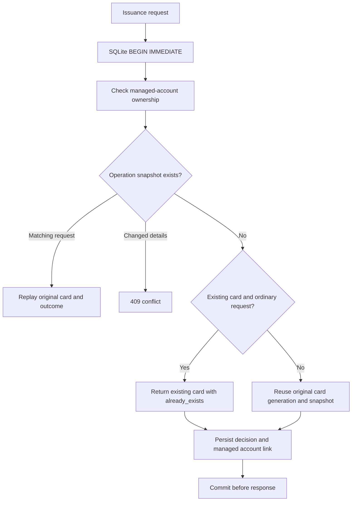

# Card issuance: retries and existing-card protection

Both `POST /banking/cards` and the compatibility `POST /cards` now prevent accidental duplicate issuance. This is a backend business rule in addition to key-based idempotency; it does not expire after a time window.

| Request | Response | Writes |
| --- | --- | --- |
| First ordinary issuance | 201, `created` | Create one card and persist the decision |
| Fresh key, same account already has a card | 200, `already_exists` | Persist the decision; return the existing card |
| Explicit `additional_card: true`, fresh key | 201, `additional_created` | Create another card and persist the decision |
| Retry with the same key and details | Original response status, card and outcome; `Idempotency-Replayed: true` | None |
| Same key with a changed account, name or additional-card choice | 409 | None |

`Card-Issuance-Outcome` is returned by both endpoints. `/banking/cards` also includes `outcome` and a customer-facing `message` in its JSON response. `/cards` retains the original Card JSON shape for compatibility. MCP projects the outcome header into trusted execution metadata, allowing the agent to say **A card already exists for this account. No new card was created** rather than reporting another creation. Results and execution metadata do not become model context.

## Customer journey

1. Choose **Issue new card** or describe the request in chat.
2. Select the owned account. Leave **Issue an additional card (creates another card)** unset or select No for ordinary issuance.
3. Review and confirm. If a card already exists, the application returns it and explains that no new card was created.
4. To intentionally obtain another card, start a fresh issuance workflow, select Yes for the additional-card choice, review that choice and confirm. Retrying this same confirmation still creates only one additional card.

The additional-card field is a strict boolean in the API and a private, bound selection in the agent form. The model cannot supply a raw boolean to bypass the form. Natural-language intent can open the form, but the customer must make the structured choice. Direct API clients express that explicit intent with `additional_card: true`; browser workflows also require their existing review nonce and confirmation button.

For example, ordinary banking issuance uses:

```json
{"account_number": "ACC-synthetic-account"}
```

An intentional additional card uses a **new** operation key and:

```json
{"account_number": "ACC-synthetic-account", "additional_card": true}
```

Keep the same key and body for network retries. Independent channels should share an operation key when retrying one operation; even when they generate different keys, the account-level rule prevents multiple ordinary cards.

## Transaction and migration

SQLite schema version 3 adds `card_issuance_requests` and an account lookup index. Each decision row has a unique request key, normalized request fingerprint (including the additional-card choice), card foreign key and original response snapshot. Several requests can reference the same existing card. Versions 1 and 2 migrate additively; existing cards, customer records and original `card_idempotency` response snapshots remain intact.



The writer reservation spans ownership, key lookup, existing-card lookup, generation, response snapshots and account-card linkage. Separate processes and channels therefore cannot both pass an ordinary first-card check. Failures roll back the complete issuance transaction. Optional card issuance during account creation uses the same path, including its established deterministic retry key.

Managed accounts are scoped to the authenticated database owner. Legacy, unmanaged `/cards` accounts are scoped by account number and verified username, preserving the original identity boundary and avoiding cross-customer data disclosure. The isolated memory adapter implements the same issuance policy under a lock.

If old data already contains several cards, none are deleted. Ordinary requests return the earliest card by creation timestamp and ID. Card lifecycle statuses other than `created` are not currently implemented; replacement/revocation eligibility rules would be a separate future policy.

## Verification

`tests/test_card_issuance.py` covers concurrent distinct-key requests, managed-account channels, explicit additional cards, replay after restart, conflicting choices, preserved legacy data, strict validation and atomic rollback. `tests/test_banking.py` covers direct forms and conversational workflows, verifies that no additional card is created before confirmation, and checks existing-card messaging. The real MCP/HTTP tests verify that outcomes survive transport and replay correctly.

Run `.venv\Scripts\python.exe -m pytest -q`. For Docker, rebuild with `.\scripts\stack.ps1 -Build`; for native debugging, restart the affected Python services and Vite. SQLite initialization applies the migration automatically.
