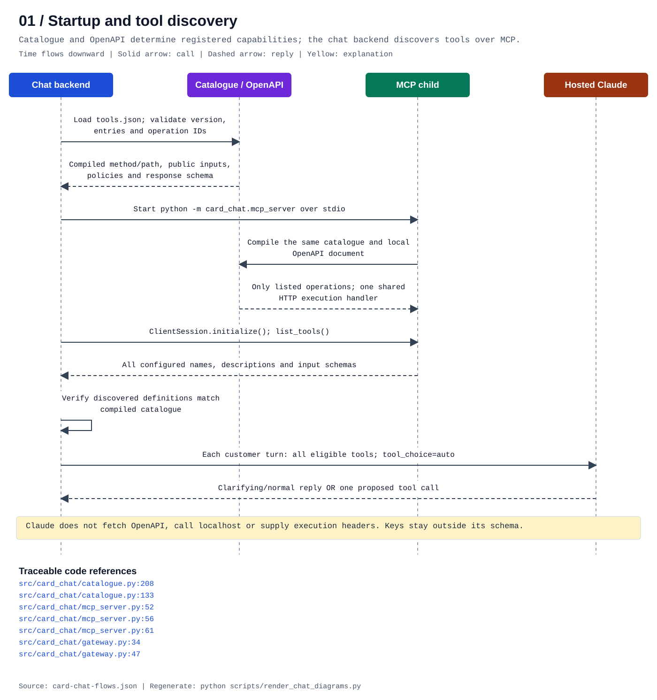
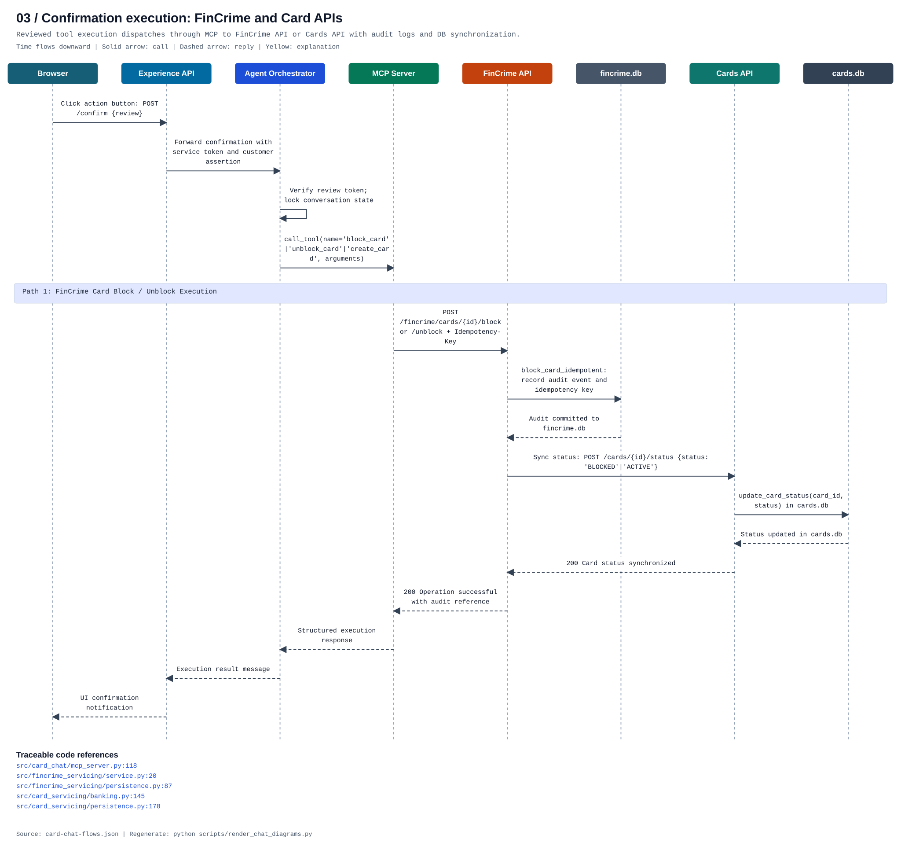
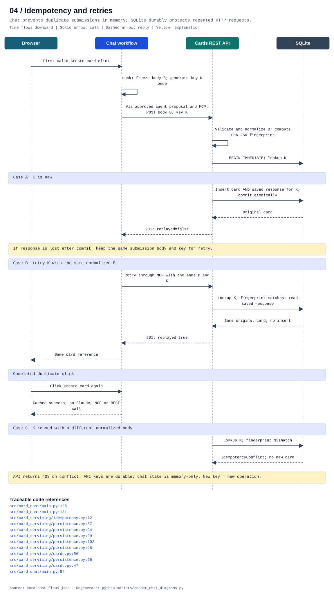

# Card servicing chat: a traceable end-to-end walkthrough

This describes the implemented demo, including its deliberately controlled question
wording. Claude interprets natural language and proposes a tool call. Python owns
the conversation state, questions, validation, confirmation and execution. The
Cards API owns durable card creation and idempotency.

## Open, zoom and download the diagrams

Open [the offline diagram viewer](diagrams/index.html) in a browser. It needs no
server or internet connection. Use the size controls, or open an individual SVG
and use browser zoom. SVG is vector graphics: text and lines stay sharp as you
zoom. These are SVG sequence diagrams with participant lifelines, solid call arrows, dashed reply arrows and clearly marked conditional sections. Read time from top to bottom. They are real files in the repository, not chat-only Mermaid previews.

| Diagram | Open the standalone SVG |
| --- | --- |
| Startup: who creates MCP and discovers tools | [01 Startup and discovery](diagrams/01-startup-and-discovery.svg) |
| Every message: natural language, state and next question | [02 Conversation and context](diagrams/02-conversation-and-context.svg) |
| Confirmation: Claude proposal through MCP to REST | [03 Confirmation to Cards API](diagrams/03-confirmation-to-card-api.svg) |
| Duplicate clicks, response loss and durable replay | [04 Idempotency and retries](diagrams/04-idempotency-and-retries.svg) |
| Startup-selected store and telemetry contracts | [05 API adapters](diagrams/05-startup-adapter-selection.svg) |

On GitHub, open an SVG file and use its raw/download control to save it locally.
For Markdown, use VS Code **Open Preview** (`Ctrl+Shift+V`). The SVGs are embedded
below as well as linked, so reading this document does not require Mermaid support.

## 1. Which component knows what?

| Component | Responsibility | Implementation |
| --- | --- | --- |
| Browser page | Display messages, keep conversation ID and latest review token, send text/button requests | [index.html](../src/card_chat/index.html) |
| Chat workflow | Own state, validate fields, check completeness, enforce confirmation, manage retry key, execute MCP | [main.py](../src/card_chat/main.py) |
| Single concrete agent | Interpret a turn through the model adapter; return `CustomerReply` or `ProposedToolCall` | [agent.py](../src/card_chat/agent.py) |
| Anthropic adapter | Build hosted Messages API requests and parse text/tool-use blocks | [provider.py](../src/card_chat/provider.py) |
| MCP gateway/client | Launch child, initialize, discover tool schema, dispatch tool calls | [gateway.py](../src/card_chat/gateway.py) |
| MCP server | Register one tool and translate its execution into the existing REST client call | [mcp_server.py](../src/card_chat/mcp_server.py) |
| REST client | Map `create_card` to HTTP POST `/cards` and `Idempotency-Key` header | [client.py](../src/api_client/client.py) |
| Cards route and store | Validate HTTP contract, create simulated card, save/replay durable result | [cards.py](../src/card_servicing/cards.py), [persistence.py](../src/card_servicing/persistence.py) |

There are separate processes for browser, chat backend, MCP child, and Cards API.
Claude runs remotely. Chat is served on `127.0.0.1:8020`; the API is on host port
8010, or 8011 when exposed by this repository's Docker configuration. MCP uses
stdio pipes, not a separate HTTP port. Claude never connects directly to localhost.

## 2. Startup: MCP construction and discovery



1. Uvicorn imports `card_chat.main:app`. FastAPI's `lifespan` creates the configured
   model adapter and one `CardServicingAgent`.
2. `gateway.connect()` constructs `StdioServerParameters` using the current Python
   executable and `['-m', 'card_chat.mcp_server']`. `stdio_client` launches and
   manages that child process.
3. Inside the child, `mcp = FastMCP('Card servicing', ...)` creates the server.
   `@mcp.tool()` registers the `create_card` function. The SDK derives its input
   schema from that function's typed arguments.
4. `mcp.run(transport='stdio')` runs the server's protocol loop. stdout is reserved
   for protocol messages; logging goes to stderr.
5. The backend opens `ClientSession`, calls `initialize()`, then `list_tools()`.
   It verifies that exactly one tool, `create_card`, was returned.
6. `Gateway.__init__` copies the discovered `inputSchema` and removes
   `idempotency_key` from both `properties` and `required`. That projected schema
   is the only tool schema later offered to Claude.

**Who discovers the tool? The local chat backend, not Anthropic.** The backend
later includes that schema in an Anthropic request. Discovery does not write a
card or require the REST API to be called. A failed MCP handshake prevents the
chat app from completing startup.

The discovered tool schema describes typed function arguments. It is not an
automatic import of the entire REST OpenAPI specification. In particular, this
tool signature does not expose every `CardCreate` length constraint. Python
validation still enforces them at execution time.

## 3. Opening the page and creating context

The browser loads `/`, which returns `index.html`. JavaScript's `start()` calls
`POST /conversations`. The workflow generates `cid`, creates a `Conversation`,
stores it in its local `conversations` dictionary, and returns:

```json
{
  "id": "synthetic-conversation-id",
  "message": "Hi! What would you like help with?",
  "review": null
}
```

The greeting is application text; no Claude call is needed. The browser keeps
`cid` in a JavaScript variable. Every subsequent answer uses the same URL ID.

| State | Location | Survives chat restart? |
| --- | --- | --- |
| Visible messages, `cid`, review token | Browser memory/DOM | No; refresh starts a new conversation |
| `history`, validated `draft`, review token, submission, lock | Chat Python `Conversation` object | No |
| Agent/model adapter instance | Chat application state | Recreated on restart |
| Committed cards and idempotency outcomes | SQLite, normally `data/cards.db` | Yes |
| API diagnostic events and request timing | Selected sink: MongoDB `card_servicing`, stdout, or none | Independent of chat context |

A browser refresh does not recover the prior conversation even if its server-side
object still exists. MongoDB is not the chat history store. The agent itself is
stateless across turns; the workflow supplies the current context each time.

## 4. One message: how natural language becomes fields


Suppose the user enters:

```text
I want a new card. My given name is Alex and my user name is alex.synthetic.
```

The browser's submit handler posts:

```http
POST /conversations/synthetic-conversation-id/messages
Content-Type: application/json

{"text":"I want a new card. My given name is Alex and my user name is alex.synthetic."}
```

`main.message()` retrieves `c = get(cid)` and acquires `c.lock`, serializing work
for that conversation. It appends the raw text to `c.history`, then calls:

```python
turn = await app.state.agent.interpret_turn(
    c.history, c.draft, allowed_tools={}
)
```

The empty tool mapping means this turn can only collect information. The agent
passes copies of history and draft to `AnthropicModel.extract()`.

The adapter's system prompt explicitly tells Claude:

* Classify intent as `create`, `servicing`, `unsupported`, or `other`.
* Extract only supplied updates for `given_name`, `user_name`, `account_number`.
* Return JSON with string values; preserve leading zeros and never invent values.
* Treat freeze/replacement as unsupported; use history to interpret contextual replies.

The actual Messages request contains this system instruction and one user message
whose text is a JSON serialization of `{"conversation": history, "draft": draft}`.
The stored history is not currently sent as separate Anthropic role messages.

Claude uses its language understanding to map different phrasings onto that
requested structure. A representative response is:

```json
{
  "intent": "create",
  "fields": {
    "given_name": "Alex",
    "user_name": "alex.synthetic"
  }
}
```

`Extraction.model_validate_json()` checks the intent enum and string-valued field
mapping. Malformed model responses produce a retry message. This is interpretation,
not a business write; the model has not been offered an execution tool.

## 5. How the next question is chosen

The application does not ask Claude to invent the next customer-facing question.
`agent.py` defines this ordered mapping:

```python
QUESTIONS = {
    'given_name': 'What is your given name?',
    'user_name': 'What is your user name?',
    'account_number': 'What is your existing account number? Please include any leading zeros.',
}
```

The agent combines its draft snapshot with the extracted fields and selects the
first missing key. Given the example above, `account_number` is missing, so it
returns a `CustomerReply` containing the predefined account question and the two
supplied field updates. It also indicates whether all question keys are present
with `requests_review`; that flag is advisory, not authorization to execute.

Generic `servicing` intent yields the fixed question about creating a new card for
an existing account. `unsupported` intent yields the fixed supported-action reply.
A payment-topic phrase does not automatically select an arbitrary payments API:
this increment has one supported operation and a small intent vocabulary.

The workflow merges candidate fields into the existing draft and validates with
`CardCreate`. Names have length 1-100; account strings length 1-64. Values are
trimmed, control characters rejected, and extra fields forbidden. Account numbers
are never converted to integers. Invalid candidates are not saved.

For partial updates, the workflow supplies temporary `'pending'` values for absent
fields so it can run the existing complete-request model. It then saves **only
the keys actually present in the candidate**. These placeholders never become
collected data or REST parameters.

After saving, it independently checks:

```python
set(c.draft) == set(CardCreate.model_fields)
```

If incomplete, it returns the selected question. `reply()` appends that assistant
text to history. On the next user turn, the previous question, previous answer and
validated draft are all sent back as context. That is how an answer such as
`0012345678` can be interpreted as the requested account rather than an isolated
number.

### A sample draft across turns

| User turn | Saved draft after successful extraction/validation | Next application response |
| --- | --- | --- |
| "I want a new card" | `{}` | Given-name question |
| "My given name is Alex" | `{"given_name":"Alex"}` | User-name question |
| "alex.synthetic" | Previous fields plus `user_name` | Account-number question |
| "0012345678" | All three fields, account still a string | Masked review and button |

Several fields in one answer skip questions whose keys are already present.
Claude extraction can still make mistakes; validation checks structure and
constraints, while the user's review checks whether the intended values were
understood correctly.

## 6. Review and explicit confirmation

`review()` fully validates the draft, masks the account as `******5678` for this
example, and creates a fresh review token. The browser shows **Create card** when
the response has that token. A valid edit before submission invalidates the old
review and produces a new one; a stale token is rejected with HTTP 409.

Typing "yes" is still a `/messages` request. Only the explicit button uses
`POST /conversations/{cid}/confirm` with `{"review": "..."}`.

Under the conversation lock, the first valid confirmation freezes:

```python
c.submission = {
    'key': uuid4().hex,
    'body': CardCreate.model_validate(c.draft).model_dump(),
    'result': None,
}
```

The body comes from saved server-side values, not fields submitted by the button.
After submission, the conversation is fixed for safe retry; start a new
conversation for a different request.

## 7. How Claude learns about create_card



The workflow calls the same agent with the confirmed body and:

```python
allowed_tools = {'create_card': app.state.gateway.schema}
```

The agent takes its proposal branch and calls `AnthropicModel.propose()`.
The adapter sends:

* The confirmed body, with an instruction that the customer clicked Create card.
* One tool definition: `name`, an application-configured description, and the
  MCP-discovered/projected `input_schema`.
* `tool_choice` forcing that one named tool, with parallel tool use disabled.

The model-facing schema requires the three string fields; it does not contain
the idempotency key. Claude returns a `tool_use` content block, conceptually:

```json
{
  "type": "tool_use",
  "id": "synthetic-tool-use-id",
  "name": "create_card",
  "input": {
    "given_name": "Alex",
    "user_name": "alex.synthetic",
    "account_number": "0012345678"
  }
}
```

**There is no autonomous API discovery by Claude.** `docs/cards.openapi.json` is
not loaded by this chat path. The REST path, HTTP method and header mapping are
implemented by `ApiClient.create_card()`. The adapter instructs a tool proposal
for an already confirmed operation; Claude does not decide whether a write is
authorized. During collection, it knows the field names from the extraction
prompt, not from tool discovery or OpenAPI.

## 8. Workflow approval, MCP execution and Cards API

The adapter requires exactly one tool call. The agent returns `ProposedToolCall`.
The workflow then requires its name to equal `create_card`, validates the proposed
arguments through `CardCreate`, and compares their normalized values to the
frozen submission body. A mismatch never reaches MCP.

Even for a matching proposal, execution uses:

```python
await app.state.gateway.create(submission['body'], submission['key'])
```

The gateway injects the private key into the MCP arguments and calls
`ClientSession.call_tool('create_card', ...)` over stdio. MCP dispatches to the
registered Python function, which validates again and calls the existing client.

The client performs this HTTP request against `CARD_API_BASE_URL`:

```http
POST /cards
Idempotency-Key: synthetic-submission-key
Content-Type: application/json

{"given_name":"Alex","user_name":"alex.synthetic","account_number":"0012345678"}
```

FastAPI validates the request model and required idempotency header before route
execution. `cards.create_card()` delegates to `store.create_idempotent()`.
The normal API entry point selects `SQLiteCardStore` through validated startup
settings. HTTP code consumes `CardStorePort` and maps provider-neutral
`StorageUnavailable` to 503. See [adapter switching](infrastructure-adapters.md). Isolated test factories can
use the in-memory store. The supplied account is assumed to exist: there is no
account service lookup, card network integration or physical fulfilment.

## 9. Idempotency: two layers protect the operation



### Chat layer: one confirmed submission

The lock serializes duplicate clicks. The workflow generates a key once and
retains body/key after errors. A completed duplicate click uses `submission.result`
and makes no additional model, MCP or REST call. A failed attempt can ask the
model to propose again, but execution must still match the same frozen body/key.
Retries are explicit customer clicks, not an automatic loop.

### API layer: durable replay in SQLite

1. `CardCreate` produces normalized validated values.
2. `fingerprint()` serializes fields as sorted, compact JSON and hashes it with
   SHA-256. This fingerprint detects a changed request body; it is not encryption.
3. `SQLiteCardStore.create_idempotent()` begins `BEGIN IMMEDIATE` before looking
   up the key, serializing SQLite writers across threads/processes.
4. If the key is new, generate the card UUID and `SIM-...` identifier. Insert a
   `cards` row and a `card_idempotency` row with the key, fingerprint, card ID,
   response status and original response JSON in the same transaction.
5. Commit both rows atomically. A failure rolls back; a successful request returns
   HTTP 201 and `Idempotency-Replayed: false`.
6. For an existing key and matching fingerprint, reconstruct the original card
   from saved JSON and return 201 with `Idempotency-Replayed: true`; no insert.
7. For an existing key and different fingerprint, raise `IdempotencyConflict`;
   the route returns 409. Storage failures return a sanitized 503.

| Situation | Outcome |
| --- | --- |
| Double click after success | Chat returns its saved result |
| API committed but response timed out | Retry same body/key; API returns the original card |
| Concurrent HTTP requests with same key/body | SQLite transaction serialization permits one create, then replay |
| Same key, changed body | 409 conflict, no second card |
| Same body, new key | A separate operation; may create a second card |
| API restarts, chat remains running | Durable API replay still works |
| Chat restarts after uncertain submission | Chat loses key/context; automatic recovery is not implemented |

Do not start a new conversation to retry an uncertain creation: that would generate
a new key. API persistence protects only requests carrying the original key.

## 10. How success gets back to the chat window

The API returns the `Card` object only after successful creation or replay.
`ApiClient` raises for unsuccessful HTTP statuses. The MCP tool validates the API
response as `Card` and returns only `ok`, `id`, and `card_number`. HTTP errors,
timeouts and validation failures produce sanitized errors instead of success.

The gateway returns MCP structured content. The workflow checks for a successful
result with identifiers, saves it in the submission, and formats the final reply.
JavaScript appends it using `textContent`. The final result is not sent back to
Claude for another narrative response in this implementation. API diagnostics
go to the configured sink: MongoDB asynchronously (default), structured stdout,
or none. Tool timing/outcome goes to stderr. Neither is the
authoritative card store or conversation memory.

## 11. Breakpoint trail

Start **Debug Chat + API** from `.vscode/launch.json`; use one chat process. Both
debuggers must finish startup before opening the page. `Debug Chat` currently
sets `subProcess: false`, so MCP auto-attachment is disabled. The gateway and API
breakpoints let you see both sides of that boundary. F5 continues across process
boundaries; F11 does not carry the Python stack across an HTTP request.

| Order | Code location / executable statement | Inspect |
| --- | --- | --- |
| Startup | `gateway.connect`: `session.list_tools()` | Tool name, input schema |
| 1 | `main.message`: `c = get(cid)` | `cid`, `body.text` |
| 2 | `main.message`: append user message / `interpret_turn(...)` | `c.history`, `c.draft` |
| 3 | `agent.interpret_turn`: `self.model.extract(...)` | `allowed_tools == {}`, copies of context |
| 4 | `provider.extract`: `self.client.messages.create(...)` | System instruction and serialized context |
| 5 | `provider.extract`: `Extraction.model_validate_json(...)` | `response.content`, `usage`, `stop_reason` |
| 6 | `agent.interpret_turn`: `question = next(...)` | `extraction`, candidate and next missing field |
| 7 | `main.message`: draft assignment, then next statement | `validated`, updated `c.draft` |
| 8 | `main.review`: full validation and token generation | Complete fields, new review token |
| 9 | `main.confirm`: submission creation | Frozen body, generated key |
| 10 | `provider.propose`: `return calls[0].name, calls[0].input` | Claude's proposed tool call |
| 11 | `main.confirm`: `gateway.create(...)` | Checked proposal, server-owned submission |
| 12 | `gateway.create`: `session.call_tool(...)` | Injected MCP execution arguments and returned content |
| 13 | `cards.create_card`: `store.create_idempotent(...)` | Validated instruction and header key |
| 14 | `persistence.create_idempotent`: lookup and insert/replay | Fingerprint, stored response, transaction |
| 15 | `main.confirm`: `submission['result'] = result` | Actual API/MCP success result |

Watch sensitive values locally only; do not add chat text, credentials or account
identifiers to logs. Long pauses in REST can exceed the client's ten-second
timeout. Resume the API and retry with the same chat submission if necessary.

## 12. Keeping architecture diagrams synchronized

The editable architecture source is
[`diagrams/card-chat-flows.json`](diagrams/card-chat-flows.json). The renderer is
[`scripts/render_chat_diagrams.py`](../scripts/render_chat_diagrams.py), using only
the Python standard library. The source defines participants and ordered messages (calls, replies, notes and
conditional sections). Detailed steps retain explanatory text and source-code anchors. The renderer resolves current line numbers and emits SVGs.

When architecture changes:

1. Change the implementation and its meaningful tests.
2. Update this walkthrough and the affected JSON diagram steps in the same PR.
3. Regenerate and verify:

   ```powershell
   python scripts/render_chat_diagrams.py
   python scripts/render_chat_diagrams.py --check
   ```

4. Open the offline viewer and inspect readability and flow.
5. Commit the JSON source, generated SVGs and Markdown together.

CI runs `--check` to reject stale output and references to missing code anchors.
It cannot prove that a paragraph accurately describes changed business behavior;
that remains part of code/documentation review. Source-line movements can require
regeneration even if the architecture has not changed. See the generator's output
for the files to update.

This increment intentionally keeps questions and field expectations controlled by
the application. Changes to required API input can require coordinated changes
to `CardCreate`, `QUESTIONS`, the extraction prompt and the MCP/client signature.
The documentation does not describe automatic schema-driven question generation
or autonomous discovery of new API capabilities.
