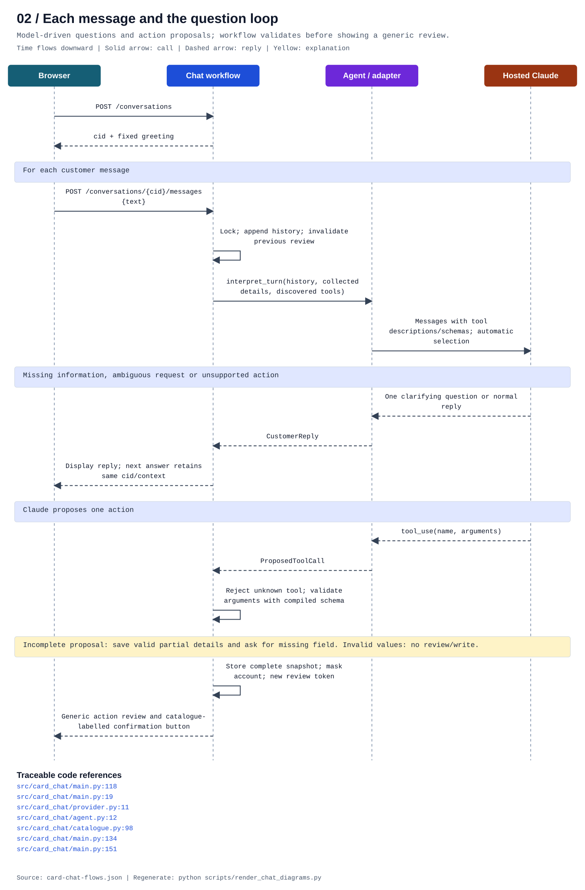

# Card servicing chat: end-to-end flow

For an existing card, confirmed ordinary issuance now reports that no new card was created. Select the additional-card choice explicitly to create another; see [card issuance](card-issuance.md).

The [Customer banking extension](customer-banking.md) adds pre-login form-opening intent, secure registration/login, account creation and owned card reads/issuance. Account/card reads return `Reply.data` for React only; tool results stay out of model context. Existing review, confirmation and durable retry behavior applies to all banking writes.

This is the current catalogue-driven implementation. Claude proposes an action
before confirmation. The workflow validates and reviews it, then executes the
stored snapshot without another model call. The previous fixed intent enum and
question mapping have been removed. For catalogue authoring, supported schemas,
policies and VS Code instructions, see [the tool catalogue guide](tool-catalogue.md).

## Open and zoom the sequence diagrams

Open [the offline viewer](diagrams/index.html) in a browser; no application or
internet connection is needed. The SVG files stay sharp when zoomed and can be
saved individually. Read participants across the top and time down the page.
Solid arrows are calls, dashed arrows are replies, shaded sections explain branches.

| Diagram | SVG |
| --- | --- |
| Catalogue loading, MCP registration and runtime discovery | [01 Startup and discovery](diagrams/01-startup-and-discovery.svg) |
| Model-generated questions, context and validated action review | [02 Conversation and context](diagrams/02-conversation-and-context.svg) |
| Confirmed snapshot through MCP/shared HTTP to Cards API | [03 Confirmation to API](diagrams/03-confirmation-to-card-api.svg) |
| Contract-aware retries and durable SQLite replay | [04 Idempotency](diagrams/04-idempotency-and-retries.svg) |
| API store/telemetry startup configuration | [05 Infrastructure adapters](diagrams/05-startup-adapter-selection.svg) |

## 1. Boundaries and processes

| Component | Owns | Code |
| --- | --- | --- |
| Browser | Message display, conversation ID, review token, generic confirmation button | [index.html](../src/card_chat/index.html) |
| Chat workflow | History, collected details, proposal validation, review, confirmation and retry submission | [main.py](../src/card_chat/main.py) |
| CardServicingAgent | One stateless model-driven turn; checks returned tool is allowed | [agent.py](../src/card_chat/agent.py) |
| Anthropic adapter | Hosted Messages request and parsing of text/tool-use outcomes | [provider.py](../src/card_chat/provider.py) |
| Catalogue compiler | Trusted operation definitions and policies derived from OpenAPI | [catalogue.py](../src/card_chat/catalogue.py), [tools.json](../src/card_chat/tools.json) |
| MCP gateway | Child lifecycle, discovery, schema verification and execution metadata | [gateway.py](../src/card_chat/gateway.py) |
| MCP server | List configured tools and execute them through one handler | [mcp_server.py](../src/card_chat/mcp_server.py) |
| Shared HTTP client | Encoded path parameters, JSON request, configured destination and application headers | [client.py](../src/api_client/client.py) |
| Cards API | Request validation, business boundary, durable create/replay | [cards.py](../src/card_servicing/cards.py), [persistence.py](../src/card_servicing/persistence.py) |

The browser, chat backend, MCP child and Cards API are separate processes. Claude
is hosted remotely. Chat serves 8020. The Cards API uses 8010 locally, or Docker
host port 8011. MCP communicates over stdin/stdout pipes, not another HTTP port.
Only API telemetry may use structured stdout; MCP stdout is protocol-only.

## 2. Startup and discovery


FastAPI chat lifespan creates the adapter and agent, then enters `gateway.connect`.
The gateway compiles the selected local catalogue, starts the current Python
executable with `-m card_chat.mcp_server`, initializes `ClientSession`, and calls
`list_tools()`.

The child calls `create_server(settings())`. This constructs the official MCP SDK
`Server`, compiles the same catalogue and registers one `list_tools` handler and
one shared `call_tool` handler. `stdio_server` and `server.run` run the protocol.
There is no decorated Python function per REST operation. Adding an entry expands
what `list_tools` returns, not the Python routing logic.

The catalogue refers to stable OpenAPI operation IDs. The compiler resolves local
schema references and derives the HTTP method, path, JSON/body and path input
properties, required values and success response schema. It separately retains
confirmation/display/replay policies. Header parameters never become model inputs.
The gateway compares the discovered tool names, descriptions and schemas with its
local compiled catalogue, failing startup if they differ.

**The backend discovers the tools; Claude does not discover the API itself.**
Claude receives the discovered definitions in the subsequent Messages request.
The OpenAPI `servers` address is not used for execution: `CARD_API_BASE_URL` is.

## 3. Browser message and context



Loading `/` returns the plain page. JavaScript calls `POST /conversations`, which
creates `conversations[cid] = Conversation()` and returns the fixed greeting:
"Hi! What would you like help with?" No model call is needed for that greeting.

The browser stores `cid` and sends each answer to
`POST /conversations/{cid}/messages` with `{"text":"..."}`. `main.message` gets the
same `Conversation`, acquires its lock, appends the user text, and invalidates the
previous review before interpreting the turn. It passes history, collected details
and all discovered tool definitions to the agent. Copies protect workflow state
from accidental mutation by the adapter.

| State | Stored where | Recovery |
| --- | --- | --- |
| Visible messages, cid and review token | Browser JavaScript/DOM | Refresh starts a new conversation |
| History, draft/collected proposal details, proposal, review, submission and lock | Chat process memory | Lost on chat restart |
| Agent and adapter | Chat application state | Recreated on startup |
| Cards and committed idempotency snapshots | SQLite | Durable across API restart |
| Diagnostic events | Selected Mongo/stdout/none sink | Not conversation context |

A clarifying text turn preserves supplied information in history. If Claude emits
an incomplete call, validated partial arguments are also retained in `c.draft` as
`{"tool":"...","arguments":{...}}`. A complete proposal replaces that with its
validated full snapshot. There is no separate fixed-field extraction pass.

## 4. What Claude receives and returns

`AnthropicModel.turn` sends one hosted Messages request per customer turn. A system
instruction defines general behavior: choose only supplied tools, ask for missing
or ambiguous values, never invent values, preserve string identifiers, handle one
action at a time and never claim an unexecuted action succeeded.

The user-message content serializes the accumulated `conversation` (including
this latest answer) and `collected_details`. The request's `tools` contains every
eligible discovered name, description and public input schema. Tool choice is
`auto`, with parallel tool use disabled. There is no forced create-card tool.

For example, create_card's schema comes from the CardCreate OpenAPI request body:
required `given_name`, `user_name`, `account_number`, string constraints, titles,
descriptions and examples. The account description explicitly preserves leading
zeros. Another catalogue entry would supply its own schema and use description.

The outcomes are:

| Model output | Application interpretation |
| --- | --- |
| Text asking for a missing value | `CustomerReply`; display the clarifying question |
| Text explaining an unsupported request or asking which action | `CustomerReply`; no review or execution |
| One `tool_use` name/arguments block | `ProposedToolCall`; validate before review |
| Multiple tool blocks | Ask the customer to choose one action |
| Invalid/truncated response | Retry feedback; no review or execution |

The agent checks the name against allowed tools. It has no intent-to-operation
mapping, fixed field list, `QUESTIONS` mapping, MCP client or execution authority.
Questions can vary in wording; schema validation and explicit review are the
organization-controlled enforcement boundaries.

## 5. Proposal validation and generic review

Suppose the customer supplies:

```text
Create a new card for my existing account. My given name is Alex,
my user name is alex.synthetic, and my account number is 0012345678.
```

A representative model block is:

```json
{
  "type": "tool_use",
  "name": "create_card",
  "input": {
    "given_name": "Alex",
    "user_name": "alex.synthetic",
    "account_number": "0012345678"
  }
}
```

The workflow looks up the discovered compiled tool and validates with its JSON
schema. Strings are trimmed, controls rejected, extra properties forbidden, and
identifiers remain strings. It does not coerce numeric account IDs into strings.
API validation still runs later; custom business validators are not replaced by
JSON schema validation.

Missing required properties cannot create an executable review. The workflow can
retain valid partial values and ask for the next missing value using metadata.
Invalid values or unknown tools produce feedback without a write. A complete
proposal becomes a server-owned `ProposedToolCall` and a fresh review token.

`ToolSpec.masked` formats labels from the catalogue/schema and masks sensitive or
account-named values (for the example: `******5678`). The server sends the action
label and confirmation label. The browser uses generic `textContent` rendering
and the supplied button label; it contains no create-versus-block branch.

A new message invalidates the review even if it leads to a normal reply or error.
An accepted correction produces a new token. Old confirmations return 409.
Only GET entries explicitly configured with `confirmation:none` execute without
review; all writes require an explicit button click.

## 6. Confirmation executes the snapshot, not another model decision


The button sends `POST /conversations/{cid}/confirm` with only its review token.
Under the same lock, the workflow checks that the token and stored proposal exist.
The first click creates a submission containing the reviewed tool, validated
arguments, optional generated replay key, attempted flag and result cache.

No Claude call occurs at confirmation or retry. The workflow executes:

```python
await app.state.gateway.execute(
    submission['tool'], submission['arguments'], submission['key']
)
```

The key is outside the model schema and public arguments. `Gateway.execute` sends
it in MCP request metadata (`_meta.idempotency_key`) while the arguments contain
customer values only. The server looks up the compiled operation by name, validates
arguments, splits path/body values and injects the declared execution header.

For create_card, `ApiClient.execute_operation` sends the unchanged request:

```http
POST /cards
Idempotency-Key: synthetic-submission-key
Content-Type: application/json

{"given_name":"Alex","user_name":"alex.synthetic","account_number":"0012345678"}
```

Other supported operations use this same handler. A path value is URL-encoded,
so it cannot replace the configured host/path template. Gateway base path prefixes
are preserved. There is no per-tool Python HTTP mapping or UI routing branch.
The existing `ApiClient.create_card` method is retained for existing callers.

## 7. Cards API, durable idempotency and retries


FastAPI validates CardCreate and the Idempotency-Key header. The route calls
`CardStorePort.create_idempotent`. The normal app selects SQLite through startup
settings; expected storage errors are translated to `StorageUnavailable` and
mapped to sanitized 503. Idempotency conflicts remain 409. Account existence is
assumed; there is no account lookup or payment-network integration.

SQLite's unchanged replay algorithm is:

1. Normalize the model; serialize sorted compact JSON and compute SHA-256.
2. Begin `BEGIN IMMEDIATE` before looking up the submission key.
3. New key: generate the UUID and SIM identifier; atomically insert the card and
   original response snapshot in `card_idempotency`; commit and return 201.
4. Existing key, matching fingerprint: return the saved original card with 201
   and `Idempotency-Replayed:true`, without another insert.
5. Existing key, changed body: return 409 without creating another card.

Chat serializes duplicate clicks and retains its frozen submission after an
uncertain result. For create_card, retries use the same arguments and key. A
completed duplicate returns the cached success without model/MCP/HTTP work.

For other writes, the catalogue must declare an actual safe-replay contract before
retries are allowed. A non-idempotent write gets at most one attempt; lost results
or failures disable its button and repeated confirmations cannot execute again.
New conversation/new key is a new operation, not a way to safely recover an
uncertain write. Chat restart loses its submission key; recovery is not implemented.

## 8. The real result comes back

The shared handler checks the actual success status and validates response JSON
against the compiled OpenAPI schema. It returns structured `{ok,result}` on success
or a sanitized error. It never reports success merely because Claude proposed a
call. Tool logs contain only name, duration and outcome on stderr.

The workflow formats catalogue-selected scalar result properties. Create-card
shows the real `SIM-...` identifier and UUID. It caches that text for duplicate
confirmation. There is no extra Claude call to generate a success summary. The
browser renders the server reply safely as text.

## 9. Trace and maintain

For exact startup and breakpoint steps, use [the catalogue guide](tool-catalogue.md).
Trace in order: `main.message` -> `agent.interpret_turn` -> `provider.turn` ->
`spec.validate` -> review token -> `main.confirm/execute` -> `gateway.execute` ->
`mcp_server.execute` -> `ApiClient.execute_operation` -> `cards.create_card` ->
`SQLiteCardStore.create_idempotent`.

`Debug Chat + API` starts both debuggers. MCP auto-attachment remains disabled;
inspect its gateway arguments/results or attach separately. A pause longer than
the HTTP timeout can cause an uncertain result; retry only when supported.

Update [diagram source](diagrams/card-chat-flows.json) with code changes, then run:

```powershell
python scripts/export_cards_openapi.py --check
python scripts/render_chat_diagrams.py
python scripts/render_chat_diagrams.py --check
python -m pytest
```

CI checks the contract export, generated SVG freshness and code anchors. It does
not automatically update Markdown or judge architectural prose. Commit the
catalogue, contract, code, tests, diagram definitions and generated SVGs together.
