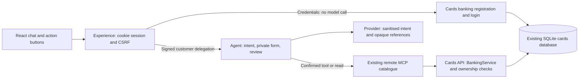
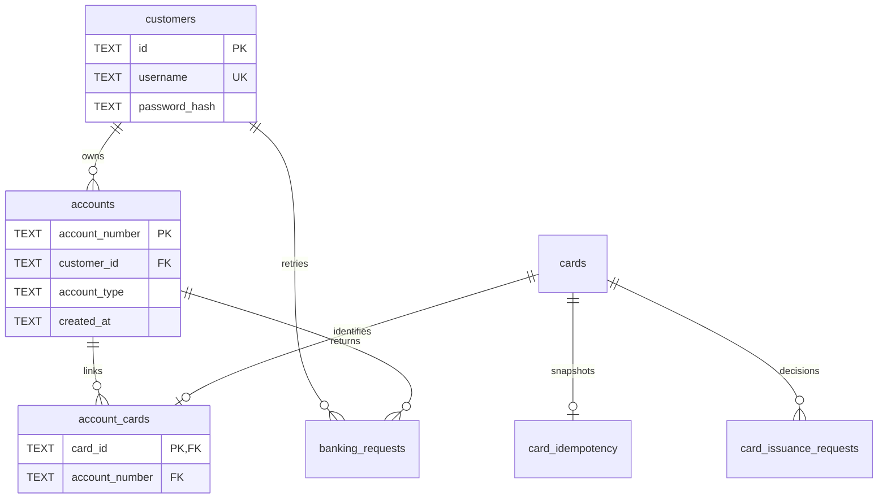

# Customer registration and conversational banking

Card issuance now returns an existing card by default, even with a fresh request key. To intentionally issue another, select the additional-card option and confirm. See [card issuance](card-issuance.md).

MongoDB service diagnostics are now enabled by default in the Docker stack, which starts Mongo automatically. See [logging and existing-card/idempotency distinctions](mongodb-logging.md).

The React interface supports direct action buttons and natural-language intent. Both paths use the existing Experience → Agent → remote MCP → Cards API flow for banking operations. Direct actions open the same structured form or perform a read without a model call. Claude (or the local intent stub) selects capabilities; it never authenticates customers or decides ownership.

## Complete journey

Start the existing stack using `.\scripts\stack.ps1 -Build` (see [HTTP stack setup](http-stack.md) for the environment preparation and supported commands), or use the existing VS Code native launch configuration. Rebuild containers after changing code. Open `http://localhost:8080`.

1. Select **Register / Sign up**, or type **I want to register**. Use a synthetic username (3–64 ASCII characters, starting with a letter; letters, numbers, `_`, `.`, `-`) and a password of 10–128 characters. Registration generates a UUID customer ID and signs in immediately.
2. Select **View my accounts**, or start a conversation and type **Show my accounts**. An empty customer receives a Create account option.
3. Select **Create account**, or type **Create a savings account**. Complete the private form with `savings` or `transaction` and optionally choose to issue a card. Review and confirm; no write happens before confirmation.
4. Select **View my cards** or type **Show all my cards**. Results appear in the conversation interface. All card identifiers start with `SIM-`; they cannot be used for payments.
5. Select **Issue new card**, or type **I want a new debit card**. Choose a masked account and confirm. Ordinary issuance returns an existing card; select the additional-card option explicitly to create another. With no eligible account, chat opens account creation first; the direct form offers the same option.
6. Select **Sign out**, or type **Log me out** and confirm. Select **Login**, or type **Log me in**, then use the secure credentials form. Accounts and cards persist.
7. Register a second customer. The account and card lists must be empty, and the first customer's account selections and conversation IDs must be inaccessible.

Prominent action buttons start a fresh workflow. After a confirmed action, use another action button or **New conversation** to start another request. Retries reuse the reviewed snapshot and idempotency key. The optional existing OIDC sign-in remains available for the original synthetic identity demo; local registration is independent of Keycloak users.

## Boundaries and authentication



Credentials go only from the browser's password form through the BFF to the Cards service. They are absent from the tool catalogue, conversation journal and model context. Pre-login chat has only registration/login form-opening capabilities and uses the same agent/provider. Authenticated chat can request logout, which opens a confirmation control. Known private pastes are rejected before model invocation; free-text filtering is conservative, so customers should always use forms for private information.

Passwords use per-customer random 16-byte salts and scrypt (`N=16384`, `r=8`, `p=1`, 64-byte derived key); verification uses a constant-time comparison. Usernames are case-insensitively unique. The BFF limits registration/login to 20 attempts per client IP in a five-minute window; behind the single demo proxy this is a shared limit. It rejects cross-origin authentication submissions. Browser sessions retain the established random HttpOnly, SameSite=Lax cookie, hashed session keys, one-hour expiry, CSRF token plus Origin validation, rotation on login and server-side deletion on logout. Set `COOKIE_SECURE=true` with HTTPS outside localhost.

Service OIDC authentication and EdDSA customer delegation remain in use. The BFF calls `/banking/*` with its existing `experience-service`, `agent` audience, `agent:invoke` token and `X-Banking-BFF: 1`. This header selects a validation policy; it grants no access by itself. MCP continues to use `mcp-service`, `cards` audience and `cards:write`. Only the BFF service can invoke credential endpoints. Every customer banking request requires a signed customer assertion. Before forwarding a registered customer's agent request, the BFF refreshes eligible accounts from SQLite. Cards checks ownership again against the database even if a signed account list is stale.

## API contract

The generated [Cards OpenAPI](cards.openapi.json) includes the following routes. Browser banking actions use the existing `/api/conversations`, `/inputs`, `/messages`, `/confirm` and `/operations` contracts; `Reply.data` carries account/card read results to React without adding them to model history.

| Endpoint | Purpose | Customer authentication |
| --- | --- | --- |
| `POST /auth/register` (BFF) | Register and start browser session | Origin check; credentials form |
| `POST /auth/password-login` (BFF) | Start/rotate browser session | Origin check; credentials form |
| `POST /auth/logout` (BFF) | Delete session | Cookie, Origin, CSRF |
| `POST /api/entry/messages` (BFF) | Interpret registration/login intent | Origin check; no credentials |
| `POST /banking/register` / `/banking/login` | Credential services; return verified customer facts | BFF service only |
| `GET /banking/accounts` | List owned accounts | Signed customer assertion |
| `POST /banking/accounts` | Create account; optionally issue card | Signed customer; Idempotency-Key |
| `GET /banking/cards` | List cards on owned accounts | Signed customer assertion |
| `POST /banking/cards` | Issue card on owned account | Signed customer; Idempotency-Key |

Unknown or foreign account issuance returns 404; the original `/cards` compatibility route returns 403 when a registered customer supplies a foreign account. Duplicate usernames and mismatched retry bodies return 409. Validation errors omit input values. Storage failures return 503. The application retains existing trace middleware and telemetry adapters.

## Database migration and retry behavior

SQLite initialization applies additive schema version 3 in a transaction. Existing `cards`, statuses, original response snapshots and idempotency keys are preserved. Legacy account strings are not automatically assigned to newly registered customers. The compatibility `/cards` route retains the original signed-account policy for OIDC-only identities; registered customers additionally require database ownership. Banking issuance always requires an actual owned account.



All SQLite connections enable foreign keys. New card issuance reuses `SQLiteCardStore.create_idempotent`, the existing Card model, simulated number generation and durable response snapshots. The new link table has foreign keys to both accounts and cards. Reads join the existing card account number to owned accounts, including compatibility-route cards on those accounts. Account creation stores the customer-scoped request key and normalized body together in a `BEGIN IMMEDIATE` transaction. Optional card issuance follows with a deterministic scoped key. An interrupted optional issuance can leave the account committed; retrying the same request completes card issuance without creating a second account/card. No distributed transaction or new framework is introduced.

## Verification

```powershell
.venv\Scripts\python.exe -m pytest -q
.venv\Scripts\python.exe scripts/export_cards_openapi.py --check
cd frontend
npm ci
npm run build
```

`tests/test_banking.py` exercises browser/BFF HTTP routes, real agent workflows, shared Cards endpoints, registration/login/logout, CSRF, empty accounts, explicit confirmation, optional/additional cards, persistent login, cross-customer reads/writes, stale delegated facts, schema constraints and durable retries. HTTPX transport is mocked between in-process services; existing regression tests also exercise real remote MCP/HTTP. Live hosted Claude calls are not required by these tests.
