# End-to-end debugging journeys

Source walkthrough checked against this checkout on **17 November 2026**. Use the generated journey atlas for the major runtime and operator paths, or follow the original account/card walkthrough below for a focused first session. This guide describes code inspection; it does not claim a live stack run.

## Navigate

- [Major journeys, flow diagrams and regeneration](#journey-atlas)
- [Generated breakpoint index](#breakpoint-index)
- [Run the walkthrough](#run-the-walkthrough)
- [See the whole flow](#see-the-whole-flow)
- [Set breakpoints in execution order](#set-breakpoints-in-execution-order)
- [Add the chat interpretation path](#add-the-chat-interpretation-path)
- [Find and follow identifiers](#find-and-follow-identifiers)
- [Inspect databases and logs](#inspect-databases-and-logs)
- [Diagnose a failed request](#diagnose-a-failed-request)
- [Explain the design in a code review](#explain-the-design-in-a-code-review)

Function labels below link to their current source line. GitHub supports these `#L` anchors; some local Markdown viewers open only the file. In VS Code, use **Go to Symbol in Editor** (`Ctrl+Shift+O`) and the displayed function name if the viewer ignores the anchor. Nested handlers live inside `create_app`; several files contain functions with the same name. Line anchors are navigation aids, not stable identifiers: refresh them after moving code.

<!-- BEGIN GENERATED DEBUG JOURNEYS -->

## Journey atlas

Generated from [named journey definitions](debugging-journeys.json) by [generate_debugging_guide.py](../scripts/generate_debugging_guide.py). The manifest stores qualified method names, never source line numbers. Diagrams and ordered tables are curated walkthroughs, not automatically inferred call graphs.

Each method link targets its first executable statement. Repeated methods represent different requests or phases; optional branches are identified in the step notes. Set a breakpoint with F9 after opening the link. GitHub honors `#L` anchors; if a local Markdown viewer opens only the file, use Ctrl+G and the displayed line.

### Regenerate after changing code

```powershell
.\.venv\Scripts\python.exe scripts/generate_debugging_guide.py
.\.venv\Scripts\python.exe scripts/generate_debugging_guide.py --check
```

The first command refreshes only this generated block. `--check` writes nothing and exits nonzero for stale output or an unresolved symbol, making it suitable for CI. No services, model credentials or third-party Python packages are needed. Python uses AST resolution, including nested handlers and multiline signatures; the frontend resolver supports the current named `App` function declarations and fails explicitly if that syntax changes. If a method is renamed/moved, update its `file`/`symbol` in the manifest. Review journey descriptions when behavior changes; regeneration updates positions, not architectural meaning.

The original account walkthrough below is preserved. Its annotated source links also refresh from method names; hidden `debug-symbol` comments identify the manifest entry. This document does not install or export VS Code workspace breakpoints.

- [Startup, catalogue discovery and approved-policy readiness](#journey-startup)
- [Register, password login and logout](#journey-authentication)
- [Create account with optional first card](#journey-account-card)
- [View owned accounts and cards](#journey-read-accounts-cards)
- [Natural-language request, privacy and specialist routing](#journey-chat-interpretation)
- [Issue first, existing or additional card](#journey-issue-card)
- [Block or temporarily freeze a card](#journey-block-card)
- [Policy-driven unblock offer and subsequent issuance](#journey-unblock-policy)
- [Replace a blocked card or run combined block-and-replace](#journey-replacement)
- [Approved policy ingestion and reindexing](#journey-policy-ingestion)
- [Runtime policy retrieval, verified facts and execution gate](#journey-runtime-rag)
- [Asynchronous jobs, timeouts, replay and restart recovery](#journey-async-recovery)
- [Separate FinCrime API mutation and Cards synchronization](#journey-fincrime-api)
- [OIDC browser sign-in and destination-specific service identity](#journey-identity)
- [Follow a request into structured Mongo logs](#journey-observability)
- [Complete breakpoint index](#breakpoint-index)

### Journey: startup

**Startup, catalogue discovery and approved-policy readiness**

**Trigger:** Launch the configured local or Docker stack after policy ingestion.

**Expected result:** Agent starts only with usable approved policy index and matching MCP catalogue.

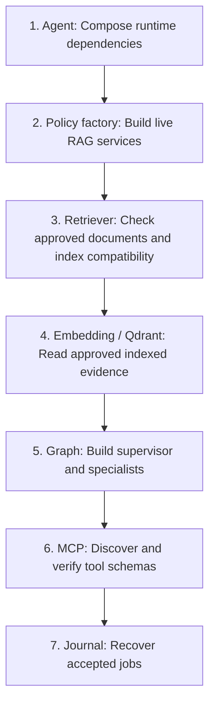

| Step | Layer / action | Methods / breakpoint links | Inspect / behavior |
| ---: | --- | --- | --- |
| 1 | Agent: Compose runtime dependencies | [create_app.lifespan](../src/card_chat/main.py#L69)<br>[Journal.__init__](../src/card_chat/durable.py#L9)<br>[DurableSqliteSaver.__init__](../src/card_chat/orchestration/persistence.py#L26) | Inspect AGENT_DB, model provider, remote FinCrime URL and checkpoint store. |
| 2 | Policy factory: Build live RAG services | [build_runtime_policy_services](../src/card_chat/policy/factory.py#L149)<br>[build_policy_retriever](../src/card_chat/policy/factory.py#L75) | Live runtime requires FastEmbed and remote persistent Qdrant unless an explicit test retriever is injected. |
| 3 | Retriever: Check approved documents and index compatibility | [HybridPolicyRetriever.check_ready](../src/card_chat/policy/adapters/retriever.py#L55)<br>[HybridPolicyRetriever._active_documents](../src/card_chat/policy/adapters/retriever.py#L33)<br>[HybridPolicyRetriever._verify_indexed](../src/card_chat/policy/adapters/retriever.py#L44)<br>[FileSystemDocumentSource.list_documents](../src/card_chat/policy/adapters/document_source.py#L72) | POL-001 through POL-004 must exist. Verify approved version, content_hash and embedding_model. |
| 4 | Embedding / Qdrant: Read approved indexed evidence | [FastEmbedEmbeddingProvider.embed_query](../src/card_chat/policy/adapters/embeddings/fastembed_provider.py#L112)<br>[QdrantVectorStore.search](../src/card_chat/policy/adapters/vector_stores/qdrant_store.py#L126) | Read-only readiness queries; runtime startup does not ingest or initialize missing collections. |
| 5 | Graph: Build supervisor and specialists | [create_banking_workflow](../src/card_chat/orchestration/graph.py#L235)<br>[SupervisorAgent.__init__](../src/card_chat/orchestration/supervisor.py#L79) | Same retriever/evaluator instances are passed into supervisor. Check tool policies and checkpointer. |
| 6 | MCP: Discover and verify tool schemas | [connect](../src/card_chat/gateway.py#L44)<br>[Gateway.__init__](../src/card_chat/gateway.py#L16)<br>[create_server.list_tools](../src/card_chat/mcp_server.py#L165)<br>[load_catalogue](../src/card_chat/catalogue.py#L225)<br>[compile_entry](../src/card_chat/catalogue.py#L141) | Gateway compares discovered tools with compiled OpenAPI/catalogue definitions. |
| 7 | Journal: Recover accepted jobs | [create_app.recover](../src/card_chat/main.py#L1185)<br>[create_app.schedule](../src/card_chat/main.py#L1179)<br>[create_app.run_operation](../src/card_chat/main.py#L1131) | Running operations were reset to pending at Journal construction; persisted delegation is revalidated before execution. |

**Troubleshoot:** For startup failure inspect service terminal, ingestion settings and index metadata. Compare catalogue/OpenAPI files on Agent and MCP; do not rebuild policy data during a request.

[Journey list](#journey-atlas) · [Complete index](#breakpoint-index)

### Journey: authentication

**Register, password login and logout**

**Trigger:** Choose Register or Login, use the credential form, later Sign out.

**Expected result:** Customer identity is stored by Cards; BFF rotates a cookie session and CSRF value.

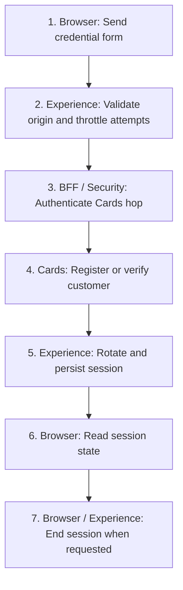

| Step | Layer / action | Methods / breakpoint links | Inspect / behavior |
| ---: | --- | --- | --- |
| 1 | Browser: Send credential form | [App.authenticate](../frontend/src/main.tsx#L262) | Passwords go to /auth/register or /auth/password-login, not chat or MCP. |
| 2 | Experience: Validate origin and throttle attempts | [create_app.register_customer](../src/card_chat/experience.py#L197)<br>[create_app.password_login](../src/card_chat/experience.py#L201)<br>[create_app.credentials](../src/card_chat/experience.py#L173) | Inspect origin and auth_attempts; repeated attempts produce 429. |
| 3 | BFF / Security: Authenticate Cards hop | [create_app.banking_request](../src/card_chat/experience.py#L151)<br>[Security.headers](../src/card_chat/security.py#L87)<br>[protect.authenticate](../src/card_chat/security.py#L101) | X-Banking-BFF selects the Experience-authorized banking entry path; downstream customer identity is not required for credential entry. |
| 4 | Cards: Register or verify customer | [register](../src/card_servicing/banking.py#L284)<br>[login](../src/card_servicing/banking.py#L291)<br>[BankingService.register](../src/card_servicing/banking.py#L131)<br>[BankingService.login](../src/card_servicing/banking.py#L144)<br>[SQLiteCardStore.connect](../src/card_servicing/persistence.py#L59) | customers holds username and scrypt hash. Login compares hashes; registration username collision returns 409. |
| 5 | Experience: Rotate and persist session | [create_app.credentials](../src/card_chat/experience.py#L173)<br>[create_app.store](../src/card_chat/experience.py#L63)<br>[create_app.load](../src/card_chat/experience.py#L69) | sessions stores hashed session ids with expiry, claims and CSRF. Inspect existence/expiry, not a shared credential dump. |
| 6 | Browser: Read session state | [App.authenticate](../frontend/src/main.tsx#L262)<br>[create_app.current_session](../src/card_chat/experience.py#L139) | React stores public name and CSRF. Login clears visible conversation state. |
| 7 | Browser / Experience: End session when requested | [App.logout](../frontend/src/main.tsx#L267)<br>[create_app.logout](../src/card_chat/experience.py#L144)<br>[create_app.load](../src/card_chat/experience.py#L69) | Logout checks CSRF, consumes stored session and clears cookie/UI state. |

**Troubleshoot:** 401: inspect customer hash verification and session expiry. 403: Origin/CSRF or service identity. Registration is outside Agent journal and does not have a conversation operation id.

[Journey list](#journey-atlas) · [Complete index](#breakpoint-index)

### Journey: account-card

**Create account with optional first card**

**Trigger:** Choose Create account; select issue_card=true; review and confirm.

**Expected result:** One account and optional card are durable; account and card commits are separate.

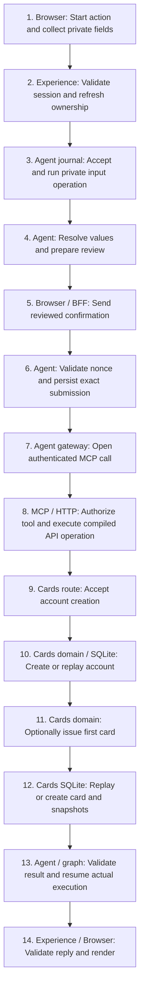

| Step | Layer / action | Methods / breakpoint links | Inspect / behavior |
| ---: | --- | --- | --- |
| 1 | Browser: Start action and collect private fields | [App.choose](../frontend/src/main.tsx#L242)<br>[App.supply](../frontend/src/main.tsx#L247)<br>[App.request](../frontend/src/main.tsx#L149) | A write opens a fresh conversation. fields are values; selections are opaque bound references. |
| 2 | Experience: Validate session and refresh ownership | [create_app.supply_inputs](../src/card_chat/experience.py#L349)<br>[create_app.session](../src/card_chat/experience.py#L77)<br>[create_app.forward](../src/card_chat/experience.py#L222)<br>[create_app.banking_request](../src/card_chat/experience.py#L151) | Origin/CSRF and cookie are checked. Local-customer account/card refreshes happen before the Agent request; each refresh has its own trace. |
| 3 | Agent journal: Accept and run private input operation | [create_app.submit_inputs](../src/card_chat/main.py#L1247)<br>[create_app.submit](../src/card_chat/main.py#L1201)<br>[create_app.schedule](../src/card_chat/main.py#L1179)<br>[create_app.run_operation](../src/card_chat/main.py#L1131) | Inspect cid, operation id, request key, stored trace and worker lock. Both sync and async submissions use the journal. |
| 4 | Agent: Resolve values and prepare review | [create_app.structured](../src/card_chat/main.py#L1043)<br>[resolve](../src/card_chat/private_inputs.py#L26)<br>[authorise](../src/card_chat/private_inputs.py#L44)<br>[ToolSpec.validate](../src/card_chat/catalogue.py#L103)<br>[create_app.save](../src/card_chat/main.py#L243) | Inspect proposal, draft, private bindings and fresh review nonce. No write is authorized by form submission alone. |
| 5 | Browser / BFF: Send reviewed confirmation | [App.confirm](../frontend/src/main.tsx#L252)<br>[create_app.confirm](../src/card_chat/experience.py#L334)<br>[create_app.forward](../src/card_chat/experience.py#L222) | Body contains the current review nonce. Browser operation key differs from the downstream execution key. |
| 6 | Agent: Validate nonce and persist exact submission | [create_app.submit_confirmation](../src/card_chat/main.py#L1243)<br>[create_app.submit](../src/card_chat/main.py#L1201)<br>[create_app.run_operation](../src/card_chat/main.py#L1131)<br>[create_app.confirm](../src/card_chat/main.py#L1120)<br>[create_app.execute](../src/card_chat/main.py#L357)<br>[Journal.save](../src/card_chat/durable.py#L28) | The execution snapshot and key are durable before the first write. Restricted card actions also recheck current facts and policy. |
| 7 | Agent gateway: Open authenticated MCP call | [connect.RemoteGateway.execute](../src/card_chat/gateway.py#L82)<br>[connect.session](../src/card_chat/gateway.py#L51)<br>[Gateway.execute](../src/card_chat/gateway.py#L27)<br>[Security.headers](../src/card_chat/security.py#L87) | Fresh destination token and customer assertion; idempotency_key and calling agent travel as MCP metadata. |
| 8 | MCP / HTTP: Authorize tool and execute compiled API operation | [create_server.call_tool](../src/card_chat/mcp_server.py#L171)<br>[execute](../src/card_chat/mcp_server.py#L72)<br>[ApiClient.execute_operation](../src/api_client/client.py#L40)<br>[protect.authenticate](../src/card_chat/security.py#L101) | Compare spec.method/path, allowed agent, body, status and response schema. Current catalogue tools target CARD_API_BASE_URL. |
| 9 | Cards route: Accept account creation | [create_account](../src/card_servicing/banking.py#L320)<br>[customer](../src/card_servicing/banking.py#L269)<br>[service](../src/card_servicing/banking.py#L262) | POST /banking/accounts receives AccountCreate and the saved execution key. |
| 10 | Cards domain / SQLite: Create or replay account | [BankingService.create_account](../src/card_servicing/banking.py#L178)<br>[SQLiteCardStore.connect](../src/card_servicing/persistence.py#L59) | BEGIN IMMEDIATE protects customer/key lookup and account insert. accounts and banking_requests commit before optional issuance. |
| 11 | Cards domain: Optionally issue first card | [BankingService.issue](../src/card_servicing/banking.py#L197)<br>[BankingService.owns](../src/card_servicing/banking.py#L163) | Only if issue_card=true. Internal key is account: plus account execution key; store prefixes customer id. |
| 12 | Cards SQLite: Replay or create card and snapshots | [SQLiteCardStore.issue_idempotent](../src/card_servicing/persistence.py#L131)<br>[SQLiteCardStore._create_idempotent](../src/card_servicing/persistence.py#L116) | Inspect card_issuance_requests, card_idempotency, cards and account_cards under one issuance transaction. |
| 13 | Agent / graph: Validate result and resume actual execution | [create_app.execute](../src/card_chat/main.py#L357)<br>[AgentOrchestrator.resume_execution](../src/card_chat/agent.py#L245)<br>[human_confirmation_node](../src/card_chat/orchestration/graph.py#L87)<br>[create_app.run_operation](../src/card_chat/main.py#L1131) | MCP structured result drives completion. Graph resumes only if a checkpoint is waiting. Operation success can still contain a business-failure Reply. |
| 14 | Experience / Browser: Validate reply and render | [create_app.forward](../src/card_chat/experience.py#L222)<br>[App.request](../frontend/src/main.tsx#L149) | BFF exposes typed Reply/Operation. View actions supply Reply.data; write results usually provide a summary. Capture correlation headers. |

**Troubleshoot:** Account exists but card is absent: retry the original account submission/key. Do not create another account to recover optional issuance. Use view actions to verify records.

[Journey list](#journey-atlas) · [Complete index](#breakpoint-index)

### Journey: read-accounts-cards

**View owned accounts and cards**

**Trigger:** Choose View my accounts or View my cards.

**Expected result:** Owned lists return in Reply.data without write confirmation.

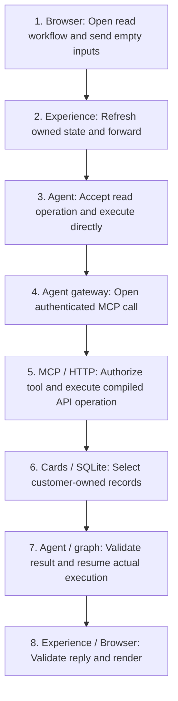

| Step | Layer / action | Methods / breakpoint links | Inspect / behavior |
| ---: | --- | --- | --- |
| 1 | Browser: Open read workflow and send empty inputs | [App.choose](../frontend/src/main.tsx#L242)<br>[App.request](../frontend/src/main.tsx#L149) | choose starts a conversation then posts inputs for view_* immediately. |
| 2 | Experience: Refresh owned state and forward | [create_app.supply_inputs](../src/card_chat/experience.py#L349)<br>[create_app.session](../src/card_chat/experience.py#L77)<br>[create_app.forward](../src/card_chat/experience.py#L222)<br>[create_app.banking_request](../src/card_chat/experience.py#L151) | Reads still require an authenticated caller; local customer summaries are refreshed. |
| 3 | Agent: Accept read operation and execute directly | [create_app.submit_inputs](../src/card_chat/main.py#L1247)<br>[create_app.submit](../src/card_chat/main.py#L1201)<br>[create_app.run_operation](../src/card_chat/main.py#L1131)<br>[create_app.structured](../src/card_chat/main.py#L1043)<br>[create_app.execute](../src/card_chat/main.py#L357) | Catalogue confirmation=none skips nonce review; request still has durable operation status. |
| 4 | Agent gateway: Open authenticated MCP call | [connect.RemoteGateway.execute](../src/card_chat/gateway.py#L82)<br>[connect.session](../src/card_chat/gateway.py#L51)<br>[Gateway.execute](../src/card_chat/gateway.py#L27)<br>[Security.headers](../src/card_chat/security.py#L87) | Fresh destination token and customer assertion; idempotency_key and calling agent travel as MCP metadata. |
| 5 | MCP / HTTP: Authorize tool and execute compiled API operation | [create_server.call_tool](../src/card_chat/mcp_server.py#L171)<br>[execute](../src/card_chat/mcp_server.py#L72)<br>[ApiClient.execute_operation](../src/api_client/client.py#L40)<br>[protect.authenticate](../src/card_chat/security.py#L101) | Compare spec.method/path, allowed agent, body, status and response schema. Current catalogue tools target CARD_API_BASE_URL. |
| 6 | Cards / SQLite: Select customer-owned records | [accounts](../src/card_servicing/banking.py#L314)<br>[cards](../src/card_servicing/banking.py#L327)<br>[BankingService.accounts](../src/card_servicing/banking.py#L157)<br>[BankingService.cards](../src/card_servicing/banking.py#L252)<br>[SQLiteCardStore.connect](../src/card_servicing/persistence.py#L59) | GET /banking/accounts or /banking/cards filters by customer sub; cards reads join owned accounts. |
| 7 | Agent / graph: Validate result and resume actual execution | [create_app.execute](../src/card_chat/main.py#L357)<br>[AgentOrchestrator.resume_execution](../src/card_chat/agent.py#L245)<br>[human_confirmation_node](../src/card_chat/orchestration/graph.py#L87)<br>[create_app.run_operation](../src/card_chat/main.py#L1131) | MCP structured result drives completion. Graph resumes only if a checkpoint is waiting. Operation success can still contain a business-failure Reply. |
| 8 | Experience / Browser: Validate reply and render | [create_app.forward](../src/card_chat/experience.py#L222)<br>[App.request](../frontend/src/main.tsx#L149) | BFF exposes typed Reply/Operation. View actions supply Reply.data; write results usually provide a summary. Capture correlation headers. |

**Troubleshoot:** An empty list can be valid. Compare caller sub and effective native/Compose database. A BFF refresh failure may occur before the read operation is accepted.

[Journey list](#journey-atlas) · [Complete index](#breakpoint-index)

### Journey: chat-interpretation

**Natural-language request, privacy and specialist routing**

**Trigger:** Send an authenticated chat message describing an account/card operation.

**Expected result:** Sanitized interpretation returns a reply, private form or reviewed proposal; it does not directly authorize a write.

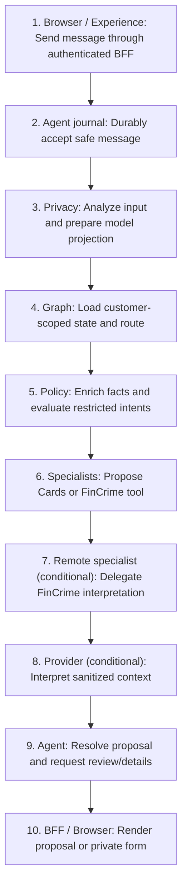

| Step | Layer / action | Methods / breakpoint links | Inspect / behavior |
| ---: | --- | --- | --- |
| 1 | Browser / Experience: Send message through authenticated BFF | [App.submit](../frontend/src/main.tsx#L257)<br>[create_app.message](../src/card_chat/experience.py#L329)<br>[create_app.forward](../src/card_chat/experience.py#L222) | Frontend hides private-looking pasted input; server performs its own checks. |
| 2 | Agent journal: Durably accept safe message | [create_app.submit_message](../src/card_chat/main.py#L1239)<br>[create_app.submit](../src/card_chat/main.py#L1201)<br>[create_app.run_operation](../src/card_chat/main.py#L1131)<br>[create_app.message](../src/card_chat/main.py#L787) | submit replaces rejected private pastes before storage; message invalidates stale reviews. |
| 3 | Privacy: Analyze input and prepare model projection | [PIIGateway.sanitize_input](../src/card_chat/pii/gateway.py#L123)<br>[sanitise](../src/card_chat/model_context.py#L21)<br>[build_context](../src/card_chat/model_context.py#L62)<br>[PIIGateway.verify_outbound](../src/card_chat/pii/gateway.py#L210) | Inspect safe history/verified draft; raw account choices and credentials must not become model arguments. |
| 4 | Graph: Load customer-scoped state and route | [AgentOrchestrator.interpret_turn](../src/card_chat/agent.py#L155)<br>[SupervisorAgent.plan_or_route](../src/card_chat/orchestration/supervisor.py#L177)<br>[SupervisorAgent._classify_and_plan](../src/card_chat/orchestration/supervisor.py#L818) | thread_id=owner:cid. Inspect planned_intents, action_plan, permitted tools and policy decisions; supervisor can run repeatedly. |
| 5 | Policy: Enrich facts and evaluate restricted intents | [SupervisorAgent._retrieve_domain_facts](../src/card_chat/orchestration/supervisor.py#L92)<br>[create_app.lifespan.get_verified_domain_facts](../src/card_chat/main.py#L110)<br>[GroundedPolicyEvaluator.evaluate](../src/card_chat/policy/adapters/evaluator.py#L108) | Card lifecycle intents may invoke the RAG journey below. Account/auth/read intents do not need FinCrime facts. |
| 6 | Specialists: Propose Cards or FinCrime tool | [CardsSpecialistNode.execute](../src/card_chat/orchestration/specialists.py#L55)<br>[FinCrimeSpecialistNode.execute](../src/card_chat/orchestration/specialists.py#L225)<br>[CardServicingAgent.interpret_turn](../src/card_chat/agent.py#L25) | Specialists are permission-filtered. Deterministic stub/compound branches can bypass a provider call. |
| 7 | Remote specialist (conditional): Delegate FinCrime interpretation | [RemoteFinCrimeAgent.interpret_turn](../src/card_chat/fincrime_agent.py#L35)<br>[create_app.turn](../src/card_chat/fincrime_agent.py#L96)<br>[FinCrimeAgent.interpret_turn](../src/card_chat/agent.py#L49) | Only when remote specialist interpretation is actually invoked. A remote proposal is not an executed block. |
| 8 | Provider (conditional): Interpret sanitized context | [AnthropicModel.turn](../src/card_chat/provider.py#L62)<br>[StubModel.turn](../src/card_chat/provider.py#L212) | Hosted and stub branches differ; inspect returned CustomerReply/ProposedToolCall and usage, not credentials. |
| 9 | Agent: Resolve proposal and request review/details | [create_app.message](../src/card_chat/main.py#L787)<br>[resolve](../src/card_chat/private_inputs.py#L26)<br>[authorise](../src/card_chat/private_inputs.py#L44)<br>[human_confirmation_node](../src/card_chat/orchestration/graph.py#L87) | Missing owned account for issue_card opens create_account. A write waits for explicit review; follow that action journey next. |
| 10 | BFF / Browser: Render proposal or private form | [create_app.forward](../src/card_chat/experience.py#L222)<br>[App.request](../frontend/src/main.tsx#L149) | input_tool selects the form; can_confirm/review controls confirmation. |

**Troubleshoot:** If forms work but chat fails, inspect PII, supervisor state, provider response and policy retrieval. Never infer write success from model prose alone.

[Journey list](#journey-atlas) · [Complete index](#breakpoint-index)

### Journey: issue-card

**Issue first, existing or additional card**

**Trigger:** Choose Issue new card and an owned account; explicitly select additional_card only for another card.

**Expected result:** Ordinary issuance creates one card or returns already_exists; an explicit additional request can create another.

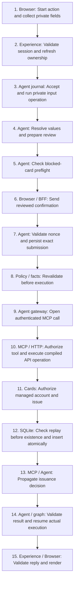

| Step | Layer / action | Methods / breakpoint links | Inspect / behavior |
| ---: | --- | --- | --- |
| 1 | Browser: Start action and collect private fields | [App.choose](../frontend/src/main.tsx#L242)<br>[App.supply](../frontend/src/main.tsx#L247)<br>[App.request](../frontend/src/main.tsx#L149) | A write opens a fresh conversation. fields are values; selections are opaque bound references. |
| 2 | Experience: Validate session and refresh ownership | [create_app.supply_inputs](../src/card_chat/experience.py#L349)<br>[create_app.session](../src/card_chat/experience.py#L77)<br>[create_app.forward](../src/card_chat/experience.py#L222)<br>[create_app.banking_request](../src/card_chat/experience.py#L151) | Origin/CSRF and cookie are checked. Local-customer account/card refreshes happen before the Agent request; each refresh has its own trace. |
| 3 | Agent journal: Accept and run private input operation | [create_app.submit_inputs](../src/card_chat/main.py#L1247)<br>[create_app.submit](../src/card_chat/main.py#L1201)<br>[create_app.schedule](../src/card_chat/main.py#L1179)<br>[create_app.run_operation](../src/card_chat/main.py#L1131) | Inspect cid, operation id, request key, stored trace and worker lock. Both sync and async submissions use the journal. |
| 4 | Agent: Resolve values and prepare review | [create_app.structured](../src/card_chat/main.py#L1043)<br>[resolve](../src/card_chat/private_inputs.py#L26)<br>[authorise](../src/card_chat/private_inputs.py#L44)<br>[ToolSpec.validate](../src/card_chat/catalogue.py#L103)<br>[create_app.save](../src/card_chat/main.py#L243) | Inspect proposal, draft, private bindings and fresh review nonce. No write is authorized by form submission alone. |
| 5 | Agent: Check blocked-card preflight | [create_app.check_account_has_blocked](../src/card_chat/main.py#L217)<br>[create_app.structured](../src/card_chat/main.py#L1043) | Forms can reject a blocked account before confirmation; this is not the authoritative backend transaction. |
| 6 | Browser / BFF: Send reviewed confirmation | [App.confirm](../frontend/src/main.tsx#L252)<br>[create_app.confirm](../src/card_chat/experience.py#L334)<br>[create_app.forward](../src/card_chat/experience.py#L222) | Body contains the current review nonce. Browser operation key differs from the downstream execution key. |
| 7 | Agent: Validate nonce and persist exact submission | [create_app.submit_confirmation](../src/card_chat/main.py#L1243)<br>[create_app.submit](../src/card_chat/main.py#L1201)<br>[create_app.run_operation](../src/card_chat/main.py#L1131)<br>[create_app.confirm](../src/card_chat/main.py#L1120)<br>[create_app.execute](../src/card_chat/main.py#L357)<br>[Journal.save](../src/card_chat/durable.py#L28) | The execution snapshot and key are durable before the first write. Restricted card actions also recheck current facts and policy. |
| 8 | Policy / facts: Revalidate before execution | [create_app.lifespan.get_verified_domain_facts](../src/card_chat/main.py#L110)<br>[GroundedPolicyEvaluator.validate_execution](../src/card_chat/policy/adapters/evaluator.py#L264)<br>[GroundedPolicyEvaluator.evaluate](../src/card_chat/policy/adapters/evaluator.py#L108)<br>[HybridPolicyRetriever.retrieve](../src/card_chat/policy/adapters/retriever.py#L140) | Inspect latest verified blocked-card facts, policy evidence and pinned versions. See runtime RAG journey. |
| 9 | Agent gateway: Open authenticated MCP call | [connect.RemoteGateway.execute](../src/card_chat/gateway.py#L82)<br>[connect.session](../src/card_chat/gateway.py#L51)<br>[Gateway.execute](../src/card_chat/gateway.py#L27)<br>[Security.headers](../src/card_chat/security.py#L87) | Fresh destination token and customer assertion; idempotency_key and calling agent travel as MCP metadata. |
| 10 | MCP / HTTP: Authorize tool and execute compiled API operation | [create_server.call_tool](../src/card_chat/mcp_server.py#L171)<br>[execute](../src/card_chat/mcp_server.py#L72)<br>[ApiClient.execute_operation](../src/api_client/client.py#L40)<br>[protect.authenticate](../src/card_chat/security.py#L101) | Compare spec.method/path, allowed agent, body, status and response schema. Current catalogue tools target CARD_API_BASE_URL. |
| 11 | Cards: Authorize managed account and issue | [issue_card](../src/card_servicing/banking.py#L334)<br>[BankingService.issue](../src/card_servicing/banking.py#L197)<br>[BankingService.owns](../src/card_servicing/banking.py#L163) | POST /banking/cards; backend still checks ownership and blocked-card restrictions. |
| 12 | SQLite: Check replay before existence and insert atomically | [SQLiteCardStore.issue_idempotent](../src/card_servicing/persistence.py#L131)<br>[SQLiteCardStore._create_idempotent](../src/card_servicing/persistence.py#L116) | BEGIN IMMEDIATE protects ownership, existing decisions, blocked cards and ordinary card existence. Same key/details replays; changed fingerprint conflicts. |
| 13 | MCP / Agent: Propagate issuance decision | [execute](../src/card_chat/mcp_server.py#L72)<br>[create_app.execute](../src/card_chat/main.py#L357) | Card-Issuance-Outcome/JSON outcome distinguishes created, already_exists and additional_created. HTTP 200 already_exists is not a failed creation. |
| 14 | Agent / graph: Validate result and resume actual execution | [create_app.execute](../src/card_chat/main.py#L357)<br>[AgentOrchestrator.resume_execution](../src/card_chat/agent.py#L245)<br>[human_confirmation_node](../src/card_chat/orchestration/graph.py#L87)<br>[create_app.run_operation](../src/card_chat/main.py#L1131) | MCP structured result drives completion. Graph resumes only if a checkpoint is waiting. Operation success can still contain a business-failure Reply. |
| 15 | Experience / Browser: Validate reply and render | [create_app.forward](../src/card_chat/experience.py#L222)<br>[App.request](../frontend/src/main.tsx#L149) | BFF exposes typed Reply/Operation. View actions supply Reply.data; write results usually provide a summary. Capture correlation headers. |

**Troubleshoot:** For a timeout, inspect saved execution key and card_issuance_requests before retrying. Keep the same key/body for one operation; a new additional card needs a new reviewed workflow.

[Journey list](#journey-atlas) · [Complete index](#breakpoint-index)

### Journey: block-card

**Block or temporarily freeze a card**

**Trigger:** Choose Block card; select active card; enter a synthetic reason; review and confirm.

**Expected result:** Cards status becomes blocked; a chat graph may offer a subsequent replacement.

Current block/unblock catalogue entries have no idempotency_header. ToolSpec.safe_retry is false for these writes. Do not apply issuance retry guarantees to a block after an uncertain result.

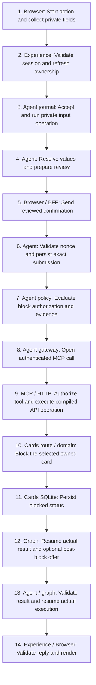

| Step | Layer / action | Methods / breakpoint links | Inspect / behavior |
| ---: | --- | --- | --- |
| 1 | Browser: Start action and collect private fields | [App.choose](../frontend/src/main.tsx#L242)<br>[App.supply](../frontend/src/main.tsx#L247)<br>[App.request](../frontend/src/main.tsx#L149) | A write opens a fresh conversation. fields are values; selections are opaque bound references. |
| 2 | Experience: Validate session and refresh ownership | [create_app.supply_inputs](../src/card_chat/experience.py#L349)<br>[create_app.session](../src/card_chat/experience.py#L77)<br>[create_app.forward](../src/card_chat/experience.py#L222)<br>[create_app.banking_request](../src/card_chat/experience.py#L151) | Origin/CSRF and cookie are checked. Local-customer account/card refreshes happen before the Agent request; each refresh has its own trace. |
| 3 | Agent journal: Accept and run private input operation | [create_app.submit_inputs](../src/card_chat/main.py#L1247)<br>[create_app.submit](../src/card_chat/main.py#L1201)<br>[create_app.schedule](../src/card_chat/main.py#L1179)<br>[create_app.run_operation](../src/card_chat/main.py#L1131) | Inspect cid, operation id, request key, stored trace and worker lock. Both sync and async submissions use the journal. |
| 4 | Agent: Resolve values and prepare review | [create_app.structured](../src/card_chat/main.py#L1043)<br>[resolve](../src/card_chat/private_inputs.py#L26)<br>[authorise](../src/card_chat/private_inputs.py#L44)<br>[ToolSpec.validate](../src/card_chat/catalogue.py#L103)<br>[create_app.save](../src/card_chat/main.py#L243) | Inspect proposal, draft, private bindings and fresh review nonce. No write is authorized by form submission alone. |
| 5 | Browser / BFF: Send reviewed confirmation | [App.confirm](../frontend/src/main.tsx#L252)<br>[create_app.confirm](../src/card_chat/experience.py#L334)<br>[create_app.forward](../src/card_chat/experience.py#L222) | Body contains the current review nonce. Browser operation key differs from the downstream execution key. |
| 6 | Agent: Validate nonce and persist exact submission | [create_app.submit_confirmation](../src/card_chat/main.py#L1243)<br>[create_app.submit](../src/card_chat/main.py#L1201)<br>[create_app.run_operation](../src/card_chat/main.py#L1131)<br>[create_app.confirm](../src/card_chat/main.py#L1120)<br>[create_app.execute](../src/card_chat/main.py#L357)<br>[Journal.save](../src/card_chat/durable.py#L28) | The execution snapshot and key are durable before the first write. Restricted card actions also recheck current facts and policy. |
| 7 | Agent policy: Evaluate block authorization and evidence | [GroundedPolicyEvaluator.validate_execution](../src/card_chat/policy/adapters/evaluator.py#L264)<br>[GroundedPolicyEvaluator._evaluate_fincrime_action](../src/card_chat/policy/adapters/evaluator.py#L516)<br>[HybridPolicyRetriever.retrieve](../src/card_chat/policy/adapters/retriever.py#L140) | POL-003/POL-004 evidence is required. A FinCrime specialist proposal is separate from API execution. |
| 8 | Agent gateway: Open authenticated MCP call | [connect.RemoteGateway.execute](../src/card_chat/gateway.py#L82)<br>[connect.session](../src/card_chat/gateway.py#L51)<br>[Gateway.execute](../src/card_chat/gateway.py#L27)<br>[Security.headers](../src/card_chat/security.py#L87) | Fresh destination token and customer assertion; idempotency_key and calling agent travel as MCP metadata. |
| 9 | MCP / HTTP: Authorize tool and execute compiled API operation | [create_server.call_tool](../src/card_chat/mcp_server.py#L171)<br>[execute](../src/card_chat/mcp_server.py#L72)<br>[ApiClient.execute_operation](../src/api_client/client.py#L40)<br>[protect.authenticate](../src/card_chat/security.py#L101) | Compare spec.method/path, allowed agent, body, status and response schema. Current catalogue tools target CARD_API_BASE_URL. |
| 10 | Cards route / domain: Block the selected owned card | [block_card](../src/card_servicing/banking.py#L370)<br>[BankingService.block_card](../src/card_servicing/banking.py#L211)<br>[SQLiteCardStore.get_card](../src/card_servicing/persistence.py#L234) | Current tool resolves to POST /banking/cards/{card_id}/block on Cards, not POST /fincrime/cards/{card_id}/block. |
| 11 | Cards SQLite: Persist blocked status | [SQLiteCardStore.update_card_status](../src/card_servicing/persistence.py#L217) | cards.status becomes blocked. This route does not insert blocked_cards or persist reason in the separate FinCrime DB. |
| 12 | Graph: Resume actual result and optional post-block offer | [AgentOrchestrator.resume_execution](../src/card_chat/agent.py#L245)<br>[human_confirmation_node](../src/card_chat/orchestration/graph.py#L87)<br>[SupervisorAgent.plan_or_route](../src/card_chat/orchestration/supervisor.py#L177)<br>[GroundedPolicyEvaluator._evaluate_post_block](../src/card_chat/policy/adapters/evaluator.py#L357) | When a waiting graph resumes, actual success creates card_blocked_success context. Offer logic considers the actual reason/context; a direct form may have no waiting graph. |
| 13 | Agent / graph: Validate result and resume actual execution | [create_app.execute](../src/card_chat/main.py#L357)<br>[AgentOrchestrator.resume_execution](../src/card_chat/agent.py#L245)<br>[human_confirmation_node](../src/card_chat/orchestration/graph.py#L87)<br>[create_app.run_operation](../src/card_chat/main.py#L1131) | MCP structured result drives completion. Graph resumes only if a checkpoint is waiting. Operation success can still contain a business-failure Reply. |
| 14 | Experience / Browser: Validate reply and render | [create_app.forward](../src/card_chat/experience.py#L222)<br>[App.request](../frontend/src/main.tsx#L149) | BFF exposes typed Reply/Operation. View actions supply Reply.data; write results usually provide a summary. Capture correlation headers. |

**Troubleshoot:** Inspect Cards status first. Missing FinCrime reason records can limit temporary-freeze/compromise classification; do not assume the two databases were synchronized by this tool.

[Journey list](#journey-atlas) · [Complete index](#breakpoint-index)

### Journey: unblock-policy

**Policy-driven unblock offer and subsequent issuance**

**Trigger:** With verified temporary-freeze facts, ask for another card; accept the unblock offer and confirm the reviewed unblock.

**Expected result:** Eligible temporary freeze can be removed; a subsequent issue_card action requires its own review.

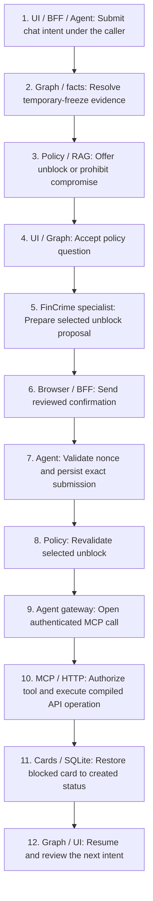

| Step | Layer / action | Methods / breakpoint links | Inspect / behavior |
| ---: | --- | --- | --- |
| 1 | UI / BFF / Agent: Submit chat intent under the caller | [App.submit](../frontend/src/main.tsx#L257)<br>[create_app.message](../src/card_chat/experience.py#L329)<br>[create_app.forward](../src/card_chat/experience.py#L222)<br>[create_app.submit_message](../src/card_chat/main.py#L1239)<br>[create_app.submit](../src/card_chat/main.py#L1201)<br>[create_app.run_operation](../src/card_chat/main.py#L1131)<br>[create_app.message](../src/card_chat/main.py#L787) | Use the chat path to observe the interactive policy branch. A private form can simply reject a blocked account. |
| 2 | Graph / facts: Resolve temporary-freeze evidence | [AgentOrchestrator.interpret_turn](../src/card_chat/agent.py#L155)<br>[SupervisorAgent.plan_or_route](../src/card_chat/orchestration/supervisor.py#L177)<br>[SupervisorAgent._retrieve_domain_facts](../src/card_chat/orchestration/supervisor.py#L92)<br>[create_app.lifespan.get_verified_domain_facts](../src/card_chat/main.py#L110) | Facts must identify a temporary freeze and target card. See the MCP policy-facts journey; unknown reason is not automatically an eligible temporary freeze. |
| 3 | Policy / RAG: Offer unblock or prohibit compromise | [GroundedPolicyEvaluator.evaluate](../src/card_chat/policy/adapters/evaluator.py#L108)<br>[HybridPolicyRetriever.retrieve](../src/card_chat/policy/adapters/retriever.py#L140)<br>[GroundedPolicyEvaluator._evaluate_issuance](../src/card_chat/policy/adapters/evaluator.py#L414) | Inspect pending_customer_question and pinned policy version. Permanently compromised facts prohibit unblocking. |
| 4 | UI / Graph: Accept policy question | [App.submit](../frontend/src/main.tsx#L257)<br>[create_app.message](../src/card_chat/main.py#L787)<br>[SupervisorAgent.plan_or_route](../src/card_chat/orchestration/supervisor.py#L177)<br>[GroundedPolicyEvaluator._handle_pending_question_response](../src/card_chat/policy/adapters/evaluator.py#L283) | A conversational yes chooses the next intent; it does not replace the write confirmation nonce. |
| 5 | FinCrime specialist: Prepare selected unblock proposal | [FinCrimeSpecialistNode.execute](../src/card_chat/orchestration/specialists.py#L225)<br>[create_app.message](../src/card_chat/main.py#L787) | Validate selected card binding and authorization. Remote interpretation is conditional; deterministic branches may prepare the proposal locally. |
| 6 | Browser / BFF: Send reviewed confirmation | [App.confirm](../frontend/src/main.tsx#L252)<br>[create_app.confirm](../src/card_chat/experience.py#L334)<br>[create_app.forward](../src/card_chat/experience.py#L222) | Body contains the current review nonce. Browser operation key differs from the downstream execution key. |
| 7 | Agent: Validate nonce and persist exact submission | [create_app.submit_confirmation](../src/card_chat/main.py#L1243)<br>[create_app.submit](../src/card_chat/main.py#L1201)<br>[create_app.run_operation](../src/card_chat/main.py#L1131)<br>[create_app.confirm](../src/card_chat/main.py#L1120)<br>[create_app.execute](../src/card_chat/main.py#L357)<br>[Journal.save](../src/card_chat/durable.py#L28) | The execution snapshot and key are durable before the first write. Restricted card actions also recheck current facts and policy. |
| 8 | Policy: Revalidate selected unblock | [GroundedPolicyEvaluator.validate_execution](../src/card_chat/policy/adapters/evaluator.py#L264)<br>[GroundedPolicyEvaluator._evaluate_fincrime_action](../src/card_chat/policy/adapters/evaluator.py#L516) | Fail closed if policy retrieval/facts are unavailable or compromise forbids unblocking. |
| 9 | Agent gateway: Open authenticated MCP call | [connect.RemoteGateway.execute](../src/card_chat/gateway.py#L82)<br>[connect.session](../src/card_chat/gateway.py#L51)<br>[Gateway.execute](../src/card_chat/gateway.py#L27)<br>[Security.headers](../src/card_chat/security.py#L87) | Fresh destination token and customer assertion; idempotency_key and calling agent travel as MCP metadata. |
| 10 | MCP / HTTP: Authorize tool and execute compiled API operation | [create_server.call_tool](../src/card_chat/mcp_server.py#L171)<br>[execute](../src/card_chat/mcp_server.py#L72)<br>[ApiClient.execute_operation](../src/api_client/client.py#L40)<br>[protect.authenticate](../src/card_chat/security.py#L101) | Compare spec.method/path, allowed agent, body, status and response schema. Current catalogue tools target CARD_API_BASE_URL. |
| 11 | Cards / SQLite: Restore blocked card to created status | [unblock_card](../src/card_servicing/banking.py#L378)<br>[BankingService.unblock_card](../src/card_servicing/banking.py#L221)<br>[SQLiteCardStore.update_card_status](../src/card_servicing/persistence.py#L217) | Backend verifies ownership and current blocked state. This route does not update FinCrime records; compare sources if later policy facts remain blocked. |
| 12 | Graph / UI: Resume and review the next intent | [AgentOrchestrator.resume_execution](../src/card_chat/agent.py#L245)<br>[human_confirmation_node](../src/card_chat/orchestration/graph.py#L87)<br>[SupervisorAgent.plan_or_route](../src/card_chat/orchestration/supervisor.py#L177)<br>[create_app.execute](../src/card_chat/main.py#L357)<br>[App.request](../frontend/src/main.tsx#L149) | Inspect planned/completed intents and next proposal. Subsequent issuance requires a fresh review/confirmation, then follows issuance journey. |

**Troubleshoot:** No unblock offer: inspect reason provenance and temporary-freeze flags, not just Cards status. After unblocking, stale FinCrime block records can still influence remote facts. Block/unblock tool retries are not declared safe.

[Journey list](#journey-atlas) · [Complete index](#breakpoint-index)

### Journey: replacement

**Replace a blocked card or run combined block-and-replace**

**Trigger:** Choose Replace card for a blocked card, or in chat explicitly request blocking and replacement of the same card.

**Expected result:** Replacement card is created for the owned account while original remains blocked.

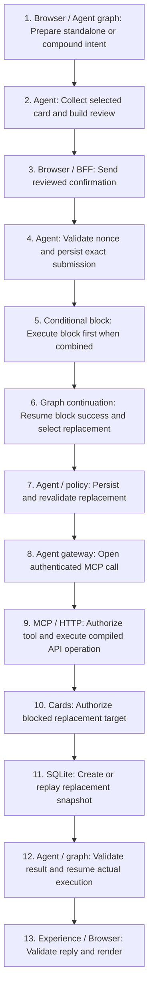

| Step | Layer / action | Methods / breakpoint links | Inspect / behavior |
| ---: | --- | --- | --- |
| 1 | Browser / Agent graph: Prepare standalone or compound intent | [App.choose](../frontend/src/main.tsx#L242)<br>[App.submit](../frontend/src/main.tsx#L257)<br>[create_app.message](../src/card_chat/main.py#L787)<br>[SupervisorAgent._classify_and_plan](../src/card_chat/orchestration/supervisor.py#L818)<br>[normalise_compound_intents](../src/card_chat/orchestration/supervisor.py#L42) | Standalone form starts with a blocked card. Compound chat plan must order block before replacement. |
| 2 | Agent: Collect selected card and build review | [create_app.structured](../src/card_chat/main.py#L1043)<br>[create_app.review_compound](../src/card_chat/main.py#L299)<br>[create_app.message](../src/card_chat/main.py#L787) | For explicit block-and-replace, compound_approval binds both writes to the same selected card; review text explicitly authorizes replacement after blocking. |
| 3 | Browser / BFF: Send reviewed confirmation | [App.confirm](../frontend/src/main.tsx#L252)<br>[create_app.confirm](../src/card_chat/experience.py#L334)<br>[create_app.forward](../src/card_chat/experience.py#L222) | Body contains the current review nonce. Browser operation key differs from the downstream execution key. |
| 4 | Agent: Validate nonce and persist exact submission | [create_app.submit_confirmation](../src/card_chat/main.py#L1243)<br>[create_app.submit](../src/card_chat/main.py#L1201)<br>[create_app.run_operation](../src/card_chat/main.py#L1131)<br>[create_app.confirm](../src/card_chat/main.py#L1120)<br>[create_app.execute](../src/card_chat/main.py#L357)<br>[Journal.save](../src/card_chat/durable.py#L28) | The execution snapshot and key are durable before the first write. Restricted card actions also recheck current facts and policy. |
| 5 | Conditional block: Execute block first when combined | [create_app.execute](../src/card_chat/main.py#L357)<br>[create_server.call_tool](../src/card_chat/mcp_server.py#L171)<br>[block_card](../src/card_servicing/banking.py#L370)<br>[BankingService.block_card](../src/card_servicing/banking.py#L211)<br>[SQLiteCardStore.update_card_status](../src/card_servicing/persistence.py#L217) | Skip this phase for an already-blocked standalone replacement. Failure prevents replacement; uncertain block is not safely retryable by catalogue declaration. |
| 6 | Graph continuation: Resume block success and select replacement | [AgentOrchestrator.resume_execution](../src/card_chat/agent.py#L245)<br>[human_confirmation_node](../src/card_chat/orchestration/graph.py#L87)<br>[SupervisorAgent.plan_or_route](../src/card_chat/orchestration/supervisor.py#L177)<br>[GroundedPolicyEvaluator._evaluate_post_block](../src/card_chat/policy/adapters/evaluator.py#L357) | Combined approval may continue automatically for the same card. A block-only offer requires a separate customer decision/review. |
| 7 | Agent / policy: Persist and revalidate replacement | [create_app.execute](../src/card_chat/main.py#L357)<br>[GroundedPolicyEvaluator.validate_execution](../src/card_chat/policy/adapters/evaluator.py#L264)<br>[GroundedPolicyEvaluator._evaluate_replacement](../src/card_chat/policy/adapters/evaluator.py#L498)<br>[Journal.save](../src/card_chat/durable.py#L28) | Combined continuation resets submission, binds approved reason/card and saves before replacement. Latest successful block result can update stale signed summaries in this same request. |
| 8 | Agent gateway: Open authenticated MCP call | [connect.RemoteGateway.execute](../src/card_chat/gateway.py#L82)<br>[connect.session](../src/card_chat/gateway.py#L51)<br>[Gateway.execute](../src/card_chat/gateway.py#L27)<br>[Security.headers](../src/card_chat/security.py#L87) | Fresh destination token and customer assertion; idempotency_key and calling agent travel as MCP metadata. |
| 9 | MCP / HTTP: Authorize tool and execute compiled API operation | [create_server.call_tool](../src/card_chat/mcp_server.py#L171)<br>[execute](../src/card_chat/mcp_server.py#L72)<br>[ApiClient.execute_operation](../src/api_client/client.py#L40)<br>[protect.authenticate](../src/card_chat/security.py#L101) | Compare spec.method/path, allowed agent, body, status and response schema. Current catalogue tools target CARD_API_BASE_URL. |
| 10 | Cards: Authorize blocked replacement target | [replace_card](../src/card_servicing/banking.py#L386)<br>[BankingService.replace_card](../src/card_servicing/banking.py#L233) | Target must exist, belong to customer and remain blocked. Replacement has its own durable key. |
| 11 | SQLite: Create or replay replacement snapshot | [SQLiteCardStore.replace_idempotent](../src/card_servicing/persistence.py#L179)<br>[SQLiteCardStore._create_idempotent](../src/card_servicing/persistence.py#L116) | cards gets new SIM card; account_cards links it. card_issuance_requests stores replacement_created; old card stays blocked. |
| 12 | Agent / graph: Validate result and resume actual execution | [create_app.execute](../src/card_chat/main.py#L357)<br>[AgentOrchestrator.resume_execution](../src/card_chat/agent.py#L245)<br>[human_confirmation_node](../src/card_chat/orchestration/graph.py#L87)<br>[create_app.run_operation](../src/card_chat/main.py#L1131) | MCP structured result drives completion. Graph resumes only if a checkpoint is waiting. Operation success can still contain a business-failure Reply. |
| 13 | Experience / Browser: Validate reply and render | [create_app.forward](../src/card_chat/experience.py#L222)<br>[App.request](../frontend/src/main.tsx#L149) | BFF exposes typed Reply/Operation. View actions supply Reply.data; write results usually provide a summary. Capture correlation headers. |

**Troubleshoot:** Inspect compound_approval.status (reviewed/confirmed/replacing/complete), block outcome and replacement key separately. This is ordered multi-step execution, not a transaction across both HTTP writes.

[Journey list](#journey-atlas) · [Complete index](#breakpoint-index)

### Journey: policy-ingestion

**Approved policy ingestion and reindexing**

**Trigger:** Run python -m card_chat.policy.pipeline.cli ingest (or update FILE) with the runtime model/collection settings.

**Expected result:** Approved Markdown is chunked, embedded and written to Qdrant with policy metadata and an ingestion audit entry.

Ingestion is an operator journey, not a browser request: it has no browser cid/review/operation trace. Breakpoints require launching the CLI under a Python debugger.

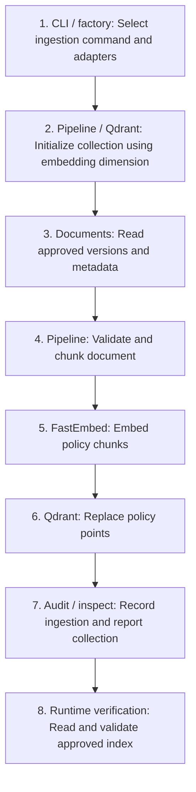

| Step | Layer / action | Methods / breakpoint links | Inspect / behavior |
| ---: | --- | --- | --- |
| 1 | CLI / factory: Select ingestion command and adapters | [main](../src/card_chat/policy/pipeline/cli.py#L18)<br>[build_policy_pipeline](../src/card_chat/policy/factory.py#L124) | Match POLICIES_DIR, QDRANT_URL, POLICY_COLLECTION, embedding provider/model with runtime. Use a configured shell or the Compose invocation in live-policy-runtime.md. |
| 2 | Pipeline / Qdrant: Initialize collection using embedding dimension | [PolicyIngestionPipeline.ingest_all](../src/card_chat/policy/pipeline/ingestion.py#L215)<br>[PolicyIngestionPipeline.initialize](../src/card_chat/policy/pipeline/ingestion.py#L175)<br>[QdrantVectorStore.initialize](../src/card_chat/policy/adapters/vector_stores/qdrant_store.py#L51) | This is a separate ingestion process. Runtime startup does not create the collection. |
| 3 | Documents: Read approved versions and metadata | [FileSystemDocumentSource.list_documents](../src/card_chat/policy/adapters/document_source.py#L72)<br>[parse_policy_file](../src/card_chat/policy/adapters/document_source.py#L18) | Approved flags/status, effective dates, version, required actions and content hash come from Markdown frontmatter/content. |
| 4 | Pipeline: Validate and chunk document | [PolicyIngestionPipeline.ingest_document](../src/card_chat/policy/pipeline/ingestion.py#L181)<br>[PolicyIngestionPipeline.validate_document](../src/card_chat/policy/pipeline/ingestion.py#L140)<br>[chunk_policy_markdown](../src/card_chat/policy/pipeline/ingestion.py#L22) | Inspect section chunks and metadata; empty documents produce no vectors. |
| 5 | FastEmbed: Embed policy chunks | [FastEmbedEmbeddingProvider.embed_documents](../src/card_chat/policy/adapters/embeddings/fastembed_provider.py#L101)<br>[FastEmbedEmbeddingProvider._ensure_model](../src/card_chat/policy/adapters/embeddings/fastembed_provider.py#L70) | Each embedding input combines policy id/version, section title and content; dimensions must match collection. |
| 6 | Qdrant: Replace policy points | [QdrantVectorStore.delete_by_policy_id](../src/card_chat/policy/adapters/vector_stores/qdrant_store.py#L166)<br>[QdrantVectorStore.upsert_chunks](../src/card_chat/policy/adapters/vector_stores/qdrant_store.py#L85) | Inspect collection points and embedding_model/content_hash payload. Delete then upsert are separate operations, not one atomic cross-request replacement. |
| 7 | Audit / inspect: Record ingestion and report collection | [PolicyIngestionPipeline._record_audit](../src/card_chat/policy/pipeline/ingestion.py#L155)<br>[PolicyIngestionPipeline.inspect](../src/card_chat/policy/pipeline/ingestion.py#L229) | POLICY_AUDIT_LOG defaults to data/policy_audit.json; it is distinct from Mongo request traces. |
| 8 | Runtime verification: Read and validate approved index | [build_runtime_policy_services](../src/card_chat/policy/factory.py#L149)<br>[HybridPolicyRetriever.check_ready](../src/card_chat/policy/adapters/retriever.py#L55)<br>[HybridPolicyRetriever._verify_indexed](../src/card_chat/policy/adapters/retriever.py#L44) | Restart or recheck the live runtime with the new index. Existing workflows can reject changed pinned versions. |

**Troubleshoot:** If interrupted between delete and upsert, runtime can fail closed on missing/stale index; rerun approved ingestion. Check model/cache connectivity, writable audit path and identical ingestion/runtime config.

[Journey list](#journey-atlas) · [Complete index](#breakpoint-index)

### Journey: runtime-rag

**Runtime policy retrieval, verified facts and execution gate**

**Trigger:** Ask for a restricted card action in chat, or confirm an issue/block/unblock/replace proposal.

**Expected result:** Approved evidence and verified domain facts produce a structured permit/deny/offer decision; unavailable evidence prevents restricted execution.

This is policy-guided servicing, not an unrestricted document Q&A endpoint. A direct form may stop at blocked-card preflight before the full gate. No single action must touch every component; the journey set covers the distinct components.

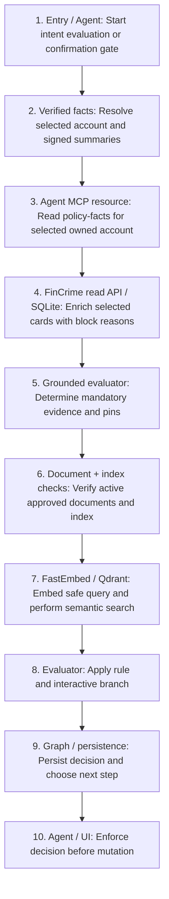

| Step | Layer / action | Methods / breakpoint links | Inspect / behavior |
| ---: | --- | --- | --- |
| 1 | Entry / Agent: Start intent evaluation or confirmation gate | [create_app.message](../src/card_chat/main.py#L787)<br>[SupervisorAgent.plan_or_route](../src/card_chat/orchestration/supervisor.py#L177)<br>[create_app.execute](../src/card_chat/main.py#L357)<br>[GroundedPolicyEvaluator.validate_execution](../src/card_chat/policy/adapters/evaluator.py#L264) | Chat evaluates before delegation. Direct forms bypass language interpretation but restricted card actions revalidate at execution; create_account optional issuance is not in this restricted-tool list. |
| 2 | Verified facts: Resolve selected account and signed summaries | [SupervisorAgent._retrieve_domain_facts](../src/card_chat/orchestration/supervisor.py#L92)<br>[create_app.lifespan.get_verified_domain_facts](../src/card_chat/main.py#L110) | Inspect account_number resolution, caller accounts/cards, temporary_freeze, compromised and retrieval_failed. |
| 3 | Agent MCP resource: Read policy-facts for selected owned account | [connect.RemoteGateway.policy_facts](../src/card_chat/gateway.py#L71)<br>[create_server.read_policy_facts](../src/card_chat/mcp_server.py#L120)<br>[Security.customer](../src/card_chat/security.py#L49)<br>[Security.headers](../src/card_chat/security.py#L87) | This is read_resource, not call_tool. Customer delegation and tools permission constrain account and card ids. |
| 4 | FinCrime read API / SQLite: Enrich selected cards with block reasons | [create_app.get_card](../src/fincrime_servicing/main.py#L95)<br>[FinCrimeService.get_blocked_card](../src/fincrime_servicing/service.py#L182)<br>[SQLiteFinCrimeStore.get_blocked_card](../src/fincrime_servicing/persistence.py#L217) | MCP reads /fincrime/cards/{id} only for signed card summaries. A 404 preserves a signed blocked status without inventing reason/eligibility. |
| 5 | Grounded evaluator: Determine mandatory evidence and pins | [GroundedPolicyEvaluator.evaluate](../src/card_chat/policy/adapters/evaluator.py#L108)<br>[HybridPolicyRetriever.retrieve](../src/card_chat/policy/adapters/retriever.py#L140)<br>[HybridPolicyRetriever.retrieve_mandatory](../src/card_chat/policy/adapters/retriever.py#L90) | Runtime adapter is GroundedPolicyEvaluator, not legacy policy/evaluator.py. Required policy differs by intent; strict restricted checks also require POL-004. |
| 6 | Document + index checks: Verify active approved documents and index | [HybridPolicyRetriever._active_documents](../src/card_chat/policy/adapters/retriever.py#L33)<br>[HybridPolicyRetriever._verify_indexed](../src/card_chat/policy/adapters/retriever.py#L44)<br>[FileSystemDocumentSource.list_documents](../src/card_chat/policy/adapters/document_source.py#L72) | Check one approved version per id, matching content_hash/model metadata. Mandatory lookup cannot be omitted by semantic ranking. |
| 7 | FastEmbed / Qdrant: Embed safe query and perform semantic search | [FastEmbedEmbeddingProvider.embed_query](../src/card_chat/policy/adapters/embeddings/fastembed_provider.py#L112)<br>[QdrantVectorStore.search](../src/card_chat/policy/adapters/vector_stores/qdrant_store.py#L126) | Qdrant query_points returns hits filtered against current approved document/version/hash/model. Exact mandatory-index verification may also issue earlier embedding/search calls. |
| 8 | Evaluator: Apply rule and interactive branch | [GroundedPolicyEvaluator._evaluate](../src/card_chat/policy/adapters/evaluator.py#L217)<br>[GroundedPolicyEvaluator._evaluate_issuance](../src/card_chat/policy/adapters/evaluator.py#L414)<br>[GroundedPolicyEvaluator._evaluate_replacement](../src/card_chat/policy/adapters/evaluator.py#L498)<br>[GroundedPolicyEvaluator._evaluate_fincrime_action](../src/card_chat/policy/adapters/evaluator.py#L516)<br>[GroundedPolicyEvaluator._handle_pending_question_response](../src/card_chat/policy/adapters/evaluator.py#L283) | Inspect permitted/prohibited, required_actions, pending question, evidence_citations and pinned_versions. Semantic similarity is evidence retrieval, not ownership authorization. |
| 9 | Graph / persistence: Persist decision and choose next step | [SupervisorAgent.plan_or_route](../src/card_chat/orchestration/supervisor.py#L177)<br>[DurableSqliteSaver.put](../src/card_chat/orchestration/persistence.py#L169)<br>[DurableSqliteSaver.get_tuple](../src/card_chat/orchestration/persistence.py#L69) | Thread owner:cid retains policy_evaluation, retrieved_policies and pins. Decisions can respond, hand off, request a choice or wait for confirmation. |
| 10 | Agent / UI: Enforce decision before mutation | [create_app.execute](../src/card_chat/main.py#L357)<br>[App.request](../frontend/src/main.tsx#L149) | Denied gate returns a Reply without gateway write. Permitted reviewed actions continue through MCP tool and authoritative backend transaction. |

**Troubleshoot:** Inspect graph policy_error and raw caught exception in evaluator/retriever; check FinCrime reachability separately from Qdrant. PolicyRetrievalUnavailable is a safe customer-facing result, not the underlying cause. Changed pinned approved versions require a fresh workflow.

[Journey list](#journey-atlas) · [Complete index](#breakpoint-index)

### Journey: async-recovery

**Asynchronous jobs, timeouts, replay and restart recovery**

**Trigger:** Select Submit and poll; interrupt a response or restart Agent after durable acceptance using synthetic data.

**Expected result:** Accepted work is recoverable and retries preserve operation/execution identity according to tool guarantees.

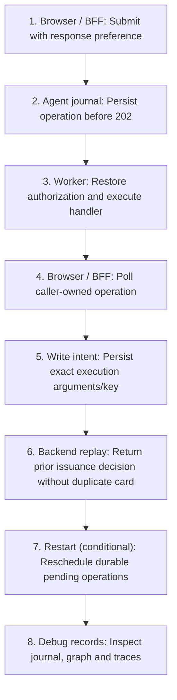

| Step | Layer / action | Methods / breakpoint links | Inspect / behavior |
| ---: | --- | --- | --- |
| 1 | Browser / BFF: Submit with response preference | [App.request](../frontend/src/main.tsx#L149)<br>[create_app.forward](../src/card_chat/experience.py#L222) | Prefer: respond-async and browser Idempotency-Key are forwarded. Keep exact body/key for the same HTTP submission. |
| 2 | Agent journal: Persist operation before 202 | [create_app.submit](../src/card_chat/main.py#L1201)<br>[Journal.__init__](../src/card_chat/durable.py#L9) | operations stores owner,cid,kind,request_key,body,delegation,trace,status and request_hash. Changed key/body association returns 409. |
| 3 | Worker: Restore authorization and execute handler | [create_app.schedule](../src/card_chat/main.py#L1179)<br>[create_app.run_operation](../src/card_chat/main.py#L1131) | Single worker lock serializes jobs. Saved delegation may expire; state and result commit together after handler completion. |
| 4 | Browser / BFF: Poll caller-owned operation | [App.request](../frontend/src/main.tsx#L149)<br>[create_app.status](../src/card_chat/experience.py#L339)<br>[create_app.status](../src/card_chat/main.py#L1198)<br>[create_app.operation](../src/card_chat/main.py#L1189) | BFF rewrites status_url to /api/operations/{oid}. Poll trace differs from original operations.trace. |
| 5 | Write intent: Persist exact execution arguments/key | [create_app.execute](../src/card_chat/main.py#L357)<br>[create_app.save](../src/card_chat/main.py#L243)<br>[Journal.save](../src/card_chat/durable.py#L28) | For safely retryable tools, submission key survives failures/restart and is reused rather than regenerated. |
| 6 | Backend replay: Return prior issuance decision without duplicate card | [BankingService.create_account](../src/card_servicing/banking.py#L178)<br>[SQLiteCardStore.issue_idempotent](../src/card_servicing/persistence.py#L131)<br>[SQLiteCardStore.replace_idempotent](../src/card_servicing/persistence.py#L179) | Account/card/replacement replay behavior differs from block/unblock tools with no declared safe retry. |
| 7 | Restart (conditional): Reschedule durable pending operations | [Journal.__init__](../src/card_chat/durable.py#L9)<br>[create_app.recover](../src/card_chat/main.py#L1185)<br>[create_app.schedule](../src/card_chat/main.py#L1179) | Journal resets running to pending at startup; recover schedules pending after gateway initialization. |
| 8 | Debug records: Inspect journal, graph and traces | [create_app.operation](../src/card_chat/main.py#L1189)<br>[DurableSqliteSaver.get_tuple](../src/card_chat/orchestration/persistence.py#L69)<br>[instrument.request_trace](../src/card_chat/observability.py#L86) | Use cid and request key to recover original execution trace. A succeeded handler may return a business error Reply. |

**Troubleshoot:** Do not delete snapshots or regenerate keys for an uncertain write. An existing completed browser operation returns stored result; retrying tool execution may require reconfirming the fixed reviewed action. An attempted unsafe tool must be checked before a new action.

[Journey list](#journey-atlas) · [Complete index](#breakpoint-index)

### Journey: fincrime-api

**Separate FinCrime API mutation and Cards synchronization**

**Trigger:** Invoke the configured FinCrime API with authorized service/customer headers, or debug its explicit integration tests.

**Expected result:** FinCrime records block/audit state and attempts a separate Cards synchronization call.

This integration path is documented separately because the current tools.json/OpenAPI routes all tool writes to Cards. It is not a required hidden phase of UI blocking.

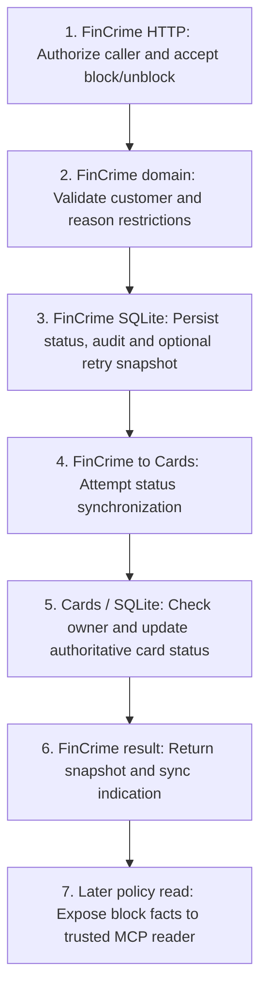

| Step | Layer / action | Methods / breakpoint links | Inspect / behavior |
| ---: | --- | --- | --- |
| 1 | FinCrime HTTP: Authorize caller and accept block/unblock | [protect.authenticate](../src/card_chat/security.py#L101)<br>[create_app.block_card](../src/fincrime_servicing/main.py#L58)<br>[create_app.unblock_card](../src/fincrime_servicing/main.py#L77) | This is /fincrime/cards/{card_id}/block or /unblock, not the current UI catalogue target. Supply actual customer delegation; do not paste secrets into docs. |
| 2 | FinCrime domain: Validate customer and reason restrictions | [FinCrimeService.block_card](../src/fincrime_servicing/service.py#L22)<br>[FinCrimeService.unblock_card](../src/fincrime_servicing/service.py#L55) | With an injected Cards service, ownership/card details are checked in-process. Remote mode uses the code-specific boundaries; do not assume identical checks. |
| 3 | FinCrime SQLite: Persist status, audit and optional retry snapshot | [SQLiteFinCrimeStore.block_card_idempotent](../src/fincrime_servicing/persistence.py#L89)<br>[SQLiteFinCrimeStore.unblock_card_idempotent](../src/fincrime_servicing/persistence.py#L143) | Inspect blocked_cards, fincrime_audit_log and fincrime_idempotency. Account linkage depends on resolved/supplied account_number. |
| 4 | FinCrime to Cards: Attempt status synchronization | [FinCrimeService._sync_to_cards_api](../src/fincrime_servicing/service.py#L124)<br>[FinCrimeService._sync_unblock_to_cards_api](../src/fincrime_servicing/service.py#L92) | HTTP mode uses /banking/cards/{id}/block or /unblock with generated service headers; in-process mode calls BankingService directly. |
| 5 | Cards / SQLite: Check owner and update authoritative card status | [block_card](../src/card_servicing/banking.py#L370)<br>[unblock_card](../src/card_servicing/banking.py#L378)<br>[BankingService.block_card](../src/card_servicing/banking.py#L211)<br>[BankingService.unblock_card](../src/card_servicing/banking.py#L221)<br>[SQLiteCardStore.update_card_status](../src/card_servicing/persistence.py#L217) | Verify actual Cards HTTP response and cards.status; FinCrime record commit and Cards update are separate effects. |
| 6 | FinCrime result: Return snapshot and sync indication | [FinCrimeService.block_card](../src/fincrime_servicing/service.py#L22)<br>[FinCrimeService.unblock_card](../src/fincrime_servicing/service.py#L55)<br>[SQLiteFinCrimeStore.mark_card_synced](../src/fincrime_servicing/persistence.py#L189) | Current service creates results with synced=True and only marks failure when both synchronization fails and result.synced is false. A failed remote sync can therefore leave synced=True; verify both stores directly. |
| 7 | Later policy read: Expose block facts to trusted MCP reader | [create_server.read_policy_facts](../src/card_chat/mcp_server.py#L120)<br>[create_app.get_card](../src/fincrime_servicing/main.py#L95)<br>[SQLiteFinCrimeStore.get_blocked_card](../src/fincrime_servicing/persistence.py#L217) | Policy resource can consume stored reason/status; it does not retroactively make cross-service writes atomic. |

**Troubleshoot:** A successful FinCrime response or synced flag alone does not prove Cards changed. Inspect the synchronization call, service audience/client authorization and both SQLite stores. These observed implementation limits are not an automatic repair/reconciliation mechanism.

[Journey list](#journey-atlas) · [Complete index](#breakpoint-index)

### Journey: identity

**OIDC browser sign-in and destination-specific service identity**

**Trigger:** Choose OIDC sign in for the demo identity path, or inspect a protected BFF/Agent/MCP/Cards hop.

**Expected result:** Browser identity establishes a BFF session; each service obtains a destination token and carries a separate customer assertion.

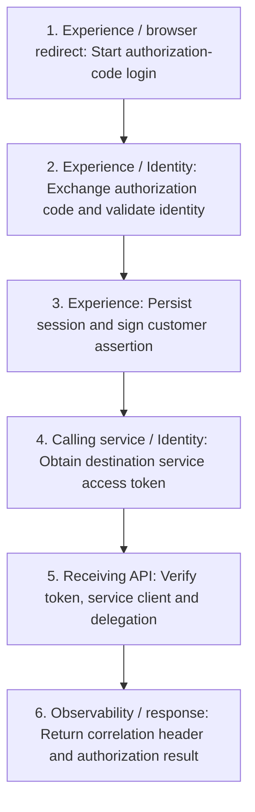

| Step | Layer / action | Methods / breakpoint links | Inspect / behavior |
| ---: | --- | --- | --- |
| 1 | Experience / browser redirect: Start authorization-code login | [create_app.login](../src/card_chat/experience.py#L100)<br>[create_app.store](../src/card_chat/experience.py#L63) | GET /auth/login creates state, nonce and PKCE verifier; redirects browser to Identity. This is separate from local-customer password registration. |
| 2 | Experience / Identity: Exchange authorization code and validate identity | [create_app.complete_login](../src/card_chat/experience.py#L114)<br>[create_app.load](../src/card_chat/experience.py#L69)<br>[Security.verify](../src/card_chat/security.py#L30) | Check state cookie, one-use pending state, code_verifier, id-token audience/issuer and nonce. |
| 3 | Experience: Persist session and sign customer assertion | [create_app.store](../src/card_chat/experience.py#L63)<br>[create_app.session](../src/card_chat/experience.py#L77)<br>[Security.issue_customer](../src/card_chat/security.py#L67) | Inspect claims/account provenance. OIDC demo identities do not automatically create banking customers; account creation still checks customers table. |
| 4 | Calling service / Identity: Obtain destination service access token | [Security.headers](../src/card_chat/security.py#L87)<br>[Security.service_token](../src/card_chat/security.py#L79) | Client-credentials token is acquired per configured service; X-Customer-Delegation is separate from OAuth token and trace header. |
| 5 | Receiving API: Verify token, service client and delegation | [protect.authenticate](../src/card_chat/security.py#L101)<br>[Security.verify](../src/card_chat/security.py#L30)<br>[Security.customer](../src/card_chat/security.py#L49) | Inspect audience, scope, azp, delegation sub/accounts/permissions and expiration. BFF banking entry has a special service boundary. |
| 6 | Observability / response: Return correlation header and authorization result | [protect.authenticate](../src/card_chat/security.py#L101)<br>[create_app.trace_request](../src/card_servicing/main.py#L91) | Protected services return X-Correlation-ID; Cards also returns X-Trace-ID. Record status and trace without copying tokens. |

**Troubleshoot:** 401 usually concerns invalid/expired token or assertion; 403 concerns service client/scope/account permissions. Check destination settings and signing-key consistency; do not assume a browser token can be reused at every API.

[Journey list](#journey-atlas) · [Complete index](#breakpoint-index)

### Journey: observability

**Follow a request into structured Mongo logs**

**Trigger:** Perform any journey with TELEMETRY_SINK=mongo and capture the main request correlation header.

**Expected result:** Best-effort structured events and HTTP traces reach indexed Mongo collections independently of business commits.

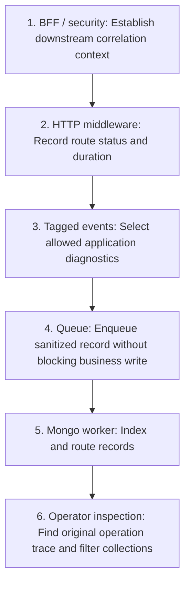

| Step | Layer / action | Methods / breakpoint links | Inspect / behavior |
| ---: | --- | --- | --- |
| 1 | BFF / security: Establish downstream correlation context | [create_app.forward](../src/card_chat/experience.py#L222)<br>[create_app.banking_request](../src/card_chat/experience.py#L151)<br>[Security.headers](../src/card_chat/security.py#L87)<br>[protect.authenticate](../src/card_chat/security.py#L101) | Main Agent forward has a fresh trace; each BFF account/card refresh has another. Existing operation trace identifies original execution, not later polls/replays. |
| 2 | HTTP middleware: Record route status and duration | [instrument.request_trace](../src/card_chat/observability.py#L86)<br>[create_app.trace_request](../src/card_servicing/main.py#L91) | Route templates, service, status_code, duration_ms and trace_id are emitted; not arbitrary request bodies. |
| 3 | Tagged events: Select allowed application diagnostics | [DiagnosticHandler.emit](../src/card_chat/observability.py#L26)<br>[diagnostic](../src/card_servicing/banking.py#L276)<br>[execute](../src/card_chat/mcp_server.py#L72) | Only tagged supported Agent/MCP events enter this sink; Cards emits domain events. Ordinary exception text remains in service terminals rather than structured Mongo export. |
| 4 | Queue: Enqueue sanitized record without blocking business write | [event_record](../src/card_servicing/telemetry.py#L48)<br>[MongoTelemetry.emit](../src/card_servicing/telemetry.py#L99) | Bounded queue uses put_nowait. Full queue emits console fallback; it does not roll back Cards state. |
| 5 | Mongo worker: Index and route records | [MongoTelemetry._run](../src/card_servicing/telemetry.py#L106) | Thread creates seven-day timestamp TTL and trace_id indexes; kind=trace goes to request_traces, other events to application_logs in configured database. |
| 6 | Operator inspection: Find original operation trace and filter collections | [create_app.operation](../src/card_chat/main.py#L1189)<br>[fallback](../src/card_servicing/telemetry.py#L18) | In Compass query trace_id in card_servicing.request_traces and application_logs. For outage read fallback console, original operations.trace and authoritative SQLite. |

**Troubleshoot:** Missing Mongo documents can mean sink=none/stdout, queue delay/full, credentials/connection failure or TTL expiry. These are operational logs, not a durable banking audit ledger. Do not infer commit outcome from log absence.

[Journey list](#journey-atlas) · [Complete index](#breakpoint-index)

## Breakpoint index

174 named locations. The previous 65 account/card locations are retained; the additional entries cover the other journeys. These are recommended source locations, not a claim that additional IDE breakpoints have been installed.

### Breakpoints: Browser

| Method / breakpoint link | File | Line | First executable statement |
| --- | --- | ---: | --- |
| [App.choose](../frontend/src/main.tsx#L242) | `frontend/src/main.tsx` | 242 | <code>const read = name.startsWith(&#x27;view_&#x27;);</code> |
| [App.request](../frontend/src/main.tsx#L149) | `frontend/src/main.tsx` | 149 | <code>setBusy(true);</code> |
| [App.supply](../frontend/src/main.tsx#L247) | `frontend/src/main.tsx` | 247 | <code>e.preventDefault();</code> |
| [App.confirm](../frontend/src/main.tsx#L252) | `frontend/src/main.tsx` | 252 | <code>if (!latestReply?.review \|\| busy \|\| pending) return;</code> |
| [App.authenticate](../frontend/src/main.tsx#L262) | `frontend/src/main.tsx` | 262 | <code>e.preventDefault();</code> |
| [App.submit](../frontend/src/main.tsx#L257) | `frontend/src/main.tsx` | 257 | <code>e.preventDefault();</code> |
| [App.logout](../frontend/src/main.tsx#L267) | `frontend/src/main.tsx` | 267 | <code>if (!session) return;</code> |

### Breakpoints: Experience BFF

| Method / breakpoint link | File | Line | First executable statement |
| --- | --- | ---: | --- |
| [create_app.start](../src/card_chat/experience.py#L325) | `src/card_chat/experience.py` | 325 | <code>return await forward(request, &#x27;/conversations&#x27;)</code> |
| [create_app.forward](../src/card_chat/experience.py#L222) | `src/card_chat/experience.py` | 222 | <code>value = session(request)</code> |
| [create_app.session](../src/card_chat/experience.py#L77) | `src/card_chat/experience.py` | 77 | <code>value = load(request.cookies.get(&#x27;card_session&#x27;))</code> |
| [create_app.supply_inputs](../src/card_chat/experience.py#L349) | `src/card_chat/experience.py` | 349 | <code>check_id(cid)</code> |
| [create_app.confirm](../src/card_chat/experience.py#L334) | `src/card_chat/experience.py` | 334 | <code>check_id(cid)</code> |
| [create_app.register_customer](../src/card_chat/experience.py#L197) | `src/card_chat/experience.py` | 197 | <code>return await credentials(request, body, &#x27;register&#x27;)</code> |
| [create_app.password_login](../src/card_chat/experience.py#L201) | `src/card_chat/experience.py` | 201 | <code>return await credentials(request, body, &#x27;login&#x27;)</code> |
| [create_app.credentials](../src/card_chat/experience.py#L173) | `src/card_chat/experience.py` | 173 | <code>if request.headers.get(&#x27;Origin&#x27;) != origin:</code> |
| [create_app.banking_request](../src/card_chat/experience.py#L151) | `src/card_chat/experience.py` | 151 | <code>dt = delegation.set(security.issue_customer(value[&#x27;claims&#x27;]) if value else None)</code> |
| [create_app.message](../src/card_chat/experience.py#L329) | `src/card_chat/experience.py` | 329 | <code>check_id(cid)</code> |
| [create_app.store](../src/card_chat/experience.py#L63) | `src/card_chat/experience.py` | 63 | <code>db.execute(&#x27;DELETE FROM sessions WHERE expires &lt; ?&#x27;, (time.time(),))</code> |
| [create_app.load](../src/card_chat/experience.py#L69) | `src/card_chat/experience.py` | 69 | <code>digest = hashlib.sha256((key or &#x27;&#x27;).encode()).hexdigest()</code> |
| [create_app.current_session](../src/card_chat/experience.py#L139) | `src/card_chat/experience.py` | 139 | <code>value = session(request)</code> |
| [create_app.logout](../src/card_chat/experience.py#L144) | `src/card_chat/experience.py` | 144 | <code>session(request)</code> |
| [create_app.status](../src/card_chat/experience.py#L339) | `src/card_chat/experience.py` | 339 | <code>check_id(oid)</code> |
| [create_app.login](../src/card_chat/experience.py#L100) | `src/card_chat/experience.py` | 100 | <code>state, verifier, nonce = secrets.token_urlsafe(32), secrets.token_urlsafe(48), secrets.token_urlsafe(32)</code> |
| [create_app.complete_login](../src/card_chat/experience.py#L114) | `src/card_chat/experience.py` | 114 | <code>if not secrets.compare_digest(state, request.cookies.get(&#x27;card_oidc&#x27;, &#x27;&#x27;)):</code> |

### Breakpoints: Agent HTTP and jobs

| Method / breakpoint link | File | Line | First executable statement |
| --- | --- | ---: | --- |
| [create_app.start](../src/card_chat/main.py#L673) | `src/card_chat/main.py` | 673 | <code>cid = uuid4().hex</code> |
| [create_app.input_options](../src/card_chat/main.py#L1036) | `src/card_chat/main.py` | 1036 | <code>async with worker_lock:</code> |
| [create_app.submit_inputs](../src/card_chat/main.py#L1247) | `src/card_chat/main.py` | 1247 | <code>return await submit(cid, body, &#x27;inputs&#x27;, request)</code> |
| [create_app.submit](../src/card_chat/main.py#L1201) | `src/card_chat/main.py` | 1201 | <code>get(cid)  # Authorize before accepting or returning a deduplicated operation.</code> |
| [create_app.schedule](../src/card_chat/main.py#L1179) | `src/card_chat/main.py` | 1179 | <code>task = asyncio.create_task(run_operation(oid))</code> |
| [create_app.run_operation](../src/card_chat/main.py#L1131) | `src/card_chat/main.py` | 1131 | <code>async with worker_lock:</code> |
| [create_app.structured](../src/card_chat/main.py#L1043) | `src/card_chat/main.py` | 1043 | <code>begin_next_action(c)</code> |
| [create_app.submit_confirmation](../src/card_chat/main.py#L1243) | `src/card_chat/main.py` | 1243 | <code>return await submit(cid, body, &#x27;confirm&#x27;, request)</code> |
| [create_app.confirm](../src/card_chat/main.py#L1120) | `src/card_chat/main.py` | 1120 | <code>async with c.lock:</code> |
| [create_app.execute](../src/card_chat/main.py#L357) | `src/card_chat/main.py` | 357 | <code>proposal = c.proposal</code> |
| [create_app.check_account_has_blocked](../src/card_chat/main.py#L217) | `src/card_chat/main.py` | 217 | <code>cards = caller().get(&#x27;cards&#x27;, [])</code> |
| [create_app.submit_message](../src/card_chat/main.py#L1239) | `src/card_chat/main.py` | 1239 | <code>return await submit(cid, body, &#x27;messages&#x27;, request)</code> |
| [create_app.message](../src/card_chat/main.py#L787) | `src/card_chat/main.py` | 787 | <code>async with c.lock:</code> |
| [create_app.save](../src/card_chat/main.py#L243) | `src/card_chat/main.py` | 243 | <code>data = {k: v for k, v in vars(c).items() if k != &#x27;lock&#x27;}</code> |
| [create_app.lifespan](../src/card_chat/main.py#L69) | `src/card_chat/main.py` | 69 | <code>if model is None and gateway is None and not config.get(&#x27;OIDC_ISSUER&#x27;) and config.get(&#x27;ALLOW_INSECURE_LOCAL&#x27;) != &#x27;1&#x27;:</code> |
| [create_app.recover](../src/card_chat/main.py#L1185) | `src/card_chat/main.py` | 1185 | <code>for row in journal.db.execute(&quot;SELECT id FROM operations WHERE status=&#x27;pending&#x27;&quot;).fetchall():</code> |
| [create_app.lifespan.get_verified_domain_facts](../src/card_chat/main.py#L110) | `src/card_chat/main.py` | 110 | <code>cust = caller()</code> |
| [create_app.review_compound](../src/card_chat/main.py#L299) | `src/card_chat/main.py` | 299 | <code>c.compound_approval = None</code> |
| [create_app.status](../src/card_chat/main.py#L1198) | `src/card_chat/main.py` | 1198 | <code>return operation(oid)</code> |
| [create_app.operation](../src/card_chat/main.py#L1189) | `src/card_chat/main.py` | 1189 | <code>row = journal.db.execute(&#x27;SELECT * FROM operations WHERE id=? AND owner=?&#x27;, (oid, owner())).fetchone()</code> |

### Breakpoints: Private inputs

| Method / breakpoint link | File | Line | First executable statement |
| --- | --- | ---: | --- |
| [form_options](../src/card_chat/private_inputs.py#L74) | `src/card_chat/private_inputs.py` | 74 | <code>tools = []</code> |
| [bind](../src/card_chat/private_inputs.py#L16) | `src/card_chat/private_inputs.py` | 16 | <code>for ref, item in bindings.items():</code> |
| [resolve](../src/card_chat/private_inputs.py#L26) | `src/card_chat/private_inputs.py` | 26 | <code>result = {}</code> |
| [authorise](../src/card_chat/private_inputs.py#L44) | `src/card_chat/private_inputs.py` | 44 | <code>if not set(spec.entry.permissions) &lt;= set(caller.get(&#x27;permissions&#x27;, [])):</code> |

### Breakpoints: Catalogue

| Method / breakpoint link | File | Line | First executable statement |
| --- | --- | ---: | --- |
| [ToolSpec.validate](../src/card_chat/catalogue.py#L103) | `src/card_chat/catalogue.py` | 103 | <code>if not isinstance(arguments, dict):</code> |
| [load_catalogue](../src/card_chat/catalogue.py#L225) | `src/card_chat/catalogue.py` | 225 | <code>config = config or {}</code> |
| [compile_entry](../src/card_chat/catalogue.py#L141) | `src/card_chat/catalogue.py` | 141 | <code>matches = [(method.upper(), path, item, operation)</code> |

### Breakpoints: MCP gateway

| Method / breakpoint link | File | Line | First executable statement |
| --- | --- | ---: | --- |
| [connect.RemoteGateway.execute](../src/card_chat/gateway.py#L82) | `src/card_chat/gateway.py` | 82 | <code>async with session() as connected:</code> |
| [connect.session](../src/card_chat/gateway.py#L51) | `src/card_chat/gateway.py` | 51 | <code>async with httpx.AsyncClient(headers=await security.headers(), timeout=120) as client:</code> |
| [Gateway.execute](../src/card_chat/gateway.py#L27) | `src/card_chat/gateway.py` | 27 | <code>self.catalogue[name].validate(arguments)</code> |
| [connect](../src/card_chat/gateway.py#L44) | `src/card_chat/gateway.py` | 44 | <code>config = settings() if config is None else config</code> |
| [Gateway.__init__](../src/card_chat/gateway.py#L16) | `src/card_chat/gateway.py` | 16 | <code>self.session = session</code> |
| [connect.RemoteGateway.policy_facts](../src/card_chat/gateway.py#L71) | `src/card_chat/gateway.py` | 71 | <code>if not security.enabled:</code> |

### Breakpoints: MCP server

| Method / breakpoint link | File | Line | First executable statement |
| --- | --- | ---: | --- |
| [create_server.call_tool](../src/card_chat/mcp_server.py#L171) | `src/card_chat/mcp_server.py` | 171 | <code>if name not in catalogue:</code> |
| [execute](../src/card_chat/mcp_server.py#L72) | `src/card_chat/mcp_server.py` | 72 | <code>started = perf_counter()</code> |
| [create_server.list_tools](../src/card_chat/mcp_server.py#L165) | `src/card_chat/mcp_server.py` | 165 | <code>return [Tool(name=spec.name, description=spec.entry.description,</code> |
| [create_server.read_policy_facts](../src/card_chat/mcp_server.py#L120) | `src/card_chat/mcp_server.py` | 120 | <code>parsed = urlsplit(str(uri))</code> |

### Breakpoints: HTTP client

| Method / breakpoint link | File | Line | First executable statement |
| --- | --- | ---: | --- |
| [ApiClient.execute_operation](../src/api_client/client.py#L40) | `src/api_client/client.py` | 40 | <code>for name, value in path_parameters.items():</code> |

### Breakpoints: Security

| Method / breakpoint link | File | Line | First executable statement |
| --- | --- | ---: | --- |
| [protect.authenticate](../src/card_chat/security.py#L101) | `src/card_chat/security.py` | 101 | <code>supplied = request.headers.get(&#x27;X-Correlation-ID&#x27;, &#x27;&#x27;)</code> |
| [Security.headers](../src/card_chat/security.py#L87) | `src/card_chat/security.py` | 87 | <code>headers = {&#x27;X-Correlation-ID&#x27;: trace.get() or uuid4().hex}</code> |
| [Security.customer](../src/card_chat/security.py#L49) | `src/card_chat/security.py` | 49 | <code>try:</code> |
| [Security.verify](../src/card_chat/security.py#L30) | `src/card_chat/security.py` | 30 | <code>try:</code> |
| [Security.issue_customer](../src/card_chat/security.py#L67) | `src/card_chat/security.py` | 67 | <code>now = int(time.time())</code> |
| [Security.service_token](../src/card_chat/security.py#L79) | `src/card_chat/security.py` | 79 | <code>async with httpx.AsyncClient(timeout=15) as client:</code> |

### Breakpoints: Cards middleware

| Method / breakpoint link | File | Line | First executable statement |
| --- | --- | ---: | --- |
| [create_app.trace_request](../src/card_servicing/main.py#L91) | `src/card_servicing/main.py` | 91 | <code>supplied = request.headers.get(&#x27;X-Correlation-ID&#x27;, &#x27;&#x27;)</code> |

### Breakpoints: Banking routes and domain

| Method / breakpoint link | File | Line | First executable statement |
| --- | --- | ---: | --- |
| [create_account](../src/card_servicing/banking.py#L320) | `src/card_servicing/banking.py` | 320 | <code>result = service(request).create_account(customer(), body, idempotency_key)</code> |
| [customer](../src/card_servicing/banking.py#L269) | `src/card_servicing/banking.py` | 269 | <code>value = principal.get()</code> |
| [service](../src/card_servicing/banking.py#L262) | `src/card_servicing/banking.py` | 262 | <code>value = getattr(request.app.state, &#x27;banking&#x27;, None)</code> |
| [BankingService.create_account](../src/card_servicing/banking.py#L178) | `src/card_servicing/banking.py` | 178 | <code>identity = body.model_dump_json()</code> |
| [BankingService.issue](../src/card_servicing/banking.py#L197) | `src/card_servicing/banking.py` | 197 | <code>if not self.owns(customer[&#x27;sub&#x27;], number):</code> |
| [BankingService.owns](../src/card_servicing/banking.py#L163) | `src/card_servicing/banking.py` | 163 | <code>with closing(self.store.connect()) as db:</code> |
| [issue_card](../src/card_servicing/banking.py#L334) | `src/card_servicing/banking.py` | 334 | <code>try:</code> |
| [register](../src/card_servicing/banking.py#L284) | `src/card_servicing/banking.py` | 284 | <code>result = service(request).register(body)</code> |
| [login](../src/card_servicing/banking.py#L291) | `src/card_servicing/banking.py` | 291 | <code>result = service(request).login(body)</code> |
| [BankingService.register](../src/card_servicing/banking.py#L131) | `src/card_servicing/banking.py` | 131 | <code>salt = secrets.token_hex(16)</code> |
| [BankingService.login](../src/card_servicing/banking.py#L144) | `src/card_servicing/banking.py` | 144 | <code>with closing(self.store.connect()) as db:</code> |
| [accounts](../src/card_servicing/banking.py#L314) | `src/card_servicing/banking.py` | 314 | <code>result = service(request).accounts(customer()[&#x27;sub&#x27;])</code> |
| [cards](../src/card_servicing/banking.py#L327) | `src/card_servicing/banking.py` | 327 | <code>result = service(request).cards(customer()[&#x27;sub&#x27;])</code> |
| [BankingService.accounts](../src/card_servicing/banking.py#L157) | `src/card_servicing/banking.py` | 157 | <code>with closing(self.store.connect()) as db:</code> |
| [BankingService.cards](../src/card_servicing/banking.py#L252) | `src/card_servicing/banking.py` | 252 | <code>with closing(self.store.connect()) as db:</code> |
| [block_card](../src/card_servicing/banking.py#L370) | `src/card_servicing/banking.py` | 370 | <code>cust = customer()</code> |
| [BankingService.block_card](../src/card_servicing/banking.py#L211) | `src/card_servicing/banking.py` | 211 | <code>card = self.store.get_card(card_id)</code> |
| [unblock_card](../src/card_servicing/banking.py#L378) | `src/card_servicing/banking.py` | 378 | <code>cust = customer()</code> |
| [BankingService.unblock_card](../src/card_servicing/banking.py#L221) | `src/card_servicing/banking.py` | 221 | <code>card = self.store.get_card(card_id)</code> |
| [replace_card](../src/card_servicing/banking.py#L386) | `src/card_servicing/banking.py` | 386 | <code>try:</code> |
| [BankingService.replace_card](../src/card_servicing/banking.py#L233) | `src/card_servicing/banking.py` | 233 | <code>self.geographic_authorization(customer, geographic_context)</code> |
| [diagnostic](../src/card_servicing/banking.py#L276) | `src/card_servicing/banking.py` | 276 | <code>fields = request.app.state.telemetry.account_fields(card) if card else {}</code> |

### Breakpoints: Cards persistence

| Method / breakpoint link | File | Line | First executable statement |
| --- | --- | ---: | --- |
| [SQLiteCardStore.issue_idempotent](../src/card_servicing/persistence.py#L131) | `src/card_servicing/persistence.py` | 131 | <code>if not self.ready:</code> |
| [SQLiteCardStore._create_idempotent](../src/card_servicing/persistence.py#L116) | `src/card_servicing/persistence.py` | 116 | <code>identity = fingerprint(instruction)</code> |
| [SQLiteCardStore.connect](../src/card_servicing/persistence.py#L59) | `src/card_servicing/persistence.py` | 59 | <code>db = sqlite3.connect(self.path, timeout=2)</code> |
| [SQLiteCardStore.get_card](../src/card_servicing/persistence.py#L234) | `src/card_servicing/persistence.py` | 234 | <code>if not self.ready:</code> |
| [SQLiteCardStore.update_card_status](../src/card_servicing/persistence.py#L217) | `src/card_servicing/persistence.py` | 217 | <code>if not self.ready:</code> |
| [SQLiteCardStore.replace_idempotent](../src/card_servicing/persistence.py#L179) | `src/card_servicing/persistence.py` | 179 | <code>if not self.ready:</code> |

### Breakpoints: Orchestration

| Method / breakpoint link | File | Line | First executable statement |
| --- | --- | ---: | --- |
| [AgentOrchestrator.resume_execution](../src/card_chat/agent.py#L245) | `src/card_chat/agent.py` | 245 | <code>config = {&quot;configurable&quot;: {&quot;thread_id&quot;: thread_id}}</code> |
| [AgentOrchestrator.interpret_turn](../src/card_chat/agent.py#L155) | `src/card_chat/agent.py` | 155 | <code>policy = self.agent_tools_policy</code> |
| [CardServicingAgent.interpret_turn](../src/card_chat/agent.py#L25) | `src/card_chat/agent.py` | 25 | <code>history, collected, tools = build_context(history, collected, allowed_tools)</code> |
| [FinCrimeAgent.interpret_turn](../src/card_chat/agent.py#L49) | `src/card_chat/agent.py` | 49 | <code>history, collected, tools = build_context(history, collected, allowed_tools)</code> |

### Breakpoints: Graph

| Method / breakpoint link | File | Line | First executable statement |
| --- | --- | ---: | --- |
| [create_banking_workflow](../src/card_chat/orchestration/graph.py#L235) | `src/card_chat/orchestration/graph.py` | 235 | <code>cards_node = CardsSpecialistNode(cards_agent, policy=policy)</code> |
| [human_confirmation_node](../src/card_chat/orchestration/graph.py#L87) | `src/card_chat/orchestration/graph.py` | 87 | <code>proposal = state.get(&quot;proposed_tool&quot;)</code> |

### Breakpoints: Supervisor

| Method / breakpoint link | File | Line | First executable statement |
| --- | --- | ---: | --- |
| [SupervisorAgent.plan_or_route](../src/card_chat/orchestration/supervisor.py#L177) | `src/card_chat/orchestration/supervisor.py` | 177 | <code>&quot;&quot;&quot;Supervisor node entry point in the LangGraph workflow.&quot;&quot;&quot;</code> |
| [SupervisorAgent._classify_and_plan](../src/card_chat/orchestration/supervisor.py#L818) | `src/card_chat/orchestration/supervisor.py` | 818 | <code>clean_text = user_text.strip()</code> |
| [SupervisorAgent.__init__](../src/card_chat/orchestration/supervisor.py#L79) | `src/card_chat/orchestration/supervisor.py` | 79 | <code>self.model = model</code> |
| [SupervisorAgent._retrieve_domain_facts](../src/card_chat/orchestration/supervisor.py#L92) | `src/card_chat/orchestration/supervisor.py` | 92 | <code>if intent and intent not in (&#x27;issue_card&#x27;, &#x27;create_card&#x27;, &#x27;replace_card&#x27;, &#x27;block_card&#x27;, &#x27;unblock_card&#x27;):</code> |
| [normalise_compound_intents](../src/card_chat/orchestration/supervisor.py#L42) | `src/card_chat/orchestration/supervisor.py` | 42 | <code>if &#x27;block_card&#x27; in intents:</code> |

### Breakpoints: Specialists

| Method / breakpoint link | File | Line | First executable statement |
| --- | --- | ---: | --- |
| [CardsSpecialistNode.execute](../src/card_chat/orchestration/specialists.py#L55) | `src/card_chat/orchestration/specialists.py` | 55 | <code>handoff = state.get(&quot;current_handoff&quot;)</code> |
| [FinCrimeSpecialistNode.execute](../src/card_chat/orchestration/specialists.py#L225) | `src/card_chat/orchestration/specialists.py` | 225 | <code>handoff = state.get(&quot;current_handoff&quot;)</code> |

### Breakpoints: Language providers

| Method / breakpoint link | File | Line | First executable statement |
| --- | --- | ---: | --- |
| [AnthropicModel.turn](../src/card_chat/provider.py#L62) | `src/card_chat/provider.py` | 62 | <code>history, collected, tools = build_context(history, collected, tools)</code> |
| [StubModel.turn](../src/card_chat/provider.py#L212) | `src/card_chat/provider.py` | 212 | <code>if collected.get(&#x27;tool&#x27;) in tools and collected.get(&#x27;arguments&#x27;):</code> |

### Breakpoints: Durable journal

| Method / breakpoint link | File | Line | First executable statement |
| --- | --- | ---: | --- |
| [Journal.save](../src/card_chat/durable.py#L28) | `src/card_chat/durable.py` | 28 | <code>self.db.execute(&#x27;INSERT OR REPLACE INTO conversations VALUES(?,?,?)&#x27;, (cid, owner, json.dumps(data)))</code> |
| [Journal.__init__](../src/card_chat/durable.py#L9) | `src/card_chat/durable.py` | 9 | <code>if path != &#x27;:memory:&#x27;:</code> |

### Breakpoints: Graph checkpoints

| Method / breakpoint link | File | Line | First executable statement |
| --- | --- | ---: | --- |
| [DurableSqliteSaver.__init__](../src/card_chat/orchestration/persistence.py#L26) | `src/card_chat/orchestration/persistence.py` | 26 | <code>super().__init__(serde=JsonPlusSerializer())</code> |
| [DurableSqliteSaver.put](../src/card_chat/orchestration/persistence.py#L169) | `src/card_chat/orchestration/persistence.py` | 169 | <code>thread_id = config[&quot;configurable&quot;][&quot;thread_id&quot;]</code> |
| [DurableSqliteSaver.get_tuple](../src/card_chat/orchestration/persistence.py#L69) | `src/card_chat/orchestration/persistence.py` | 69 | <code>thread_id = config[&quot;configurable&quot;][&quot;thread_id&quot;]</code> |

### Breakpoints: Policy composition

| Method / breakpoint link | File | Line | First executable statement |
| --- | --- | ---: | --- |
| [build_runtime_policy_services](../src/card_chat/policy/factory.py#L149) | `src/card_chat/policy/factory.py` | 149 | <code>if retriever is None:</code> |
| [build_policy_retriever](../src/card_chat/policy/factory.py#L75) | `src/card_chat/policy/factory.py` | 75 | <code>config = config or {}</code> |
| [build_policy_pipeline](../src/card_chat/policy/factory.py#L124) | `src/card_chat/policy/factory.py` | 124 | <code>config = config or {}</code> |

### Breakpoints: Live RAG retriever

| Method / breakpoint link | File | Line | First executable statement |
| --- | --- | ---: | --- |
| [HybridPolicyRetriever.check_ready](../src/card_chat/policy/adapters/retriever.py#L55) | `src/card_chat/policy/adapters/retriever.py` | 55 | <code>documents = self._active_documents()</code> |
| [HybridPolicyRetriever._active_documents](../src/card_chat/policy/adapters/retriever.py#L33) | `src/card_chat/policy/adapters/retriever.py` | 33 | <code>documents = self._doc_source.list_documents(approved_only=True)</code> |
| [HybridPolicyRetriever._verify_indexed](../src/card_chat/policy/adapters/retriever.py#L44) | `src/card_chat/policy/adapters/retriever.py` | 44 | <code>hits = self._store.search(</code> |
| [HybridPolicyRetriever.retrieve](../src/card_chat/policy/adapters/retriever.py#L140) | `src/card_chat/policy/adapters/retriever.py` | 140 | <code>evidence_list: list[PolicyEvidence] = []</code> |
| [HybridPolicyRetriever.retrieve_mandatory](../src/card_chat/policy/adapters/retriever.py#L90) | `src/card_chat/policy/adapters/retriever.py` | 90 | <code>documents = self._active_documents()</code> |

### Breakpoints: Approved policy documents

| Method / breakpoint link | File | Line | First executable statement |
| --- | --- | ---: | --- |
| [FileSystemDocumentSource.list_documents](../src/card_chat/policy/adapters/document_source.py#L72) | `src/card_chat/policy/adapters/document_source.py` | 72 | <code>if not self.directory.exists() or not self.directory.is_dir():</code> |
| [parse_policy_file](../src/card_chat/policy/adapters/document_source.py#L18) | `src/card_chat/policy/adapters/document_source.py` | 18 | <code>path = Path(file_path)</code> |

### Breakpoints: FastEmbed

| Method / breakpoint link | File | Line | First executable statement |
| --- | --- | ---: | --- |
| [FastEmbedEmbeddingProvider.embed_query](../src/card_chat/policy/adapters/embeddings/fastembed_provider.py#L112) | `src/card_chat/policy/adapters/embeddings/fastembed_provider.py` | 112 | <code>if not text.strip():</code> |
| [FastEmbedEmbeddingProvider.embed_documents](../src/card_chat/policy/adapters/embeddings/fastembed_provider.py#L101) | `src/card_chat/policy/adapters/embeddings/fastembed_provider.py` | 101 | <code>if not texts:</code> |
| [FastEmbedEmbeddingProvider._ensure_model](../src/card_chat/policy/adapters/embeddings/fastembed_provider.py#L70) | `src/card_chat/policy/adapters/embeddings/fastembed_provider.py` | 70 | <code>if self._model is None:</code> |

### Breakpoints: Qdrant

| Method / breakpoint link | File | Line | First executable statement |
| --- | --- | ---: | --- |
| [QdrantVectorStore.search](../src/card_chat/policy/adapters/vector_stores/qdrant_store.py#L126) | `src/card_chat/policy/adapters/vector_stores/qdrant_store.py` | 126 | <code>query_filter: Filter \| None = None</code> |
| [QdrantVectorStore.initialize](../src/card_chat/policy/adapters/vector_stores/qdrant_store.py#L51) | `src/card_chat/policy/adapters/vector_stores/qdrant_store.py` | 51 | <code>try:</code> |
| [QdrantVectorStore.delete_by_policy_id](../src/card_chat/policy/adapters/vector_stores/qdrant_store.py#L166) | `src/card_chat/policy/adapters/vector_stores/qdrant_store.py` | 166 | <code>filter_obj = Filter(</code> |
| [QdrantVectorStore.upsert_chunks](../src/card_chat/policy/adapters/vector_stores/qdrant_store.py#L85) | `src/card_chat/policy/adapters/vector_stores/qdrant_store.py` | 85 | <code>if not chunks:</code> |

### Breakpoints: PII gateway

| Method / breakpoint link | File | Line | First executable statement |
| --- | --- | ---: | --- |
| [PIIGateway.sanitize_input](../src/card_chat/pii/gateway.py#L123) | `src/card_chat/pii/gateway.py` | 123 | <code>if not isinstance(text, str) or not text.strip():</code> |
| [PIIGateway.verify_outbound](../src/card_chat/pii/gateway.py#L210) | `src/card_chat/pii/gateway.py` | 210 | <code>if not isinstance(text, str):</code> |

### Breakpoints: Model privacy

| Method / breakpoint link | File | Line | First executable statement |
| --- | --- | ---: | --- |
| [sanitise](../src/card_chat/model_context.py#L21) | `src/card_chat/model_context.py` | 21 | <code>if not isinstance(text, str):</code> |
| [build_context](../src/card_chat/model_context.py#L62) | `src/card_chat/model_context.py` | 62 | <code>definitions = {}</code> |

### Breakpoints: Live policy evaluator

| Method / breakpoint link | File | Line | First executable statement |
| --- | --- | ---: | --- |
| [GroundedPolicyEvaluator.evaluate](../src/card_chat/policy/adapters/evaluator.py#L108) | `src/card_chat/policy/adapters/evaluator.py` | 108 | <code>if isinstance(user_text, dict) and facts is None:</code> |
| [GroundedPolicyEvaluator.validate_execution](../src/card_chat/policy/adapters/evaluator.py#L264) | `src/card_chat/policy/adapters/evaluator.py` | 264 | <code>return self.evaluate(tool_name, facts=facts, state=state,</code> |
| [GroundedPolicyEvaluator._evaluate_fincrime_action](../src/card_chat/policy/adapters/evaluator.py#L516) | `src/card_chat/policy/adapters/evaluator.py` | 516 | <code>if intent == &quot;unblock_card&quot; and facts.get(&quot;is_permanently_compromised&quot;):</code> |
| [GroundedPolicyEvaluator._evaluate_post_block](../src/card_chat/policy/adapters/evaluator.py#L357) | `src/card_chat/policy/adapters/evaluator.py` | 357 | <code>geo, geographic_evidence = self.geographic_decision(state.get(&#x27;country_context&#x27;) or facts.get(&#x27;country_context&#x27;),</code> |
| [GroundedPolicyEvaluator._evaluate_issuance](../src/card_chat/policy/adapters/evaluator.py#L414) | `src/card_chat/policy/adapters/evaluator.py` | 414 | <code>has_blocked = facts.get(&quot;has_blocked_card&quot;, False)</code> |
| [GroundedPolicyEvaluator._handle_pending_question_response](../src/card_chat/policy/adapters/evaluator.py#L283) | `src/card_chat/policy/adapters/evaluator.py` | 283 | <code>if isinstance(pending_q, dict):</code> |
| [GroundedPolicyEvaluator._evaluate_replacement](../src/card_chat/policy/adapters/evaluator.py#L498) | `src/card_chat/policy/adapters/evaluator.py` | 498 | <code>return PolicyEvaluationResult(</code> |
| [GroundedPolicyEvaluator._evaluate](../src/card_chat/policy/adapters/evaluator.py#L217) | `src/card_chat/policy/adapters/evaluator.py` | 217 | <code>if isinstance(user_text, dict) and facts is None:</code> |

### Breakpoints: Remote FinCrime specialist

| Method / breakpoint link | File | Line | First executable statement |
| --- | --- | ---: | --- |
| [RemoteFinCrimeAgent.interpret_turn](../src/card_chat/fincrime_agent.py#L35) | `src/card_chat/fincrime_agent.py` | 35 | <code>import httpx</code> |
| [create_app.turn](../src/card_chat/fincrime_agent.py#L96) | `src/card_chat/fincrime_agent.py` | 96 | <code>agent = getattr(app.state, &quot;agent&quot;, None)</code> |

### Breakpoints: Policy CLI

| Method / breakpoint link | File | Line | First executable statement |
| --- | --- | ---: | --- |
| [main](../src/card_chat/policy/pipeline/cli.py#L18) | `src/card_chat/policy/pipeline/cli.py` | 18 | <code>parent_parser = argparse.ArgumentParser(add_help=False)</code> |

### Breakpoints: Policy ingestion

| Method / breakpoint link | File | Line | First executable statement |
| --- | --- | ---: | --- |
| [PolicyIngestionPipeline.ingest_all](../src/card_chat/policy/pipeline/ingestion.py#L215) | `src/card_chat/policy/pipeline/ingestion.py` | 215 | <code>self.initialize()</code> |
| [PolicyIngestionPipeline.initialize](../src/card_chat/policy/pipeline/ingestion.py#L175) | `src/card_chat/policy/pipeline/ingestion.py` | 175 | <code>dim = self.embedder.dimension</code> |
| [PolicyIngestionPipeline.ingest_document](../src/card_chat/policy/pipeline/ingestion.py#L181) | `src/card_chat/policy/pipeline/ingestion.py` | 181 | <code>self.validate_document(doc)</code> |
| [PolicyIngestionPipeline.validate_document](../src/card_chat/policy/pipeline/ingestion.py#L140) | `src/card_chat/policy/pipeline/ingestion.py` | 140 | <code>if not doc.policy_id:</code> |
| [chunk_policy_markdown](../src/card_chat/policy/pipeline/ingestion.py#L22) | `src/card_chat/policy/pipeline/ingestion.py` | 22 | <code>lines = body.splitlines()</code> |
| [PolicyIngestionPipeline._record_audit](../src/card_chat/policy/pipeline/ingestion.py#L155) | `src/card_chat/policy/pipeline/ingestion.py` | 155 | <code>entries: list[dict[str, Any]] = []</code> |
| [PolicyIngestionPipeline.inspect](../src/card_chat/policy/pipeline/ingestion.py#L229) | `src/card_chat/policy/pipeline/ingestion.py` | 229 | <code>docs = self.source.list_documents(approved_only=False)</code> |

### Breakpoints: FinCrime API

| Method / breakpoint link | File | Line | First executable statement |
| --- | --- | ---: | --- |
| [create_app.get_card](../src/fincrime_servicing/main.py#L95) | `src/fincrime_servicing/main.py` | 95 | <code>customer()</code> |
| [create_app.block_card](../src/fincrime_servicing/main.py#L58) | `src/fincrime_servicing/main.py` | 58 | <code>cust = customer()</code> |
| [create_app.unblock_card](../src/fincrime_servicing/main.py#L77) | `src/fincrime_servicing/main.py` | 77 | <code>cust = customer()</code> |

### Breakpoints: FinCrime domain

| Method / breakpoint link | File | Line | First executable statement |
| --- | --- | ---: | --- |
| [FinCrimeService.get_blocked_card](../src/fincrime_servicing/service.py#L182) | `src/fincrime_servicing/service.py` | 182 | <code>return self.store.get_blocked_card(card_id)</code> |
| [FinCrimeService.block_card](../src/fincrime_servicing/service.py#L22) | `src/fincrime_servicing/service.py` | 22 | <code>customer_id = customer.get(&quot;sub&quot;, &quot;&quot;)</code> |
| [FinCrimeService.unblock_card](../src/fincrime_servicing/service.py#L55) | `src/fincrime_servicing/service.py` | 55 | <code>customer_id = customer.get(&quot;sub&quot;, &quot;&quot;)</code> |
| [FinCrimeService._sync_to_cards_api](../src/fincrime_servicing/service.py#L124) | `src/fincrime_servicing/service.py` | 124 | <code>if self.cards_service:</code> |
| [FinCrimeService._sync_unblock_to_cards_api](../src/fincrime_servicing/service.py#L92) | `src/fincrime_servicing/service.py` | 92 | <code>if self.cards_service:</code> |

### Breakpoints: FinCrime persistence

| Method / breakpoint link | File | Line | First executable statement |
| --- | --- | ---: | --- |
| [SQLiteFinCrimeStore.get_blocked_card](../src/fincrime_servicing/persistence.py#L217) | `src/fincrime_servicing/persistence.py` | 217 | <code>if not self.ready:</code> |
| [SQLiteFinCrimeStore.block_card_idempotent](../src/fincrime_servicing/persistence.py#L89) | `src/fincrime_servicing/persistence.py` | 89 | <code>if not self.ready:</code> |
| [SQLiteFinCrimeStore.unblock_card_idempotent](../src/fincrime_servicing/persistence.py#L143) | `src/fincrime_servicing/persistence.py` | 143 | <code>if not self.ready:</code> |
| [SQLiteFinCrimeStore.mark_card_synced](../src/fincrime_servicing/persistence.py#L189) | `src/fincrime_servicing/persistence.py` | 189 | <code>if not self.ready:</code> |

### Breakpoints: Service observability

| Method / breakpoint link | File | Line | First executable statement |
| --- | --- | ---: | --- |
| [instrument.request_trace](../src/card_chat/observability.py#L86) | `src/card_chat/observability.py` | 86 | <code>started = perf_counter()</code> |
| [DiagnosticHandler.emit](../src/card_chat/observability.py#L26) | `src/card_chat/observability.py` | 26 | <code>if record.name not in self.names:</code> |

### Breakpoints: Mongo telemetry

| Method / breakpoint link | File | Line | First executable statement |
| --- | --- | ---: | --- |
| [event_record](../src/card_servicing/telemetry.py#L48) | `src/card_servicing/telemetry.py` | 48 | <code>safe = {key: value for key, value in fields.items()</code> |
| [MongoTelemetry.emit](../src/card_servicing/telemetry.py#L99) | `src/card_servicing/telemetry.py` | 99 | <code>record = event_record(kind, event, fields)</code> |
| [MongoTelemetry._run](../src/card_servicing/telemetry.py#L106) | `src/card_servicing/telemetry.py` | 106 | <code>client = None</code> |
| [fallback](../src/card_servicing/telemetry.py#L18) | `src/card_servicing/telemetry.py` | 18 | <code>logger.warning(json.dumps(record, default=str))</code> |

<!-- END GENERATED DEBUG JOURNEYS -->

## Run the walkthrough

1. Follow [setup and debugging](getting-started.md). Launch **Debug Full Stack (Local)** or **Debug Full Stack (Docker)** from [.vscode/launch.json](../.vscode/launch.json). Open `http://localhost:8080`. Attach all relevant Python processes and the browser debugger before submitting.
2. Register or log in using synthetic credentials. A **customer** is the authenticated identity; an **account** is a separate banking record belonging to that customer.
3. Open browser DevTools **Network**, enable **Preserve log**, and filter for `api/` (include `auth/` when debugging login).
4. Choose **Create account**, enter `transaction` or `savings`, and choose **Yes** for `issue_card`. Click **Review action**. Stop here and inspect the proposal: the write has not happened yet.
5. Confirm. Follow the breakpoint table below through Agent, MCP, Cards and SQLite. This performs one `create_account` tool execution; the Cards domain service internally issues the optional card.
6. Choose **View my accounts**, then **View my cards** to verify both records. The account-creation response returns an account, not an embedded card list; an absent card panel immediately after creation does not prove issuance failed.
7. Choose **Issue new card** for that account, leave additional issuance unset or choose **No**, review and confirm. Expect the existing card with `already_exists`, not another card. Start another workflow and explicitly choose **Yes** for an additional card only when you intend another record.
8. Repeat with **Submit and poll** selected to inspect durable asynchronous acceptance. The unchecked path also uses the durable operation machinery, but waits for its result.

Start with direct actions: they isolate transport, security, confirmation and persistence from language interpretation. Then send “I want to create an account and a card” in a conversation and compare the extra chat path. Provider and policy configuration can change the proposed next step; the reviewed tool and arguments are the execution authority.

## See the whole flow

```mermaid
sequenceDiagram
    actor Customer
    participant UI as React
    participant BFF as Experience
    participant Agent as Agent + journal
    participant MCP as MCP server
    participant API as Cards API
    participant DB as Cards SQLite
    Customer->>UI: Create account
    UI->>BFF: POST /api/conversations
    BFF->>API: Refresh owned accounts/cards
    BFF->>Agent: POST /conversations
    Agent-->>UI: Conversation id (via BFF)
    UI->>BFF: GET /api/conversations/{cid}/inputs
    BFF->>Agent: GET /conversations/{cid}/inputs
    Agent-->>UI: Catalogue forms + bound selections (via BFF)
    Customer->>UI: account_type + issue_card = true; Review
    UI->>BFF: POST .../inputs
    BFF->>Agent: POST .../inputs
    Agent->>Agent: Persist operation; validate; save proposal/review
    Agent-->>UI: Masked review + nonce (via BFF)
    Customer->>UI: Confirm
    UI->>BFF: POST .../confirm
    BFF->>Agent: POST .../confirm
    Agent->>Agent: Persist operation + exact submission/key
    Agent->>MCP: call_tool(create_account, arguments, metadata)
    MCP->>API: POST /banking/accounts + execution key
    API->>DB: Commit account + banking_requests
    API->>DB: Separate card issuance transaction
    DB-->>API: Card + retry snapshots + account link
    API-->>MCP: 201 Account
    MCP-->>Agent: Validated structured result
    Agent->>Agent: Resume graph; commit conversation + operation result
    Agent-->>UI: Reply or polled operation result (via BFF)
```

Each BFF `forward` for a local customer refreshes accounts and cards before contacting Agent, not only the first call shown. Registration is a separate UI → BFF → Cards → SQLite path. No language model or MCP tool processes credentials.

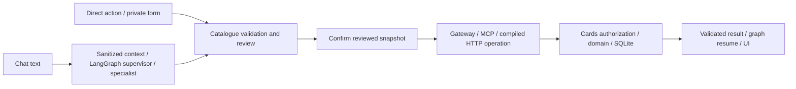

## Set breakpoints in execution order

Set breakpoints on executable statements inside these functions. Start with rows 1, 5, 8, 11 and 13; expand when a boundary fails. Use the relevant debugger process rather than expecting a single Step Into to cross HTTP.

| Step / process | Function to open | What to inspect / expected behavior |
| --- | --- | --- |
| 1. Browser | [App.choose](../frontend/src/main.tsx#L242)<!-- debug-symbol: ui.App.choose -->, [App.request](../frontend/src/main.tsx#L149)<!-- debug-symbol: ui.App.request --> | `name`, `action.path`, `action.key`; choosing a write starts a fresh conversation and opens its form. |
| 2. Experience | [start](../src/card_chat/experience.py#L325)<!-- debug-symbol: experience.create_app.start -->, [forward](../src/card_chat/experience.py#L222)<!-- debug-symbol: experience.create_app.forward -->, [session](../src/card_chat/experience.py#L77)<!-- debug-symbol: experience.create_app.session --> | Cookie session, Origin/CSRF validation, refreshed claims, downstream path and response status. |
| 3. Agent | [start](../src/card_chat/main.py#L673)<!-- debug-symbol: agent.create_app.start -->, [input_options](../src/card_chat/main.py#L1036)<!-- debug-symbol: agent.create_app.input_options -->, [form_options](../src/card_chat/private_inputs.py#L74)<!-- debug-symbol: private.form_options --> | `cid`, owner, eligible tools, generated private bindings. Conversation creation returns a greeting without model interpretation. |
| 4. Browser → Experience | [App.supply](../frontend/src/main.tsx#L247)<!-- debug-symbol: ui.App.supply -->, [supply_inputs](../src/card_chat/experience.py#L349)<!-- debug-symbol: experience.create_app.supply_inputs --> | `fields` versus `selections`. Protected identifiers travel as bound references; do not substitute arbitrary account numbers. |
| 5. Agent acceptance | [submit_inputs](../src/card_chat/main.py#L1247)<!-- debug-symbol: agent.create_app.submit_inputs -->, [submit](../src/card_chat/main.py#L1201)<!-- debug-symbol: agent.create_app.submit -->, [schedule](../src/card_chat/main.py#L1179)<!-- debug-symbol: agent.create_app.schedule -->, [run_operation](../src/card_chat/main.py#L1131)<!-- debug-symbol: agent.create_app.run_operation --> | Browser request key, operation `oid`, `kind='inputs'`, stored trace, status. Existing key/body reuses operation; changed body under same key conflicts. |
| 6. Agent review | [structured](../src/card_chat/main.py#L1043)<!-- debug-symbol: agent.create_app.structured -->, [bind](../src/card_chat/private_inputs.py#L16)<!-- debug-symbol: private.bind -->, [resolve](../src/card_chat/private_inputs.py#L26)<!-- debug-symbol: private.resolve -->, [authorise](../src/card_chat/private_inputs.py#L44)<!-- debug-symbol: private.authorise -->, [ToolSpec.validate](../src/card_chat/catalogue.py#L103)<!-- debug-symbol: catalogue.ToolSpec.validate --> | Bound values, schema, `c.draft`, `c.proposal`, fresh `c.review`. Accepted edits invalidate the previous review even if replacement validation fails. No write yet. |
| 7. Browser → Experience | [App.confirm](../frontend/src/main.tsx#L252)<!-- debug-symbol: ui.App.confirm -->, [confirm](../src/card_chat/experience.py#L334)<!-- debug-symbol: experience.create_app.confirm -->, [forward](../src/card_chat/experience.py#L222)<!-- debug-symbol: experience.create_app.forward --> | Review nonce in body; new browser request key for confirmation. |
| 8. Agent confirmation | [submit_confirmation](../src/card_chat/main.py#L1243)<!-- debug-symbol: agent.create_app.submit_confirmation -->, [submit](../src/card_chat/main.py#L1201)<!-- debug-symbol: agent.create_app.submit -->, [run_operation](../src/card_chat/main.py#L1131)<!-- debug-symbol: agent.create_app.run_operation -->, [confirm](../src/card_chat/main.py#L1120)<!-- debug-symbol: agent.create_app.confirm -->, [execute](../src/card_chat/main.py#L357)<!-- debug-symbol: agent.create_app.execute --> | Nonce equality; `submission.tool`, `.arguments`, `.key`, `.attempted`, `.result`. Save exact arguments/key before gateway call. Confirmation does not reinterpret the proposal with the model. |
| 9. Agent transport | [RemoteGateway.execute](../src/card_chat/gateway.py#L82)<!-- debug-symbol: gateway.connect.RemoteGateway.execute -->, [connect.session](../src/card_chat/gateway.py#L51)<!-- debug-symbol: gateway.connect.session -->, [Gateway.execute](../src/card_chat/gateway.py#L27)<!-- debug-symbol: gateway.Gateway.execute --> | Fresh HTTP MCP session and destination token; validated name/arguments; execution key and calling agent in MCP metadata. |
| 10. MCP | [call_tool](../src/card_chat/mcp_server.py#L171)<!-- debug-symbol: mcp.create_server.call_tool -->, [execute](../src/card_chat/mcp_server.py#L72)<!-- debug-symbol: mcp.execute --> | Customer/tool/agent permissions; metadata key; `spec.method`, `spec.path`, body fields and execution headers. The catalogue selects the HTTP operation. |
| 11. Shared HTTP client | [ApiClient.execute_operation](../src/api_client/client.py#L40)<!-- debug-symbol: client.ApiClient.execute_operation --> | Actual URL, request headers/body in debugger, HTTP status, `last_response_headers`. This path does not call `ApiClient.create_card` or `_request`. |
| 12. Cards security + route | [protect.authenticate](../src/card_chat/security.py#L101)<!-- debug-symbol: security.protect.authenticate -->, [trace_request](../src/card_servicing/main.py#L91)<!-- debug-symbol: cards.create_app.trace_request -->, [create_account route](../src/card_servicing/banking.py#L320)<!-- debug-symbol: banking.create_account -->, [customer](../src/card_servicing/banking.py#L269)<!-- debug-symbol: banking.customer -->, [service](../src/card_servicing/banking.py#L262)<!-- debug-symbol: banking.service --> | Service identity, signed customer principal, trace, `AccountCreate`, execution key. BFF refresh reads may hit this process before the mutation. |
| 13. Cards domain | [BankingService.create_account](../src/card_servicing/banking.py#L178)<!-- debug-symbol: banking.BankingService.create_account -->, [BankingService.issue](../src/card_servicing/banking.py#L197)<!-- debug-symbol: banking.BankingService.issue -->, [BankingService.owns](../src/card_servicing/banking.py#L163)<!-- debug-symbol: banking.BankingService.owns --> | Account replay/new account, customer ownership, `body.issue_card`; internal card key is `account:` + account execution key. |
| 14. Cards persistence | [SQLiteCardStore.issue_idempotent](../src/card_servicing/persistence.py#L131)<!-- debug-symbol: store.SQLiteCardStore.issue_idempotent -->, [_create_idempotent](../src/card_servicing/persistence.py#L116)<!-- debug-symbol: store.SQLiteCardStore._create_idempotent -->, [connect](../src/card_servicing/persistence.py#L59)<!-- debug-symbol: store.SQLiteCardStore.connect --> | Writer transaction, prior snapshot, blocked/existing card checks, inserts, return from transaction context commits. Card number is synthetic `SIM-...`; no external issuer is called. |
| 15. Return path | [MCP execute](../src/card_chat/mcp_server.py#L72)<!-- debug-symbol: mcp.execute -->, [Agent execute](../src/card_chat/main.py#L357)<!-- debug-symbol: agent.create_app.execute -->, [AgentOrchestrator.resume_execution](../src/card_chat/agent.py#L245)<!-- debug-symbol: orchestrator.AgentOrchestrator.resume_execution -->, [run_operation](../src/card_chat/main.py#L1131)<!-- debug-symbol: agent.create_app.run_operation -->, [BFF forward](../src/card_chat/experience.py#L222)<!-- debug-symbol: experience.create_app.forward -->, [App.request](../frontend/src/main.tsx#L149)<!-- debug-symbol: ui.App.request --> | Response schema validation, trusted result, graph continuation, durable result, typed BFF response and React state. Only view actions copy account/card lists into `Reply.data`. |

For standalone **Issue new card**, use the same spine, replacing the domain route with [issue_card](../src/card_servicing/banking.py#L334)<!-- debug-symbol: banking.issue_card --> → [BankingService.issue](../src/card_servicing/banking.py#L197)<!-- debug-symbol: banking.BankingService.issue --> → [issue_idempotent](../src/card_servicing/persistence.py#L131)<!-- debug-symbol: store.SQLiteCardStore.issue_idempotent -->. Agent also checks blocked-card facts and execution policy: inspect [check_account_has_blocked](../src/card_chat/main.py#L217)<!-- debug-symbol: agent.create_app.check_account_has_blocked --> and `policy_evaluator.validate_execution` inside `execute`. Optional issuance inside account creation goes directly through the Cards domain service; it is not a second Agent `issue_card` tool call.

<details>
<summary>Registration / login breakpoints</summary>

[App.authenticate](../frontend/src/main.tsx#L262)<!-- debug-symbol: ui.App.authenticate --> → [register_customer](../src/card_chat/experience.py#L197)<!-- debug-symbol: experience.create_app.register_customer --> or [password_login](../src/card_chat/experience.py#L201)<!-- debug-symbol: experience.create_app.password_login --> → [credentials](../src/card_chat/experience.py#L173)<!-- debug-symbol: experience.create_app.credentials --> → [banking_request](../src/card_chat/experience.py#L151)<!-- debug-symbol: experience.create_app.banking_request --> → [register route](../src/card_servicing/banking.py#L284)<!-- debug-symbol: banking.register --> / [login route](../src/card_servicing/banking.py#L291)<!-- debug-symbol: banking.login --> → [BankingService.register](../src/card_servicing/banking.py#L131)<!-- debug-symbol: banking.BankingService.register --> / [BankingService.login](../src/card_servicing/banking.py#L144)<!-- debug-symbol: banking.BankingService.login -->. Inspect session rotation and expiry; passwords are scrypt-hashed in Cards. Credentials stay out of conversation/model/tool arguments.

</details>

## Add the chat interpretation path

For typed requests, insert this chain before review. These are the primary application-owned interpretation methods; graph routing may repeat nodes and policy branches vary by state.

1. [App.submit](../frontend/src/main.tsx#L257)<!-- debug-symbol: ui.App.submit --> → [Experience.message](../src/card_chat/experience.py#L329)<!-- debug-symbol: experience.create_app.message --> → `forward` → [Agent.submit_message](../src/card_chat/main.py#L1239)<!-- debug-symbol: agent.create_app.submit_message --> → `submit` → `run_operation` → [Agent.message](../src/card_chat/main.py#L787)<!-- debug-symbol: agent.create_app.message -->.
2. `message` sanitizes private text, prepares a permitted tool/context projection, and calls [AgentOrchestrator.interpret_turn](../src/card_chat/agent.py#L155)<!-- debug-symbol: orchestrator.AgentOrchestrator.interpret_turn -->.
3. Inspect the graph built by [create_banking_workflow](../src/card_chat/orchestration/graph.py#L235)<!-- debug-symbol: graph.create_banking_workflow -->: [SupervisorAgent.plan_or_route](../src/card_chat/orchestration/supervisor.py#L177)<!-- debug-symbol: supervisor.SupervisorAgent.plan_or_route --> and [_classify_and_plan](../src/card_chat/orchestration/supervisor.py#L818)<!-- debug-symbol: supervisor.SupervisorAgent._classify_and_plan --> route to [CardsSpecialistNode.execute](../src/card_chat/orchestration/specialists.py#L55)<!-- debug-symbol: specialist.CardsSpecialistNode.execute -->, potentially through [CardServicingAgent.interpret_turn](../src/card_chat/agent.py#L25)<!-- debug-symbol: orchestrator.CardServicingAgent.interpret_turn --> and [AnthropicModel.turn](../src/card_chat/provider.py#L62)<!-- debug-symbol: provider.AnthropicModel.turn --> or [StubModel.turn](../src/card_chat/provider.py#L212)<!-- debug-symbol: provider.StubModel.turn -->. Stub-specific branches can prepare proposals without this specialist provider call.
4. Watch `planned_intents`, `active_agent`, `verified_draft`, `proposed_tool`, `policy_evaluation` and `final_response`. The thread key is `owner:cid`. Inspect graph state with `await app.state.orchestrator.workflow.aget_state({'configurable': {'thread_id': f'{owner()}:{cid}'}})` in a suitable async debugging context, or inspect existing local `snapshot` variables.
5. Back in `message`, an `issue_card` proposal with no owned accounts switches to the `create_account` form. Missing/private details open the appropriate form; a complete write proposal receives a review nonce. Follow the shared confirmation spine after that.

Policy retrieval and PII add their own branches. See [live policy runtime](live-policy-runtime.md), [model privacy](model-privacy.md), and [LangGraph architecture](langgraph-multi-agent-architecture.md). Qdrant stores policy vectors; it is not the account/card system of record. FinCrime is relevant to blocking/unblocking journeys, not the primary account-creation write.

## Find and follow identifiers

There is no single identifier for a whole browser session.

| Identifier | Where to obtain it | What it connects |
| --- | --- | --- |
| `cid` | Conversation creation JSON `id`; later request URL; React `cid` | Conversation journal and graph thread. |
| `X-Correlation-ID` / `trace_id` | DevTools response headers on successful BFF forwards; Agent operation `trace`; debugger `trace.get()` | Main downstream Agent → MCP → Cards chain for one accepted request. Cards also returns `X-Trace-ID`. |
| Browser `Idempotency-Key` | DevTools request headers; React `pending.key` | Durable operation deduplication by owner + cid + request key. |
| Operation `oid` | `202` JSON `id` / `status_url` / `Location`; Agent operations table; `submit` local | Pending/running/succeeded/failed job. Synchronous success returns a Reply without exposing its operation ID. |
| Execution key | `c.submission['key']` or saved conversation JSON | MCP metadata → Cards HTTP idempotency header. Different from the browser request key. |
| Card persistence key | `customer_sub + ':' + execution_key`; optional account issuance uses `customer_sub + ':account:' + execution_key` | `card_issuance_requests.request_key` and creation snapshot key. |
| Customer / account / card IDs | Verified principal, trusted API result, SQLite relations | Ownership and business state, rather than HTTP attempts. |

**Trace limitations to remember:** [Experience.forward](../src/card_chat/experience.py#L222)<!-- debug-symbol: experience.create_app.forward --> creates a new trace for its Agent call. Its preceding `banking_request` account and card refreshes each create separate traces. Registration also uses a separate `banking_request` trace. Error responses from `forward` and authentication paths do not consistently expose the downstream trace to the browser. If it is absent, break in `forward` before the HTTP call and inspect `headers['X-Correlation-ID']`, or find the Agent `operations.trace` row using cid/request key. For pre-Agent failures, inspect Cards/Experience logs by route and time window. There is no persisted parent/child linkage tying these BFF refresh traces together.

Polling generates fresh BFF/GET traces; an existing operation continues under its original stored trace. Reposting a deduplicated operation can return a stored result under a new HTTP response trace without repeating MCP execution. Use the operation row to find the original execution trace. Telemetry uses custom correlation IDs and independent span IDs; do not assume a complete distributed-tracing waterfall.

## Inspect databases and logs

### Locate the authoritative files

| Store | Native launcher default | Compose location / volume | Inspect |
| --- | --- | --- | --- |
| Cards SQLite (`SQLITE_PATH`) | `data/local/cards.db` | `/data/cards.db`, `cards_data` | `customers`, `accounts`, `banking_requests`, `cards`, `account_cards`, `card_idempotency`, `card_issuance_requests`. |
| Agent SQLite (`AGENT_DB`) | `data/local/agent.db` | `/data/agent.db`, `agent_data` | `conversations`, `operations`, `langgraph_checkpoints`, `langgraph_checkpoint_writes`. |
| Experience SQLite (`SESSION_DB`) | `data/local/sessions.db` | `/data/sessions.db`, `experience_data` | Session existence/expiry; `auth_attempts` throttling. |
| Mongo diagnostics | Normally host `127.0.0.1:27018` | `mongodb:27017`, `mongodb_data` | `card_servicing.application_logs`, `card_servicing.request_traces`. |

Confirm effective settings in [local_service.py](../scripts/local_service.py) and [compose.yaml](../compose.yaml). Direct factory defaults may use `:memory:` for Agent/sessions and `data/cards.db` for Cards; these are not the native launcher's files. Native and Compose data are separate. In a container debugger, inspect its `/data` path rather than the host native database.

Use a SQLite viewer in read-only mode or Python `sqlite3.connect('file:data/local/cards.db?mode=ro', uri=True)` from the repo root. When using SQLite WAL, inspect the live database through SQLite or take a proper SQLite backup; copying only the `.db` file can omit uncheckpointed commits. Never repair a retry by deleting snapshot rows.

The following are read-only queries for a SQLite viewer. Bind `:cid`, `:request_key`, `:customer_id` and `:account_number` to the values captured above; run each query against its stated database.

```sql
-- agent.db: find the original accepted attempt, including its execution trace
SELECT id, cid, kind, request_key, trace, status, error
FROM operations WHERE cid = :cid AND request_key = :request_key;

-- agent.db: inspect only workflow fields, rather than dumping private bindings
SELECT id, owner,
       json_extract(data, '$.proposal.name') AS tool,
       json_extract(data, '$.submission.key') AS execution_key,
       json_extract(data, '$.submission.attempted') AS attempted,
       json_extract(data, '$.submission.result') AS result
FROM conversations WHERE id = :cid;

-- cards.db: account request survived, even if optional card issuance failed
SELECT b.customer_id, b.request_key, a.account_number, a.account_type
FROM banking_requests b JOIN accounts a USING(account_number)
WHERE b.customer_id = :customer_id;

-- cards.db: authoritative card records and managed links
SELECT c.id, c.account_number, c.status, c.created_at, ac.card_id AS linked_card
FROM cards c LEFT JOIN account_cards ac ON ac.card_id = c.id
WHERE c.account_number = :account_number;

-- cards.db: replay decision, including an existing-card outcome
SELECT request_key, card_id, json_extract(response_json, '$.outcome') AS outcome
FROM card_issuance_requests WHERE request_key = :request_key;

-- agent.db: checkpoint metadata; decode state using the saver, not JSON SQL
SELECT thread_id, checkpoint_id, parent_checkpoint_id
FROM langgraph_checkpoints WHERE thread_id = :thread_id
ORDER BY checkpoint_id DESC LIMIT 5;
```

[Journal.save/load](../src/card_chat/durable.py#L28)<!-- debug-symbol: journal.Journal.save --> owns conversation persistence; [DurableSqliteSaver.get_tuple](../src/card_chat/orchestration/persistence.py#L69)<!-- debug-symbol: checkpoints.DurableSqliteSaver.get_tuple --> decodes graph checkpoint blobs. They share the configured file in the normal stack but serve different purposes. Restart resets running journal operations to pending and [recover](../src/card_chat/main.py#L1185)<!-- debug-symbol: agent.create_app.recover --> schedules pending jobs; expired persisted delegation can still fail authorization.

### Search diagnostics

In MongoDB Compass, use the credentials generated in ignored `.env.stack`, authentication database `admin`, and select `card_servicing`. Filter **both** collections with:

```json
{"trace_id": "PASTE_THE_32_CHARACTER_TRACE_ID"}
```

If unavailable, first filter request traces by `service` (`experience`, `agent`, `mcp`, `cards`), `route`, and a narrow time window. Inspect actual document timestamps before constructing a time filter. Request traces contain route templates, status and duration. Application events include `tool_execution`, `workflow_usage`, `model_usage`, supervisor/handoff/transitions, `account_creation_completed`, and standalone issuance events such as `card_created`, `card_replayed`, `card_already_exists`. Optional internal issuance does not call the standalone HTTP route's diagnostic function; do not require its `card_created` event as proof of success.

```powershell
docker compose --env-file .env --env-file .env.stack -f compose.yaml logs --since 10m experience cards-agent mcp-server cards-api
```

For native runs use the service debug terminals; ordinary exception logs may contain context that the structured Mongo sink deliberately excludes. For startup/attach trouble see [Docker debugging](docker-debugging.md); `data/debug-stack-build.log` concerns stack preparation/builds, not a business transaction ledger.

[instrument/request_trace](../src/card_chat/observability.py#L86)<!-- debug-symbol: telemetry.instrument.request_trace -->, [DiagnosticHandler.emit](../src/card_chat/observability.py#L26)<!-- debug-symbol: telemetry.DiagnosticHandler.emit -->, [Cards trace_request](../src/card_servicing/main.py#L91)<!-- debug-symbol: cards.create_app.trace_request -->, and [MongoTelemetry](../src/card_servicing/telemetry.py) explain what is exported. Logs are queued, best effort, and have a seven-day TTL in Mongo. Missing logs do not prove missing writes. `TELEMETRY_SINK=stdout` sends structured diagnostics to console; `none` disables them. See [Mongo logging](mongodb-logging.md) for connectivity and the synthetic round-trip check. Avoid exporting session contents, signed delegation, credentials or private binding values when sharing evidence.

## Diagnose a failed request

Find the **first boundary whose output differs from expectation**, then inspect its input and the next layer. Capture time, mode, action, cid, browser key, operation ID/trace, execution key and status before retrying.

| Symptom | First useful checks | Recovery / interpretation |
| --- | --- | --- |
| Review click never reaches Python | `App.supply`, Network, required field validation, selected tool, `busy` / `pending` | A browser form can prevent submission. `choose` alone opens a write form; it does not execute it. |
| Breakpoint stays hollow / never hits | Correct local versus Docker launch, attached process, source mapping, actual route | Use [debug setup](getting-started.md); startup does not hit request handlers. |
| 401 / 403 before Agent | Experience `session`, Origin/CSRF, session expiry; BFF refresh calls | Log in again for expired sessions; check `PUBLIC_ORIGIN` and refreshed ownership. A failed refresh can prevent Agent submission entirely. |
| 401 / 403 at service hop | `protect.authenticate`, `Security.verify`, `Security.customer`, `Security.headers` | Check audience, client, scopes, delegation keys/expiry and Identity availability. Direct browser auth is not a downstream service token. |
| 422 on form | `structured`, `resolve`, `authorise`, `ToolSpec.validate`; `AccountCreate`/`CardIssue` | Use current bound selections, supported account types and strict additional-card boolean. Refresh form/new workflow if references are stale. Raw validation details are intentionally suppressed. |
| 409 at confirmation | `confirm`: posted versus current review; `submit`: request hash | Re-read latest review. Same browser key with a changed body conflicts; changing the review must not reuse the old confirmation. |
| 409 at Cards | Account fingerprint or issuance fingerprint for execution key | Keep key and exact body for a retry. A genuinely different action needs a new workflow/key. |
| HTTP 200 but no new card | Standalone issuance outcome `already_exists` | Successful protection against duplicate ordinary cards. Explicit additional issuance requires a new reviewed workflow. |
| Issuance blocked | Agent policy/facts, blocked card records; store `BlockedCardExists` | Inspect account card statuses and resolve the blocked-card journey. The backend also enforces this rule. |
| Timeout / 503 / uncertain outcome | `ApiClient.execute_operation`, MCP `execute`, Agent `submission`; Cards DB snapshots | A response failure can occur after commit. Retry the **same submission** with its durable execution key; verify business state before a new workflow. |
| Account exists, card absent | `banking_requests`, `accounts`, optional issuance key and snapshot | Account commit precedes optional issuance. Retry the original account action/key to finish issuance without a second account. This is not an all-or-nothing account-plus-card transaction. |
| 202 stays pending/running | Operation row, `schedule`, worker lock, `run_operation`, delegation expiry | A paused debugger can hold the single worker lock and delay other operations. Continue worker and poll. Check recovery after restart. |
| Job says succeeded, UI says execution failed | Operation result message and `c.submission.result`; MCP `ok` | Agent can return a normal Reply describing a failed tool execution. Job success means the handler completed, not necessarily a successful business mutation. |
| HTTP success but UI lacks data | MCP response validation, BFF typed Reply, `App.request`, view action | Account creation returns the account summary. Use view actions for lists; check React state before concluding persistence failed. |
| Mongo empty / unavailable | Effective sink, queue, credentials/volume, fallback console | SQLite remains authoritative; logging failure does not block Cards readiness. |
| SQLite unavailable / locked | Effective path, permissions, mounted volume, long paused writer transaction | `storage_operation` translates SQLite/OS/value failures to `StorageUnavailable`; Cards returns sanitized 503. Inspect at the adapter boundary with caught-exception breakpoints. |
| Chat fails but forms work | `message`, supervisor/specialist state, provider configuration, PII/policy branches | Narrow to interpretation rather than re-debugging database writes. Stub behavior differs from the hosted provider. |

**Two retry levels:** browser **Retry same submission** reuses the pending HTTP key/body. Reconfirming a reviewed action after a tool failure may create a new browser operation, but Agent reuses its saved execution key and arguments. Replaying the same already-completed browser operation returns its stored Reply; it does not necessarily attempt the tool again. A fixed `c.submission` cannot be edited into a different write. Start a new workflow only for a genuinely new intent.

Keep pauses short at transactions and network boundaries: BFF forwards use a 120-second HTTP timeout; banking refreshes use 30 seconds. Other client/proxy timeouts can fire sooner. After a timeout inspect durable state, continue all paused processes, then use the appropriate retry level.

## Explain the design in a code review

Use this as a hands-on demonstration:

1. Stop at `structured`: explain private bindings, ownership and the review nonce; show that no account has been written.
2. Stop at Agent `execute`: distinguish the browser operation key from the saved execution key and show persistence before effects.
3. Stop at MCP `execute`: show catalogue-selected method/path and validation, rather than model-selected arbitrary HTTP.
4. Stop in `BankingService.create_account`: show the account commit boundary and explain recovery of optional issuance.
5. Stop in `issue_idempotent`: show `BEGIN IMMEDIATE`, ownership, replay before existence checks, blocked-card protection and snapshots.
6. Demonstrate ordinary issuance returning an existing card, then inspect the operation trace and database links.

For another deterministic use case, keep the UI/BFF/operation/confirmation/MCP/client spine and follow its entry in [tools.json](../src/card_chat/tools.json), [catalogue compilation](../src/card_chat/catalogue.py#L141)<!-- debug-symbol: catalogue.compile_entry -->, and its API route/domain adapter. Safe read actions skip write confirmation; block/unblock and compound replacement introduce different domain/policy paths. Do not assume every tool has the same retry guarantees: inspect `ToolSpec.safe_retry` and the catalogue's idempotency configuration.

Executable examples to read alongside the guide: [banking flows](../tests/test_banking.py), [issuance/replay/concurrency](../tests/test_card_issuance.py), [HTTP service boundaries](../tests/test_http_services.py), [idempotency](../tests/test_idempotency.py), and [observability](../tests/test_service_observability.py).

To run the focused regression suite in an installed development environment:

```powershell
.\.venv\Scripts\python.exe -m pytest -q tests/test_banking.py tests/test_card_issuance.py tests/test_http_services.py tests/test_idempotency.py tests/test_service_observability.py
```

When changing routes, method names, schema or retry semantics, update this walkthrough and its source anchors alongside the change. The source functions and tests remain the authority.
