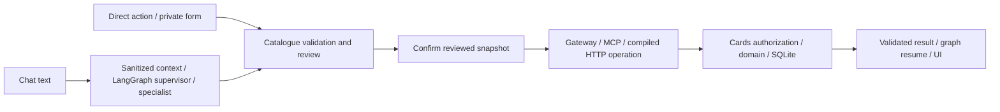

# Debug an account and card from browser to database

Source walkthrough checked against this checkout on **17 November 2026**. Start with one concrete journey, then reuse the shared request spine for other actions. This guide describes code inspection; it does not claim a live stack run.

## Navigate

- [Run the walkthrough](#run-the-walkthrough)
- [See the whole flow](#see-the-whole-flow)
- [Set breakpoints in execution order](#set-breakpoints-in-execution-order)
- [Add the chat interpretation path](#add-the-chat-interpretation-path)
- [Find and follow identifiers](#find-and-follow-identifiers)
- [Inspect databases and logs](#inspect-databases-and-logs)
- [Diagnose a failed request](#diagnose-a-failed-request)
- [Explain the design in a code review](#explain-the-design-in-a-code-review)

Function labels below link to their current source line. GitHub supports these `#L` anchors; some local Markdown viewers open only the file. In VS Code, use **Go to Symbol in Editor** (`Ctrl+Shift+O`) and the displayed function name if the viewer ignores the anchor. Nested handlers live inside `create_app`; several files contain functions with the same name. Line anchors are navigation aids, not stable identifiers: refresh them after moving code.

## Run the walkthrough

1. Follow [setup and debugging](getting-started.md). Launch **Debug Full Stack (Local)** or **Debug Full Stack (Docker)** from [.vscode/launch.json](../.vscode/launch.json). Open `http://localhost:8080`. Attach all relevant Python processes and the browser debugger before submitting.
2. Register or log in using synthetic credentials. A **customer** is the authenticated identity; an **account** is a separate banking record belonging to that customer.
3. Open browser DevTools **Network**, enable **Preserve log**, and filter for `api/` (include `auth/` when debugging login).
4. Choose **Create account**, enter `transaction` or `savings`, and choose **Yes** for `issue_card`. Click **Review action**. Stop here and inspect the proposal: the write has not happened yet.
5. Confirm. Follow the breakpoint table below through Agent, MCP, Cards and SQLite. This performs one `create_account` tool execution; the Cards domain service internally issues the optional card.
6. Choose **View my accounts**, then **View my cards** to verify both records. The account-creation response returns an account, not an embedded card list; an absent card panel immediately after creation does not prove issuance failed.
7. Choose **Issue new card** for that account, leave additional issuance unset or choose **No**, review and confirm. Expect the existing card with `already_exists`, not another card. Start another workflow and explicitly choose **Yes** for an additional card only when you intend another record.
8. Repeat with **Submit and poll** selected to inspect durable asynchronous acceptance. The unchecked path also uses the durable operation machinery, but waits for its result.

Start with direct actions: they isolate transport, security, confirmation and persistence from language interpretation. Then send “I want to create an account and a card” in a conversation and compare the extra chat path. Provider and policy configuration can change the proposed next step; the reviewed tool and arguments are the execution authority.

## See the whole flow

```mermaid
sequenceDiagram
    actor Customer
    participant UI as React
    participant BFF as Experience
    participant Agent as Agent + journal
    participant MCP as MCP server
    participant API as Cards API
    participant DB as Cards SQLite
    Customer->>UI: Create account
    UI->>BFF: POST /api/conversations
    BFF->>API: Refresh owned accounts/cards
    BFF->>Agent: POST /conversations
    Agent-->>UI: Conversation id (via BFF)
    UI->>BFF: GET /api/conversations/{cid}/inputs
    BFF->>Agent: GET /conversations/{cid}/inputs
    Agent-->>UI: Catalogue forms + bound selections (via BFF)
    Customer->>UI: account_type + issue_card = true; Review
    UI->>BFF: POST .../inputs
    BFF->>Agent: POST .../inputs
    Agent->>Agent: Persist operation; validate; save proposal/review
    Agent-->>UI: Masked review + nonce (via BFF)
    Customer->>UI: Confirm
    UI->>BFF: POST .../confirm
    BFF->>Agent: POST .../confirm
    Agent->>Agent: Persist operation + exact submission/key
    Agent->>MCP: call_tool(create_account, arguments, metadata)
    MCP->>API: POST /banking/accounts + execution key
    API->>DB: Commit account + banking_requests
    API->>DB: Separate card issuance transaction
    DB-->>API: Card + retry snapshots + account link
    API-->>MCP: 201 Account
    MCP-->>Agent: Validated structured result
    Agent->>Agent: Resume graph; commit conversation + operation result
    Agent-->>UI: Reply or polled operation result (via BFF)
```

Each BFF `forward` for a local customer refreshes accounts and cards before contacting Agent, not only the first call shown. Registration is a separate UI → BFF → Cards → SQLite path. No language model or MCP tool processes credentials.



## Set breakpoints in execution order

Set breakpoints on executable statements inside these functions. Start with rows 1, 5, 8, 11 and 13; expand when a boundary fails. Use the relevant debugger process rather than expecting a single Step Into to cross HTTP.

| Step / process | Function to open | What to inspect / expected behavior |
| --- | --- | --- |
| 1. Browser | [App.choose](../frontend/src/main.tsx#L199), [App.request](../frontend/src/main.tsx#L122) | `name`, `action.path`, `action.key`; choosing a write starts a fresh conversation and opens its form. |
| 2. Experience | [start](../src/card_chat/experience.py#L252), [forward](../src/card_chat/experience.py#L212), [session](../src/card_chat/experience.py#L69) | Cookie session, Origin/CSRF validation, refreshed claims, downstream path and response status. |
| 3. Agent | [start](../src/card_chat/main.py#L438), [input_options](../src/card_chat/main.py#L593), [form_options](../src/card_chat/private_inputs.py#L73) | `cid`, owner, eligible tools, generated private bindings. Conversation creation returns a greeting without model interpretation. |
| 4. Browser → Experience | [App.supply](../frontend/src/main.tsx#L229), [supply_inputs](../src/card_chat/experience.py#L276) | `fields` versus `selections`. Protected identifiers travel as bound references; do not substitute arbitrary account numbers. |
| 5. Agent acceptance | [submit_inputs](../src/card_chat/main.py#L786), [submit](../src/card_chat/main.py#L740), [schedule](../src/card_chat/main.py#L718), [run_operation](../src/card_chat/main.py#L669) | Browser request key, operation `oid`, `kind='inputs'`, stored trace, status. Existing key/body reuses operation; changed body under same key conflicts. |
| 6. Agent review | [structured](../src/card_chat/main.py#L600), [bind](../src/card_chat/private_inputs.py#L15), [resolve](../src/card_chat/private_inputs.py#L25), [authorise](../src/card_chat/private_inputs.py#L43), [ToolSpec.validate](../src/card_chat/catalogue.py#L102) | Bound values, schema, `c.draft`, `c.proposal`, fresh `c.review`. Accepted edits invalidate the previous review even if replacement validation fails. No write yet. |
| 7. Browser → Experience | [App.confirm](../frontend/src/main.tsx#L224), [confirm](../src/card_chat/experience.py#L261), [forward](../src/card_chat/experience.py#L212) | Review nonce in body; new browser request key for confirmation. |
| 8. Agent confirmation | [submit_confirmation](../src/card_chat/main.py#L782), [submit](../src/card_chat/main.py#L740), [run_operation](../src/card_chat/main.py#L669), [confirm](../src/card_chat/main.py#L659), [execute](../src/card_chat/main.py#L263) | Nonce equality; `submission.tool`, `.arguments`, `.key`, `.attempted`, `.result`. Save exact arguments/key before gateway call. Confirmation does not reinterpret the proposal with the model. |
| 9. Agent transport | [RemoteGateway.execute](../src/card_chat/gateway.py#L68), [connect.session](../src/card_chat/gateway.py#L47), [Gateway.execute](../src/card_chat/gateway.py#L26) | Fresh HTTP MCP session and destination token; validated name/arguments; execution key and calling agent in MCP metadata. |
| 10. MCP | [call_tool](../src/card_chat/mcp_server.py#L169), [execute](../src/card_chat/mcp_server.py#L71) | Customer/tool/agent permissions; metadata key; `spec.method`, `spec.path`, body fields and execution headers. The catalogue selects the HTTP operation. |
| 11. Shared HTTP client | [ApiClient.execute_operation](../src/api_client/client.py#L37) | Actual URL, request headers/body in debugger, HTTP status, `last_response_headers`. This path does not call `ApiClient.create_card` or `_request`. |
| 12. Cards security + route | [protect.authenticate](../src/card_chat/security.py#L99), [trace_request](../src/card_servicing/main.py#L90), [create_account route](../src/card_servicing/banking.py#L252), [customer](../src/card_servicing/banking.py#L201), [service](../src/card_servicing/banking.py#L194) | Service identity, signed customer principal, trace, `AccountCreate`, execution key. BFF refresh reads may hit this process before the mutation. |
| 13. Cards domain | [BankingService.create_account](../src/card_servicing/banking.py#L112), [BankingService.issue](../src/card_servicing/banking.py#L131), [BankingService.owns](../src/card_servicing/banking.py#L97) | Account replay/new account, customer ownership, `body.issue_card`; internal card key is `account:` + account execution key. |
| 14. Cards persistence | [SQLiteCardStore.issue_idempotent](../src/card_servicing/persistence.py#L130), [_create_idempotent](../src/card_servicing/persistence.py#L114), [connect](../src/card_servicing/persistence.py#L58) | Writer transaction, prior snapshot, blocked/existing card checks, inserts, return from transaction context commits. Card number is synthetic `SIM-...`; no external issuer is called. |
| 15. Return path | [MCP execute](../src/card_chat/mcp_server.py#L71), [Agent execute](../src/card_chat/main.py#L263), [AgentOrchestrator.resume_execution](../src/card_chat/agent.py#L208), [run_operation](../src/card_chat/main.py#L669), [BFF forward](../src/card_chat/experience.py#L212), [App.request](../frontend/src/main.tsx#L122) | Response schema validation, trusted result, graph continuation, durable result, typed BFF response and React state. Only view actions copy account/card lists into `Reply.data`. |

For standalone **Issue new card**, use the same spine, replacing the domain route with [issue_card](../src/card_servicing/banking.py#L266) → [BankingService.issue](../src/card_servicing/banking.py#L131) → [issue_idempotent](../src/card_servicing/persistence.py#L130). Agent also checks blocked-card facts and execution policy: inspect [check_account_has_blocked](../src/card_chat/main.py#L193) and `policy_evaluator.validate_execution` inside `execute`. Optional issuance inside account creation goes directly through the Cards domain service; it is not a second Agent `issue_card` tool call.

<details>
<summary>Registration / login breakpoints</summary>

[App.authenticate](../frontend/src/main.tsx#L246) → [register_customer](../src/card_chat/experience.py#L187) or [password_login](../src/card_chat/experience.py#L191) → [credentials](../src/card_chat/experience.py#L163) → [banking_request](../src/card_chat/experience.py#L143) → [register route](../src/card_servicing/banking.py#L216) / [login route](../src/card_servicing/banking.py#L223) → [BankingService.register](../src/card_servicing/banking.py#L65) / [BankingService.login](../src/card_servicing/banking.py#L78). Inspect session rotation and expiry; passwords are scrypt-hashed in Cards. Credentials stay out of conversation/model/tool arguments.

</details>

## Add the chat interpretation path

For typed requests, insert this chain before review. These are the primary application-owned interpretation methods; graph routing may repeat nodes and policy branches vary by state.

1. [App.submit](../frontend/src/main.tsx#L209) → [Experience.message](../src/card_chat/experience.py#L256) → `forward` → [Agent.submit_message](../src/card_chat/main.py#L778) → `submit` → `run_operation` → [Agent.message](../src/card_chat/main.py#L445).
2. `message` sanitizes private text, prepares a permitted tool/context projection, and calls [AgentOrchestrator.interpret_turn](../src/card_chat/agent.py#L125).
3. Inspect the graph built by [create_banking_workflow](../src/card_chat/orchestration/graph.py#L162): [SupervisorAgent.plan_or_route](../src/card_chat/orchestration/supervisor.py#L124) and [_classify_and_plan](../src/card_chat/orchestration/supervisor.py#L488) route to [CardsSpecialistNode.execute](../src/card_chat/orchestration/specialists.py#L54), potentially through [CardServicingAgent.interpret_turn](../src/card_chat/agent.py#L22) and [AnthropicModel.turn](../src/card_chat/provider.py#L28) or [StubModel.turn](../src/card_chat/provider.py#L97). Stub-specific branches can prepare proposals without this specialist provider call.
4. Watch `planned_intents`, `active_agent`, `verified_draft`, `proposed_tool`, `policy_evaluation` and `final_response`. The thread key is `owner:cid`. Inspect graph state with `await app.state.orchestrator.workflow.aget_state({'configurable': {'thread_id': f'{owner()}:{cid}'}})` in a suitable async debugging context, or inspect existing local `snapshot` variables.
5. Back in `message`, an `issue_card` proposal with no owned accounts switches to the `create_account` form. Missing/private details open the appropriate form; a complete write proposal receives a review nonce. Follow the shared confirmation spine after that.

Policy retrieval and PII add their own branches. See [live policy runtime](live-policy-runtime.md), [model privacy](model-privacy.md), and [LangGraph architecture](langgraph-multi-agent-architecture.md). Qdrant stores policy vectors; it is not the account/card system of record. FinCrime is relevant to blocking/unblocking journeys, not the primary account-creation write.

## Find and follow identifiers

There is no single identifier for a whole browser session.

| Identifier | Where to obtain it | What it connects |
| --- | --- | --- |
| `cid` | Conversation creation JSON `id`; later request URL; React `cid` | Conversation journal and graph thread. |
| `X-Correlation-ID` / `trace_id` | DevTools response headers on successful BFF forwards; Agent operation `trace`; debugger `trace.get()` | Main downstream Agent → MCP → Cards chain for one accepted request. Cards also returns `X-Trace-ID`. |
| Browser `Idempotency-Key` | DevTools request headers; React `pending.key` | Durable operation deduplication by owner + cid + request key. |
| Operation `oid` | `202` JSON `id` / `status_url` / `Location`; Agent operations table; `submit` local | Pending/running/succeeded/failed job. Synchronous success returns a Reply without exposing its operation ID. |
| Execution key | `c.submission['key']` or saved conversation JSON | MCP metadata → Cards HTTP idempotency header. Different from the browser request key. |
| Card persistence key | `customer_sub + ':' + execution_key`; optional account issuance uses `customer_sub + ':account:' + execution_key` | `card_issuance_requests.request_key` and creation snapshot key. |
| Customer / account / card IDs | Verified principal, trusted API result, SQLite relations | Ownership and business state, rather than HTTP attempts. |

**Trace limitations to remember:** [Experience.forward](../src/card_chat/experience.py#L212) creates a new trace for its Agent call. Its preceding `banking_request` account and card refreshes each create separate traces. Registration also uses a separate `banking_request` trace. Error responses from `forward` and authentication paths do not consistently expose the downstream trace to the browser. If it is absent, break in `forward` before the HTTP call and inspect `headers['X-Correlation-ID']`, or find the Agent `operations.trace` row using cid/request key. For pre-Agent failures, inspect Cards/Experience logs by route and time window. There is no persisted parent/child linkage tying these BFF refresh traces together.

Polling generates fresh BFF/GET traces; an existing operation continues under its original stored trace. Reposting a deduplicated operation can return a stored result under a new HTTP response trace without repeating MCP execution. Use the operation row to find the original execution trace. Telemetry uses custom correlation IDs and independent span IDs; do not assume a complete distributed-tracing waterfall.

## Inspect databases and logs

### Locate the authoritative files

| Store | Native launcher default | Compose location / volume | Inspect |
| --- | --- | --- | --- |
| Cards SQLite (`SQLITE_PATH`) | `data/local/cards.db` | `/data/cards.db`, `cards_data` | `customers`, `accounts`, `banking_requests`, `cards`, `account_cards`, `card_idempotency`, `card_issuance_requests`. |
| Agent SQLite (`AGENT_DB`) | `data/local/agent.db` | `/data/agent.db`, `agent_data` | `conversations`, `operations`, `langgraph_checkpoints`, `langgraph_checkpoint_writes`. |
| Experience SQLite (`SESSION_DB`) | `data/local/sessions.db` | `/data/sessions.db`, `experience_data` | Session existence/expiry; `auth_attempts` throttling. |
| Mongo diagnostics | Normally host `127.0.0.1:27018` | `mongodb:27017`, `mongodb_data` | `card_servicing.application_logs`, `card_servicing.request_traces`. |

Confirm effective settings in [local_service.py](../scripts/local_service.py) and [compose.yaml](../compose.yaml). Direct factory defaults may use `:memory:` for Agent/sessions and `data/cards.db` for Cards; these are not the native launcher's files. Native and Compose data are separate. In a container debugger, inspect its `/data` path rather than the host native database.

Use a SQLite viewer in read-only mode or Python `sqlite3.connect('file:data/local/cards.db?mode=ro', uri=True)` from the repo root. When using SQLite WAL, inspect the live database through SQLite or take a proper SQLite backup; copying only the `.db` file can omit uncheckpointed commits. Never repair a retry by deleting snapshot rows.

The following are read-only queries for a SQLite viewer. Bind `:cid`, `:request_key`, `:customer_id` and `:account_number` to the values captured above; run each query against its stated database.

```sql
-- agent.db: find the original accepted attempt, including its execution trace
SELECT id, cid, kind, request_key, trace, status, error
FROM operations WHERE cid = :cid AND request_key = :request_key;

-- agent.db: inspect only workflow fields, rather than dumping private bindings
SELECT id, owner,
       json_extract(data, '$.proposal.name') AS tool,
       json_extract(data, '$.submission.key') AS execution_key,
       json_extract(data, '$.submission.attempted') AS attempted,
       json_extract(data, '$.submission.result') AS result
FROM conversations WHERE id = :cid;

-- cards.db: account request survived, even if optional card issuance failed
SELECT b.customer_id, b.request_key, a.account_number, a.account_type
FROM banking_requests b JOIN accounts a USING(account_number)
WHERE b.customer_id = :customer_id;

-- cards.db: authoritative card records and managed links
SELECT c.id, c.account_number, c.status, c.created_at, ac.card_id AS linked_card
FROM cards c LEFT JOIN account_cards ac ON ac.card_id = c.id
WHERE c.account_number = :account_number;

-- cards.db: replay decision, including an existing-card outcome
SELECT request_key, card_id, json_extract(response_json, '$.outcome') AS outcome
FROM card_issuance_requests WHERE request_key = :request_key;

-- agent.db: checkpoint metadata; decode state using the saver, not JSON SQL
SELECT thread_id, checkpoint_id, parent_checkpoint_id
FROM langgraph_checkpoints WHERE thread_id = :thread_id
ORDER BY checkpoint_id DESC LIMIT 5;
```

[Journal.save/load](../src/card_chat/durable.py#L27) owns conversation persistence; [DurableSqliteSaver.get_tuple](../src/card_chat/orchestration/persistence.py#L68) decodes graph checkpoint blobs. They share the configured file in the normal stack but serve different purposes. Restart resets running journal operations to pending and [recover](../src/card_chat/main.py#L724) schedules pending jobs; expired persisted delegation can still fail authorization.

### Search diagnostics

In MongoDB Compass, use the credentials generated in ignored `.env.stack`, authentication database `admin`, and select `card_servicing`. Filter **both** collections with:

```json
{"trace_id": "PASTE_THE_32_CHARACTER_TRACE_ID"}
```

If unavailable, first filter request traces by `service` (`experience`, `agent`, `mcp`, `cards`), `route`, and a narrow time window. Inspect actual document timestamps before constructing a time filter. Request traces contain route templates, status and duration. Application events include `tool_execution`, `workflow_usage`, `model_usage`, supervisor/handoff/transitions, `account_creation_completed`, and standalone issuance events such as `card_created`, `card_replayed`, `card_already_exists`. Optional internal issuance does not call the standalone HTTP route's diagnostic function; do not require its `card_created` event as proof of success.

```powershell
docker compose --env-file .env --env-file .env.stack -f compose.yaml logs --since 10m experience cards-agent mcp-server cards-api
```

For native runs use the service debug terminals; ordinary exception logs may contain context that the structured Mongo sink deliberately excludes. For startup/attach trouble see [Docker debugging](docker-debugging.md); `data/debug-stack-build.log` concerns stack preparation/builds, not a business transaction ledger.

[instrument/request_trace](../src/card_chat/observability.py#L83), [DiagnosticHandler.emit](../src/card_chat/observability.py#L24), [Cards trace_request](../src/card_servicing/main.py#L90), and [MongoTelemetry](../src/card_servicing/telemetry.py#L83) explain what is exported. Logs are queued, best effort, and have a seven-day TTL in Mongo. Missing logs do not prove missing writes. `TELEMETRY_SINK=stdout` sends structured diagnostics to console; `none` disables them. See [Mongo logging](mongodb-logging.md) for connectivity and the synthetic round-trip check. Avoid exporting session contents, signed delegation, credentials or private binding values when sharing evidence.

## Diagnose a failed request

Find the **first boundary whose output differs from expectation**, then inspect its input and the next layer. Capture time, mode, action, cid, browser key, operation ID/trace, execution key and status before retrying.

| Symptom | First useful checks | Recovery / interpretation |
| --- | --- | --- |
| Review click never reaches Python | `App.supply`, Network, required field validation, selected tool, `busy` / `pending` | A browser form can prevent submission. `choose` alone opens a write form; it does not execute it. |
| Breakpoint stays hollow / never hits | Correct local versus Docker launch, attached process, source mapping, actual route | Use [debug setup](getting-started.md); startup does not hit request handlers. |
| 401 / 403 before Agent | Experience `session`, Origin/CSRF, session expiry; BFF refresh calls | Log in again for expired sessions; check `PUBLIC_ORIGIN` and refreshed ownership. A failed refresh can prevent Agent submission entirely. |
| 401 / 403 at service hop | `protect.authenticate`, `Security.verify`, `Security.customer`, `Security.headers` | Check audience, client, scopes, delegation keys/expiry and Identity availability. Direct browser auth is not a downstream service token. |
| 422 on form | `structured`, `resolve`, `authorise`, `ToolSpec.validate`; `AccountCreate`/`CardIssue` | Use current bound selections, supported account types and strict additional-card boolean. Refresh form/new workflow if references are stale. Raw validation details are intentionally suppressed. |
| 409 at confirmation | `confirm`: posted versus current review; `submit`: request hash | Re-read latest review. Same browser key with a changed body conflicts; changing the review must not reuse the old confirmation. |
| 409 at Cards | Account fingerprint or issuance fingerprint for execution key | Keep key and exact body for a retry. A genuinely different action needs a new workflow/key. |
| HTTP 200 but no new card | Standalone issuance outcome `already_exists` | Successful protection against duplicate ordinary cards. Explicit additional issuance requires a new reviewed workflow. |
| Issuance blocked | Agent policy/facts, blocked card records; store `BlockedCardExists` | Inspect account card statuses and resolve the blocked-card journey. The backend also enforces this rule. |
| Timeout / 503 / uncertain outcome | `ApiClient.execute_operation`, MCP `execute`, Agent `submission`; Cards DB snapshots | A response failure can occur after commit. Retry the **same submission** with its durable execution key; verify business state before a new workflow. |
| Account exists, card absent | `banking_requests`, `accounts`, optional issuance key and snapshot | Account commit precedes optional issuance. Retry the original account action/key to finish issuance without a second account. This is not an all-or-nothing account-plus-card transaction. |
| 202 stays pending/running | Operation row, `schedule`, worker lock, `run_operation`, delegation expiry | A paused debugger can hold the single worker lock and delay other operations. Continue worker and poll. Check recovery after restart. |
| Job says succeeded, UI says execution failed | Operation result message and `c.submission.result`; MCP `ok` | Agent can return a normal Reply describing a failed tool execution. Job success means the handler completed, not necessarily a successful business mutation. |
| HTTP success but UI lacks data | MCP response validation, BFF typed Reply, `App.request`, view action | Account creation returns the account summary. Use view actions for lists; check React state before concluding persistence failed. |
| Mongo empty / unavailable | Effective sink, queue, credentials/volume, fallback console | SQLite remains authoritative; logging failure does not block Cards readiness. |
| SQLite unavailable / locked | Effective path, permissions, mounted volume, long paused writer transaction | `storage_operation` translates SQLite/OS/value failures to `StorageUnavailable`; Cards returns sanitized 503. Inspect at the adapter boundary with caught-exception breakpoints. |
| Chat fails but forms work | `message`, supervisor/specialist state, provider configuration, PII/policy branches | Narrow to interpretation rather than re-debugging database writes. Stub behavior differs from the hosted provider. |

**Two retry levels:** browser **Retry same submission** reuses the pending HTTP key/body. Reconfirming a reviewed action after a tool failure may create a new browser operation, but Agent reuses its saved execution key and arguments. Replaying the same already-completed browser operation returns its stored Reply; it does not necessarily attempt the tool again. A fixed `c.submission` cannot be edited into a different write. Start a new workflow only for a genuinely new intent.

Keep pauses short at transactions and network boundaries: BFF forwards use a 120-second HTTP timeout; banking refreshes use 30 seconds. Other client/proxy timeouts can fire sooner. After a timeout inspect durable state, continue all paused processes, then use the appropriate retry level.

## Explain the design in a code review

Use this as a hands-on demonstration:

1. Stop at `structured`: explain private bindings, ownership and the review nonce; show that no account has been written.
2. Stop at Agent `execute`: distinguish the browser operation key from the saved execution key and show persistence before effects.
3. Stop at MCP `execute`: show catalogue-selected method/path and validation, rather than model-selected arbitrary HTTP.
4. Stop in `BankingService.create_account`: show the account commit boundary and explain recovery of optional issuance.
5. Stop in `issue_idempotent`: show `BEGIN IMMEDIATE`, ownership, replay before existence checks, blocked-card protection and snapshots.
6. Demonstrate ordinary issuance returning an existing card, then inspect the operation trace and database links.

For another deterministic use case, keep the UI/BFF/operation/confirmation/MCP/client spine and follow its entry in [tools.json](../src/card_chat/tools.json), [catalogue compilation](../src/card_chat/catalogue.py#L140), and its API route/domain adapter. Safe read actions skip write confirmation; block/unblock and compound replacement introduce different domain/policy paths. Do not assume every tool has the same retry guarantees: inspect `ToolSpec.safe_retry` and the catalogue's idempotency configuration.

Executable examples to read alongside the guide: [banking flows](../tests/test_banking.py), [issuance/replay/concurrency](../tests/test_card_issuance.py), [HTTP service boundaries](../tests/test_http_services.py), [idempotency](../tests/test_idempotency.py), and [observability](../tests/test_service_observability.py).

To run the focused regression suite in an installed development environment:

```powershell
.\.venv\Scripts\python.exe -m pytest -q tests/test_banking.py tests/test_card_issuance.py tests/test_http_services.py tests/test_idempotency.py tests/test_service_observability.py
```

When changing routes, method names, schema or retry semantics, update this walkthrough and its source anchors alongside the change. The source functions and tests remain the authority.
