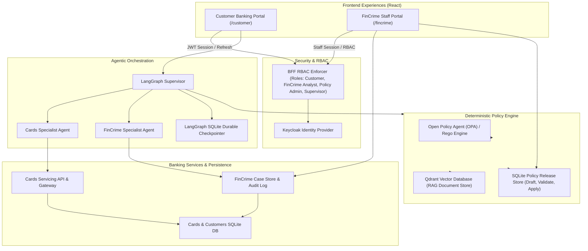
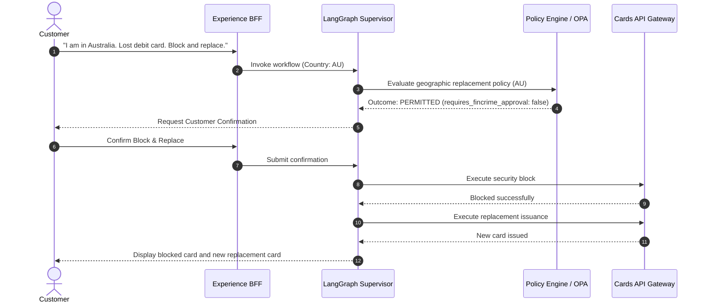
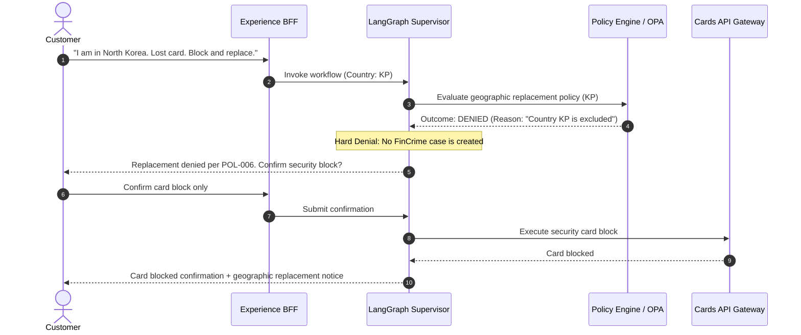
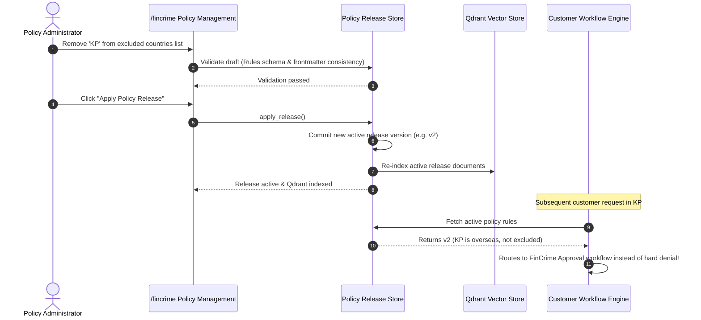

# FinCrime Staff Portal, Dynamic Policy Engine & Human-in-the-Loop Approval Demo

This guide documents the enterprise-grade FinCrime staff portal, dynamic Qdrant/OPA policy management, and LangGraph Human-in-the-Loop (HITL) approval architecture integrated into **CardServicing**.

---

## 1. Executive Summary & Core Architecture

The enhanced CardServicing system demonstrates how enterprise banking operations can govern customer-facing agentic AI using deterministic policy evaluation, durable checkpoints, and live policy release cycles without restarting backend services.

### Core Architecture



---

## 2. Key Customer & FinCrime Workflows

### Scenario A — Domestic Card Replacement (Australia / AU)
AU is designated as the domestic home country (`home_country_code = "AU"`). Replacement requests for AU customers are eligible for automated replacement after standard customer confirmation.



---

### Scenario B — Overseas Permitted Replacement & Staff HITL (New Zealand / NZ)
NZ is classified as overseas (`NZ != AU`). Overseas replacements require FinCrime staff approval under `POL-006` and `geographic-replacement-rules.json`. Card blocking is executed immediately; card replacement is suspended at a durable LangGraph checkpoint awaiting staff review.

```mermaid
sequenceDiagram
    autonumber
    actor Customer
    participant BFF as Experience BFF
    participant LG as LangGraph Supervisor
    participant CaseStore as FinCrime Case Store
    actor Analyst as FinCrime Analyst
    participant Gateway as Cards API Gateway

    Customer->>BFF: "I am in New Zealand. Lost card. Block and replace."
    BFF->>LG: Invoke workflow (Country: NZ)
    LG->>LG: Extract country = NZ (Overseas, Not Excluded)
    LG->>CaseStore: Create FinCrime Case (Status: PENDING_APPROVAL)
    LG->>LG: Execute LangGraph interrupt() (State checkpointed)
    LG->>Gateway: Execute immediate security block
    LG-->>Customer: Card blocked; "Replacement pending FinCrime approval"
    
    Analyst->>BFF: View Pending Cases in /fincrime
    BFF->>CaseStore: List pending cases (Masked identifiers)
    CaseStore-->>Analyst: Case details & Policy Citations
    Analyst->>BFF: Submit Approval (Reason: "Verified customer travel")
    BFF->>LG: Resume checkpoint (Command(resume={"action": "APPROVED"}))
    LG->>LG: Revalidate active policy & prior customer authorization
    LG->>Gateway: Issue replacement card via trusted API
    Gateway-->>LG: New replacement card generated
    LG->>CaseStore: Mark case COMPLETED (new_card_id recorded)
    
    Customer->>BFF: Refresh Customer Portal (State-based refresh)
    BFF-->>Customer: Shows new replacement card active and ready
```

---

### Scenario C — Excluded Destination Replacement (North Korea / KP)
KP is an excluded country under demonstration policy `POL-006`. Replacement is denied immediately without creating a FinCrime approval case. Security card blocking remains available and is executed upon customer confirmation.



---

### Dynamic Policy Lifecycle ("Apply" Without Restart)
FinCrime Policy Administrators can update `POL-006` or `geographic-replacement-rules.json` directly from the staff portal. When **Apply** is clicked, the release store validates schema integrity, writes the release to SQLite, and dynamically updates the Qdrant vector index. Resuming or new customer workflows immediately pick up the new release.



---

## 3. Keycloak & Role-Based Access Control (RBAC)

The system supports role-based segregation of duties between customer and staff personas.

### Roles & Credentials

| Role | Username | Password | Permitted Operations |
| :--- | :--- | :--- | :--- |
| **Customer** | `sarah.chen` | `password123` | Access `/customer`, view own cards, initiate block/replace. Cannot access `/fincrime`. |
| **FinCrime Analyst** | `fincrime.analyst` | `analyst123` | Access `/fincrime`, review cases, approve or reject replacement requests with mandatory reason. |
| **FinCrime Policy Admin** | `fincrime.admin` | `admin123` | Edit draft policies, validate rules against schema, publish and activate live releases. |
| **FinCrime Supervisor** | `fincrime.supervisor` | `supervisor123` | View executive dashboards, audit logs, inspect escalated cases and policy history. |

### Session Separation
- Customer sessions utilize standard BFF cookie and JWT tokens bound to `sarah.chen`.
- Staff sessions utilize independent session tokens (`fincrime_staff_session`) storing verified staff roles, preventing cross-tab session contamination.

---

## 4. Local Deployment & Live Demonstration Script

### Running with Docker Compose
The system is fully containerized with Open Policy Agent (OPA) and Qdrant.

```bash
# Build and run all services locally
docker compose up -d --build

# Verify all services are running:
# - Customer Portal: http://localhost:8000/customer
# - FinCrime Staff Portal: http://localhost:8000/fincrime
# - OPA Policy Engine: http://localhost:8181
# - Qdrant Vector Store: http://localhost:6333
```

### Running on Azure
```bash
# Azure Compose deployment
docker compose -f compose.azure.yaml up -d
```

---

### Step-by-Step Live Demonstration Script

#### Step 1: Scenario A (Domestic Australian Replacement)
1. Navigate to `http://localhost:8000/customer`.
2. Login as `sarah.chen`.
3. In the chat box, type:
   > *"I am in Australia. I lost my debit card. Please block it and arrange a replacement."*
4. The agent extracts `AU` as domestic. Click **Confirm Actions**.
5. Observe the card is blocked and a new replacement card is issued immediately.

#### Step 2: Scenario B (Overseas New Zealand Replacement & FinCrime HITL Approval)
1. In the customer portal chat, type:
   > *"I am currently in New Zealand. I lost my card. Please block it and arrange a replacement."*
2. Confirm the block action.
3. Observe the response: **Card is blocked, but replacement is pending FinCrime approval**.
4. In another tab or browser window, open `http://localhost:8000/fincrime`.
5. Click **Quick Login as FinCrime Analyst** (`fincrime.analyst`).
6. Navigate to **Case Management**. You will see the pending case with masked card information (`CARD-****-1001`) and customer identity (`c***1`).
7. Click **Review**. Enter justification: *"Verified customer itinerary via travel notice"* and click **Approve Replacement**.
8. Return to the customer tab. Click **Refresh Status** in the Replacement Status banner.
9. Observe that the status changes to **Approved**, the LangGraph workflow resumed, and the new replacement card is visible in the customer's card list!

#### Step 3: Scenario C (North Korea Prohibited Destination)
1. In the customer portal chat, type:
   > *"I am currently in North Korea. I lost my debit card. Please block it and arrange a replacement."*
2. Observe the deterministic policy denial: **Replacement is strictly prohibited for North Korea (KP) under POL-006**.
3. No FinCrime case is created. Customer can confirm card blocking safely.

#### Step 4: Live Policy Release ("Apply" Without Restart)
1. In the FinCrime portal, log in as **Policy Administrator** (`fincrime.admin`).
2. Navigate to **Policy Management** and select **POL-006 Geographic Replacement Restrictions**.
3. Under **Excluded Countries**, remove `KP` (or add a new test country).
4. Click **Validate Draft**. Observe validation success.
5. Click **Apply Policy Release**.
6. The new policy release is active immediately and re-indexed in Qdrant.
7. Return to the customer chat and request replacement for `KP` again:
   > *"I am in North Korea. I lost my card. Please replace it."*
8. Notice that instead of an immediate denial, it now triggers **Pending FinCrime Staff Approval** because KP is now treated as an overseas permitted destination under the new active release!
