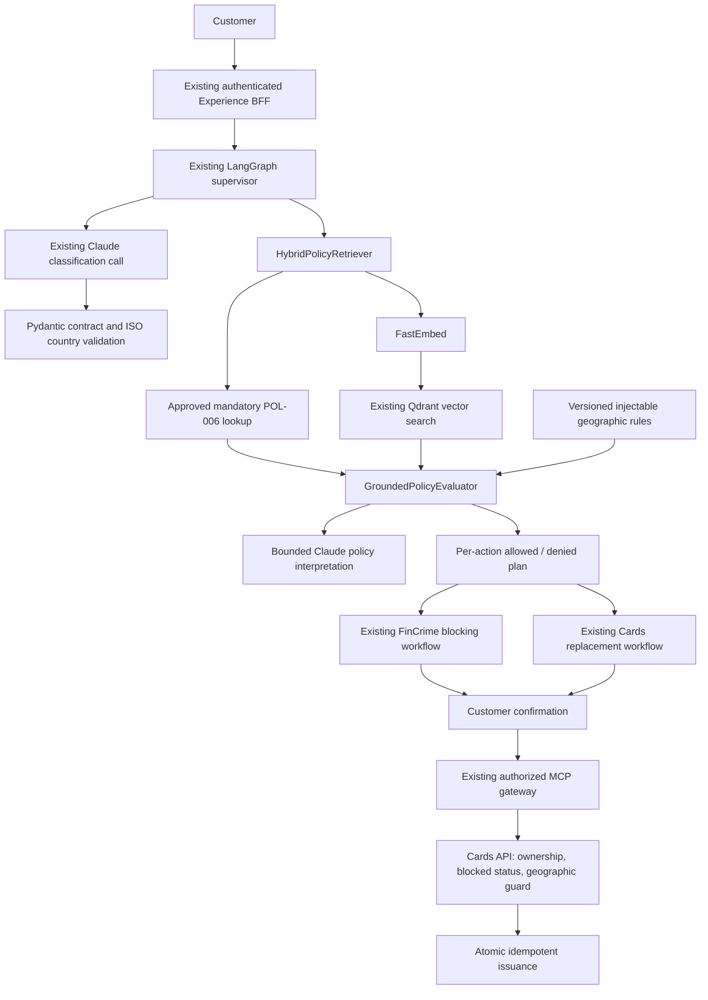

# Geographic card replacement demonstration

POL-006 is a **synthetic business policy**. Version 1.0.0 excludes KP (North
Korea) from replacement based on the customer's declared current location. It
does not exclude KR (South Korea) or AU (Australia). This is not a real bank rule,
a complete sanctions list, legal advice or compliance certification.

POL-006 also contains the synthetic `FC-COUNTRY-TRANSITION-001` control. When
enabled, an explicit declaration changing from an excluded country to a permitted
country inside the configured lookback requires FinCrime approval for replacement.
Declarations are unverified statements, not location evidence. Policy Management
exposes the enable switch and lookback hours; Apply versions the rules and document,
reindexes Qdrant, and refreshes deterministic enforcement.

## Responsibilities and architecture



The classifier's existing call now returns typed country and policy-search fields
alongside intents. ISO names/codes use `pycountry`; explicit aliases distinguish
North and South Korea. Proposed model codes are checked against the declaration
and ISO mapping. Ambiguous, missing, negated and unsupported declarations do not
authorize replacement. Australia is never inferred from an account.

The customer can supply a standalone country in chat, e.g. `Australia`, or say
`I'm currently in North Korea. Block and replace my card`. A standalone answer
resumes a pending replacement clarification. A declaration retains
`source=customer_declaration`; it is not verified physical location.

When clarification is required, the UI also displays a focused **Current country**
input and **Continue with country** button. Submitting it resumes the pending
replacement, including a replacement selected through the secure action form.
Ambiguous answers keep the field visible; excluded countries do not gain a
replacement confirmation.

Card selections refresh from the authenticated service after each conversation
response, so a card blocked during the conversation appears in replacement
choices immediately. Supplying country before confirming a pending block keeps
blocking first; it cannot jump straight to replacement of an active card.

An explicit current-country declaration already in the request is reused:
`I am in Australia and I want a replacement` opens replacement card selection
and review without asking for country again. Incomplete or conflicting model
country output cannot erase the independently validated declaration. The Cards
specialist prepares the secure replacement form without another interpretation
call; customer confirmation and all execution-time guards still apply.

Every geographic check uses the existing hybrid retriever, including actual
embedding/vector search and mandatory POL-006 retrieval. Runtime strict-index
checks verify approved policy content hashes and embedding-model metadata.
POL-006 is mandatory by `replace_card` applicability, independent of similarity.
Policy passages remain untrusted reference data. A bounded structured provider
call interprets evidence once during planning; repeated execution guards do not
make paid model calls. Returned policy ID/version/quote and decision must agree
with the retrieved evidence and deterministic result. Denied/unresolved customer
outcomes use canonical wording, even if model text recommends approval or claims
a different policy. The model can never grant tool authority.

`GroundedPolicyEvaluator` compares the validated country with an injected
`RulesSource`. `FileRulesSource` loads `policies/geographic-replacement-rules.json`.
No country exclusion is hardcoded into prompts or orchestration. The evaluator
returns action, country code, declaration provenance, allowed/denied/
clarification-required/unavailable, policy/version, artifact hash, rule ID,
reason code and safe explanation. Existing POL-002 eligibility, POL-004
confirmation, authentication, ownership and blocked-card checks remain required.

## Confirmation and execution sequence

```mermaid
sequenceDiagram
    actor Customer
    participant Agent as Supervisor / specialist agents
    participant RAG as Hybrid retrieval / Qdrant
    participant Rules as Deterministic evaluator
    participant Cards as Cards API / SQLite
    Customer->>Agent: In North Korea; block and replace card
    Agent->>Cards: Store unverified declaration scoped to customer/workflow
    Cards-->>Agent: Revision, policy version and artifact hash
    Agent->>RAG: Public semantic query + mandatory POL-006
    RAG-->>Agent: Approved evidence, versions and content hashes
    Agent->>Rules: Validate KP and pinned rules
    Rules-->>Agent: Block independently eligible; replacement denied
    Agent-->>Customer: Block-only review + demonstration restriction
    Customer->>Agent: Confirm blocking
    Agent->>Cards: Existing authorized FinCrime/MCP block path
    Cards-->>Agent: Card blocked
    Agent-->>Customer: Blocking success; replacement restricted
    Note over Agent,Cards: Any replacement attempt is checked again before MCP and inside the Cards transaction
```

Denied/unresolved replacement is removed from queued executable intents and
marked denied in the action plan. Combined approval cannot authorize it.
POL-003 offers and accepted offers recheck geography; POL-005 assistance remains
advisory and grants no replacement authority. Explicit replacement language
cannot be converted to additional issuance. Existing blocked-account issuance
guards remain in the Cards API.

Country declarations are stored through a private authenticated endpoint, not an
LLM-visible banking tool. It accepts the existing agent-service token (mcp
audience, tools:execute scope) plus signed customer delegation. No identity realm
or new secret is required. Model tool arguments cannot change the country,
revision or policy pins. Replacement metadata travels through server-controlled
MCP metadata and `X-Replacement-Context`, and is checked against the database.
There is no trusted `policy_approved` boolean.

A later country declaration invalidates prior customer workflow bindings.
Replacement rechecks the declaration revision, policy version and artifact hash
inside the same SQLite transaction as issuance, preventing a concurrent
declaration from racing the write. Missing context and stale/changed policy
bindings fail closed. A replay with the same valid context/key returns the
original card; denied retries cannot create a card.

Cards uses the same deterministic evaluator function against approved local
artifacts; the domain API has no vector or LLM availability dependency. During a
runtime vector outage, security blocking can use approved local POL-003/POL-004
controls, with all existing authorization/confirmation checks. A demonstrably
missing or stale indexed security policy is still rejected. Existing startup
readiness requirements for core policy infrastructure remain; missing POL-006
itself fails replacement at request time rather than disabling unrelated work.

## Configuration and coordinated policy changes

```json
{
  "policy_id": "POL-006",
  "version": "1.0.0",
  "country_basis": "declared_current_location",
  "excluded_country_codes": ["KP"],
  "on_unknown_country": "require_clarification",
  "allow_security_card_block": true
}
```

The Markdown frontmatter `conditions` must match all rules fields except
`policy_id`, including version. Both ingestion and execution reject mismatches.
Only approved policy documents are eligible. The deployment's review process
must approve the policy/configuration together; approval metadata is not a
cryptographic approval signature.

For a synthetic policy-change demonstration, copy the policies to a test
directory, change **both** versions to `2.0.0`, add AU to both exclusion lists,
and update the prose to agree. Ingest the approved version, deploy the artifacts
together, and start a new conversation. AU now fails replacement without any
orchestrator change. Version-1 workflows fail revalidation and require a new
conversation. Do not edit a list while retaining its version, hot-reload
unapproved artifacts, or weaken pin checks. The automated version-change test
demonstrates this procedure against the real embedded Qdrant adapter.

## Local build, ingestion and run

From the repository root in PowerShell, with Docker running:

```powershell
uv pip install --python .venv/Scripts/python.exe -e '.[chat,infra,dev]'
.\scripts\setup-stack.ps1
.\scripts\stack.ps1 -Build
```

The build script starts Qdrant and updates approved policy indexes before
starting application containers. No separate indexing command is required.

Use the same Compose overrides/environment as your existing launch. The new
country dependency requires rebuilding the Python services. Policies/config are
included in the image and mounted read-only into both the agent and Cards API;
their versions must agree. No frontend cosmetic changes are needed. Open
`http://localhost:8080` and sign in with a synthetic customer.

Independent real FastEmbed/Qdrant check (unique disposable collection; no banking
writes and no hosted-model calls):

```powershell
$env:PYTHONPATH = "$PWD\src"
$env:QDRANT_URL = 'http://127.0.0.1:6333'
.\.venv\Scripts\python.exe scripts/verify_geographic_rag.py
```

Use the Docker-accessible Qdrant URL when running that script inside a container.
The script checks AU/KR/KP and prints actual `query_points` call counts. It cleans
up only its own generated collection.

Automated offline/stub tests, including real embedded Qdrant and SQLite:

```powershell
.\.venv\Scripts\python.exe -m pytest tests/test_geographic_replacement.py tests/test_live_policy_runtime.py tests/test_compound_resumable_workflow.py tests/test_policy_recommendations.py -q
```

The suite distinguishes embedded Qdrant/deterministic embeddings, mocked SDK
responses, real FastEmbed/remote Qdrant, and paid hosted-model tests. To run the
existing optional Docker Qdrant/FastEmbed HTTP integration:

```powershell
$env:POLICY_TEST_QDRANT_URL = 'http://127.0.0.1:6333'
.\.venv\Scripts\python.exe -m pytest tests/test_live_policy_runtime.py -k docker_qdrant -q
```

Manual authenticated end-to-end checks create fresh synthetic customers:

```powershell
.\.venv\Scripts\python.exe scripts/smoke_block_replace.py --country AU
.\.venv\Scripts\python.exe scripts/smoke_block_replace.py --country KP
.\.venv\Scripts\python.exe scripts/smoke_block_replace.py --country KR
```

Those smoke commands perform banking writes in the **local demo stack**. With a
hosted-model stack they also incur the normal model calls. They are not run
automatically by the unit tests.

## Azure update

Use the existing single deployment script after local validation:
Specify `-ModelId` explicitly on both create and redeploy to select the intended
model even when deployment configuration has already been saved.

```powershell
.\scripts\azure-create.ps1 -SubscriptionId $subscriptionId -ModelId claude-haiku-5-5
```

It uploads/builds the release and runs the existing independent policy ingestion
stage. Rebuild/redeploy the agent, MCP and Cards API together; do not update just
one container. The added Cards policy mount and agent Cards URL are in both
Compose files. Existing keys, authorization, checkpoints, volumes and manual
resource-group cleanup remain in use. Old pre-feature replacement conversations
have no valid geographic binding and must declare a country and obtain a fresh
review. No Azure resources are changed by implementing or running unit tests.

## Manual expected behavior and audit

| Request | Expected review and execution |
|---|---|
| `I'm in Australia. Block and replace my card.` | Combined review; block then replacement after confirmation and revalidation |
| `I'm in North Korea. Block and replace my card.` | Block-only review; one block; no replacement; synthetic restriction explained |
| `I'm in South Korea. Block and replace my card.` | Not mistaken for KP; ordinary controls apply |
| `Replace my card` | Country clarification; no replacement until resolved |
| `I'm in Korea. Replace my card` | Clarify ambiguous country; no write |
| `I'm in North Korea. Block my card` | Blocking remains available |

Inspect `policy_retrieval`, `geographic_policy`, `supervisor_decision`,
`tool_execution`, and workflow checkpoints. Record normalized code, declared
provenance, decision/reason, policy/rules version, artifact hash, retrieved IDs,
citations, pending/denied action status and executed tool. Retrieval traces name
the backend and successful vector search; queries are reduced to public policy
vocabulary. No raw prompts, credentials, identifiers, card numbers or hidden
reasoning are logged. Exact evidence/versions/hashes are retained in checkpoints.

## Files

New: `policy/geography.py`, `policy/geographic_explanation.py`, POL-006 Markdown,
rules JSON, `tests/test_geographic_replacement.py`,
`scripts/verify_geographic_rag.py`, and this guide.

Extended: policy models/factory/retriever/evaluator/ingestion, supervisor and state,
Cards specialist and agent, main conversation/execution handling, gateway/MCP
metadata, security and tracing, Cards banking/service/persistence, both Compose
files, pyproject dependency, local smoke script and affected regression fixtures.
The generated debugging guide's source links are refreshed after source edits.

Exact modified source/configuration paths:

- `src/card_chat/policy/models.py`, `factory.py`, `adapters/evaluator.py`,
  `adapters/retriever.py`, `pipeline/ingestion.py`, `planning.py`
- `src/card_chat/orchestration/supervisor.py`, `state.py`, `specialists.py`
- `src/card_chat/agent.py`, `main.py`, `gateway.py`, `mcp_server.py`,
  `security.py`, `observability.py`
- `src/card_servicing/banking.py`, `main.py`, `persistence.py`
- `compose.yaml`, `compose.azure.yaml`, `pyproject.toml`,
  `scripts/smoke_block_replace.py`, `README.md`, `docs/debugging-account-and-card.md`
- `tests/test_compound_resumable_workflow.py`, `test_enterprise_policy_scenarios.py`,
  `test_live_policy_runtime.py`, `test_multi_agent_orchestration.py`,
  `test_policy_recommendations.py`

## Recorded verification (2026-11-19)

- Full repository run: **431 passed, 2 skipped**. The skipped tests require an
  explicit remote-Qdrant/FastEmbed URL or paid hosted-Anthropic opt-in.
- Subsequent focused policy/privacy checks: **82 passed, 1 paid-model test
  skipped**. Final geographic/orchestration/debug-guide checks: **63 passed**.
- Isolated cached Linux image with the updated source, real FastEmbed and the
  local Docker Qdrant service: AU allowed, KR allowed, KP denied; **12 actual
  `query_points` calls**, mandatory evidence/content hashes checked. Only a
  generated temporary collection was written and removed.
- The actual Anthropic SDK request shape was verified through a mocked HTTP
  transport. No paid hosted-model test, full updated Docker stack smoke or Azure
  rollout was executed for this change. Azure was left unchanged.

## Limits and production hardening

Customer declarations are unverified and a customer can lie; this is deliberately
not a geolocation or sanctions-compliance system. A production policy needs an
authoritative location/delivery service, signed approvals, expiry/revocation
rules, policy rollout governance and the appropriate complete business policy.
Rules/document sources are injectable; replace that evidence source rather than
adding prompts that pretend declarations are verified. Country phrasing outside
the bounded explicit grammar requires clarification rather than guessing.

The current declaration is customer scoped: a newer conversation's declaration
invalidates older bindings, so parallel workflows may need a new review. Existing
SQLite/volume deployment and single-process limits remain. Hosted-model behavior
and a full updated Docker/Azure deployment require the manual checks above;
offline/mocked tests do not establish a successful cloud rollout.
