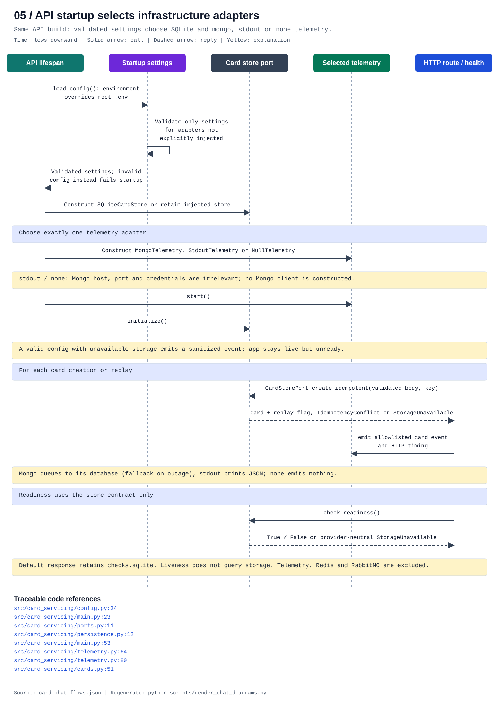

# Startup-selected infrastructure adapters

Current run/debug prerequisites and commands are in [README](../README.md). Adapter-specific API-only experiments below are separate from the full banking stack; use the current full-stack profiles in README. SQLite comes through Python; Mongo is optional when console/disabled telemetry is selected.

The [customer banking extension](customer-banking.md) composes a SQLite BankingService alongside the existing card store; card generation and retry snapshots still use CardStorePort. Banking routes require the SQLite adapter; isolated memory-card factories return 503 for banking. Schema version 3 is additive and preserves version 1 cards and idempotency records.

The same API build can use MongoDB, structured stdout, or no telemetry. SQLite
remains the only configurable runtime card store. The browser, agent, Anthropic
adapter, MCP discovery, confirmation and retry workflow are unchanged.

## Configuration boundary



The normal `card_servicing.main:app` entry point selects adapters during FastAPI
lifespan startup. `config.load_config()` merges root `.env` with `os.environ`;
environment variables win. `InfrastructureSettings.from_mapping()` validates
only the adapters that startup must construct. A missing setting uses its default;
an explicitly empty required setting is an error.

| Setting | Default | Meaning / validation |
| --- | --- | --- |
| `CARD_STORE` | `sqlite` | Only supported runtime store; other names fail startup |
| `SQLITE_PATH` | `data/cards.db` | Nonblank filesystem path; relative paths resolve from repo root, as before |
| `TELEMETRY_SINK` | `mongo` | Exactly `mongo`, `stdout`, or `none` |
| `MONGODB_HOST` | `127.0.0.1` | Hostname or IP, not a connection URI; used only for mongo |
| `MONGODB_PORT` | `27018` | Integer 1-65535; used only for mongo |
| `MONGODB_DATABASE` | `card_servicing` | Nonblank valid Mongo database name; used only for mongo |
| `MONGO_USER`, `MONGO_PASSWORD` | Required for mongo | Nonblank credentials; not required/read by stdout or none settings validation |
| `ACCOUNT_HASH_KEY` | Unset | Optional HMAC key; accounts are omitted unless the key is at least 32 bytes |
| `ACCOUNT_HASH_KEY_VERSION` | `v1` | Nonsecret diagnostic hash version |

No new environment selector is needed. Select a sink explicitly at startup. The
existing model settings (`MODEL_PROVIDER`, `MODEL_ID`, `ANTHROPIC_API_KEY`) remain
server-side chat settings. `CARD_API_BASE_URL` remains the MCP destination.

Bad configuration raises `ConfigurationError` naming the relevant setting, without
printing its supplied value or credentials. Configuration is validated before
constructing selected adapters. Importing the app module alone does not start or
validate infrastructure; startup does.

An unavailable dependency is different from invalid configuration. A syntactically
valid SQLite path that cannot be opened results in `StorageUnavailable`: startup
keeps liveness available, readiness returns 503, and card writes return sanitized
503. A valid Mongo configuration with an offline server keeps the existing
best-effort fallback logging behavior. Telemetry is never a readiness dependency.

## Explicit injection and the store contract

`create_app()` retains isolated in-memory cards and `NullTelemetry` for tests.
`create_app(local_infrastructure=True)` selects runtime infrastructure. Explicit
`card_store=` or `telemetry=` arguments always win, even in runtime mode. Only
missing instances are constructed; settings for an injected instance are ignored.

`ports.CardStorePort` defines:

```python
dependency_name: str
initialize() -> None
check_readiness() -> bool
create_idempotent(instruction, key) -> tuple[Card, bool]
issue_idempotent(instruction, key, *, additional=False, customer_id=None) -> tuple[CardIssuance, bool]
```

The route and readiness depend on this contract, not `isinstance(SQLiteCardStore)`
or SQLite exceptions. `SQLiteCardStore` translates expected SQLite, filesystem and
stored-data decoding failures into `StorageUnavailable` at its public operation
boundary. `IdempotencyConflict` remains a separate exception mapped to 409.
Original card transactions, account strings and response snapshots are preserved;
schema version 3 includes customer banking and issuance-decision tables. Default readiness still reports `checks.sqlite`.

A future store implements the port and translates its own expected failures,
then is added to settings/adapter construction. It must provide durable atomic
issuance decisions that serialize ownership, replay, existing-card checks and
explicit additional issuance; no card-route or chat rewrite is required. It must
not add a provider name until that actual implementation and tests exist.

`TelemetryPort` retains `start`, `account_fields`, `emit`, and `close`. Mongo keeps
its bounded background queue and fallback. Stdout emits one JSON event per line;
none emits nothing. Both emitting sinks enforce the existing diagnostic field
allowlist: IDs, timestamps, event metadata, timings, statuses and optional keyed
account hashes. Raw names, account identifiers, request bodies, credentials and
idempotency keys are not included. Stdout is the API's stream, never MCP's protocol
stdout. Redis and RabbitMQ remain outside the card-creation path.

## Local demonstration: change one setting

Start from the repo root with existing `.env` and synthetic data. Stop any other
host/container API that shares the same SQLite file before this demonstration.
Do not restart chat to retry an uncertain submission: its keys are memory-only.

Install once:

```powershell
.\.venv\Scripts\Activate.ps1
python -m pip install -e ".[dev,infra,chat]"
```

### First run: Mongo

Terminal 1 (Docker Desktop running; use `scripts/setup-infra.ps1` if you have not
already initialized local infrastructure and credentials):

```powershell
docker compose up -d mongodb
$env:CARD_STORE = 'sqlite'
$env:TELEMETRY_SINK = 'mongo'
python -m uvicorn card_servicing.main:app --host 127.0.0.1 --port 8010
```

Terminal 2, using the key/model already in ignored `.env`:

```powershell
.\.venv\Scripts\Activate.ps1
$env:CARD_API_BASE_URL = 'http://127.0.0.1:8010'
python -m uvicorn card_chat.main:app --host 127.0.0.1 --port 8020
```

Open `http://127.0.0.1:8020`. Ask for a new card, supply Alex / alex.synthetic /
0012345678, review and click Create card. Click again: the reference stays the same.
In Compass use `127.0.0.1:27018`, credentials from `.env`, auth database `admin`,
then `card_servicing.application_logs` / `request_traces`.

### Second run: stdout, Mongo stopped

Stop only the API in Terminal 1 with Ctrl+C, then:

```powershell
docker compose stop mongodb
$env:TELEMETRY_SINK = 'stdout'
python -m uvicorn card_servicing.main:app --host 127.0.0.1 --port 8010
```

No rebuild or source change. Leave chat running. Use **New conversation**, repeat
creation and duplicate confirmation. Observe JSON `card_created`, `card_replayed`
(when HTTP is actually retried), and `http_request` events in the API terminal.
Completed duplicate clicks use the chat's saved result and therefore need not emit
a second API event. `http://127.0.0.1:8010/health/ready` still returns SQLite ready.
Mongo credentials can be absent or invalid in this mode; no Mongo client is built.

For a real API replay after simulated response loss, run from another activated
terminal in each mode:

```powershell
# Stub model, real MCP and real HTTP; creates synthetic data.
python scripts/smoke_chat.py --api-url http://127.0.0.1:8010 --lose-first-response
# Live model using the configured key and MODEL_ID; incurs small API usage.
python scripts/smoke_chat.py --api-url http://127.0.0.1:8010 --live --lose-first-response
```

The harness runs the chat HTTP handlers with TestClient and launches real MCP;
it does not automate the browser UI. It suppresses the first successful MCP result
to simulate a lost creation response, retries the confirmed submission, compares
body/key/result, and checks a final duplicate click makes no additional tool call.

Restore your default when finished:

```powershell
docker compose start mongodb
$env:TELEMETRY_SINK = 'mongo'
# Restart API for this setting to take effect.
```

## Docker: same image, independent stdout startup

The default `compose.yaml` still starts Mongo as the API dependency. Its API
environment now forwards `CARD_STORE` and `TELEMETRY_SINK`, with existing defaults.
For standalone stdout/none there is `compose.api.yaml`: the same Dockerfile/image,
ports, SQLite mount and readiness probe, without Mongo/Redis/RabbitMQ services,
`env_file`, or required Mongo credentials. It explicitly forwards only required
non-Mongo configuration. Compose may still read root `.env` for interpolation;
those unrelated secrets are not injected into the standalone API container.

```powershell
# Default setup, build once. Do not run a host API against the same database.
$env:TELEMETRY_SINK = 'mongo'
.\scripts\start-docker-api.ps1 -Build
# Keep chat pointed to Docker for both runs:
$env:CARD_API_BASE_URL = 'http://127.0.0.1:8011'
```

After the Mongo run, switch without `-Build`:

```powershell
docker compose stop api mongodb
$env:TELEMETRY_SINK = 'stdout'
.\scripts\start-docker-api.ps1 -Standalone
docker compose -f compose.api.yaml logs --tail 20 api
```

`-Standalone` selects the independent Compose file. `-DebugApi` can also be used
with it for a manually configured API-only debugger. That old named attach profile is
not shipped; use the README full-stack Docker profiles for current application debugging. You can substitute
`none` for `stdout`. Because the standalone file defaults to stdout but Compose
reads `.env`, explicitly set the shell variable when `.env` contains mongo.

To switch back, keep the same image and database:

```powershell
docker compose -f compose.api.yaml stop api
$env:TELEMETRY_SINK = 'mongo'
.\scripts\start-docker-api.ps1
```

No `down -v`, database reset, migration or credential rotation is involved.

## Configured gateway URLs

The existing HTTPX client supports an HTTP(S) base URL with an optional path
prefix, with or without a trailing slash:

```dotenv
CARD_API_BASE_URL=https://gateway.example/demo/card-service
```

This sends `POST https://gateway.example/demo/card-service/cards` with the same
JSON and `Idempotency-Key` header. Configure the service base, not a URL already
ending in `/cards`. Tests verify both prefix forms. Query-string configuration,
gateway authentication and gateway deployment are outside this increment.

## Verification record

Baseline before edits: 53 tests passed; architecture diagram check passed. No
pre-existing local edits were present. The known Starlette TestClient deprecation
warning was present before this change.

Verification includes provider selection/errors/injection, environment precedence,
stdout redaction, runtime storage outage vs invalid configuration, legacy schema
replay, gateway prefix preservation, existing concurrency/rollback/readiness tests,
and stub-model chat -> real MCP subprocess -> normal HTTP API with stdout/none.
The legacy SQL fixture was generated using the committed pre-refactor adapter.

A separately tagged `card-servicing:adapter-demo` image was built and run first
with Mongo, then with stdout and the real Mongo container stopped. The same image
and isolated synthetic SQLite volume replayed the original response across modes.
Mongo diagnostic persistence and structured stdout creation/replay were checked.
Stub flows and live Anthropic flows passed in both modes, including a live
lost-response retry under stdout. The prior Mongo running state was restored;
the original API container and original SQLite database were left untouched.
An isolated synthetic verification volume and telemetry database were retained.

Final automated result: **78 tests passed**, architecture diagram check passed,
and the OpenAPI export was unchanged. The final image also passed standalone
Compose readiness and stub chat/MCP/HTTP lost-response replay with no Mongo
credentials and a separate SQLite volume. Verification containers were stopped.

Browser automation was not repeated in this refactor; the live smoke used the
actual chat endpoints, Anthropic adapter, MCP and HTTP API. Use the browser steps
above for visual verification.
