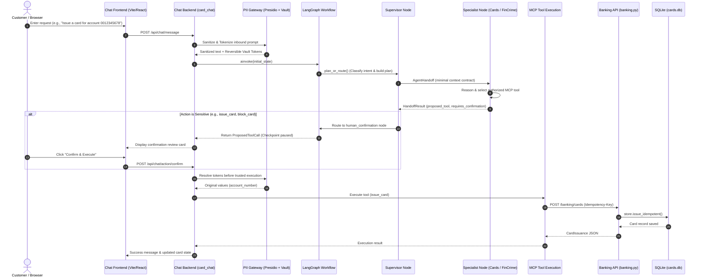
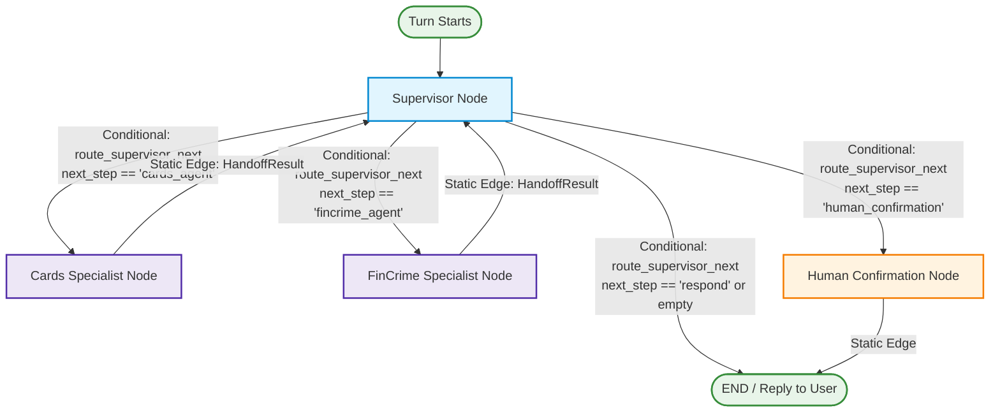
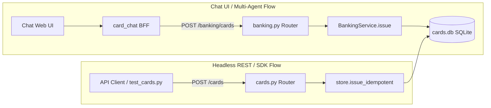

# LangGraph Multi-Agent Architecture & Request Lifecycle

This document provides a comprehensive technical reference for the **LangGraph + LangChain multi-agent architecture**, the **privacy-preserving PII tokenization layer**, and the **request routing lifecycle** implemented in the `CardServicing` platform.

---

## 1. Overall System Architecture

The following diagram illustrates how customer requests flow from the chat frontend through privacy sanitization, multi-agent reasoning, policy enforcement, and execution in the banking core:



---

## 2. LangGraph StateGraph Architecture

The orchestration engine is compiled as a LangGraph `StateGraph` in [`src/card_chat/orchestration/graph.py`](file:///a:/PrincipalEngineer/CardServicing/src/card_chat/orchestration/graph.py).

### Workflow Graph Diagram



---

## 3. Node Definitions and Responsibilities

| Node Name | Handler Function | Source File | Responsibilities |
| :--- | :--- | :--- | :--- |
| **`supervisor`** | `supervisor.plan_or_route` | [`supervisor.py`](file:///a:/PrincipalEngineer/CardServicing/src/card_chat/orchestration/supervisor.py) | • Analyzes sanitized user intent.<br>• Coordinates single or compound requests (e.g., `["block_card", "view_cards"]`).<br>• Emits structured `AgentHandoff` contracts.<br>• Resumes upon specialist completion and synthesizes final response. |
| **`cards_agent`** | `cards_node.execute` | [`specialists.py`](file:///a:/PrincipalEngineer/CardServicing/src/card_chat/orchestration/specialists.py) | • Selects authorized cards tools: `issue_card`, `view_cards`, `create_account`, `view_accounts`.<br>• Enforces tool boundary policy.<br>• Flags sensitive mutations (`issue_card`) as requiring confirmation. |
| **`fincrime_agent`**| `fincrime_node.execute` | [`specialists.py`](file:///a:/PrincipalEngineer/CardServicing/src/card_chat/orchestration/specialists.py) | • Selects authorized risk tools: `block_card`, `unblock_card`, `get_card`.<br>• Enforces security boundary rules.<br>• Flags card blocking as requiring confirmation. |
| **`human_confirmation`**| `human_confirmation_node`| [`graph.py`](file:///a:/PrincipalEngineer/CardServicing/src/card_chat/orchestration/graph.py) | • Serves as a stateful checkpoint pause.<br>• Emits `can_confirm: True` so the frontend can present two-phase review. |

---

## 4. Shared Workflow State Schema

Defined in [`src/card_chat/orchestration/state.py`](file:///a:/PrincipalEngineer/CardServicing/src/card_chat/orchestration/state.py):

```python
class BankingWorkflowState(TypedDict, total=False):
    # Identity & Context Scope
    owner: str
    session_id: str
    workflow_id: str

    # Sanitized Conversation
    messages: list[dict[str, Any]]
    verified_draft: dict[str, Any]
    allowed_tools: dict[str, Any]

    # Minimal-Context Handoff Contracts
    current_handoff: AgentHandoff | None
    handoff_history: Annotated[list[HandoffResult], operator.add]
    active_agent: str | None
    next_step: str | None

    # Compound Intent Tracking
    planned_intents: list[str]
    completed_intents: list[str]

    # Proposal & Confirmation Lifecycle
    proposed_tool: dict[str, Any] | None
    review: str | None
    can_confirm: bool
    confirmation_label: str | None
    input_tool: str | None

    # Guardrails & Control
    iteration_count: int
    final_response: str | None
    error: str | None
```

### Minimal-Context Contract Model

Instead of forwarding entire conversation histories between agents, nodes communicate strictly using typed Pydantic contracts ([`contracts.py`](file:///a:/PrincipalEngineer/CardServicing/src/card_chat/orchestration/contracts.py)):

1. **`AgentHandoff`**:
   - `target_agent`: Specialist to invoke (`cards_agent` or `fincrime_agent`).
   - `intent`: Single action requested (`issue_card`, `block_card`, etc.).
   - `parameters`: Only the specific parameters required (e.g. `{"account_number": "0012345678"}`).
   - `max_iterations`: Bounded loop limit (default: 3).

2. **`HandoffResult`**:
   - `agent`: Reporting agent.
   - `status`: `"success" | "failure" | "needs_confirmation"`.
   - `proposed_tool`: The concrete tool call (`name`, `arguments`).
   - `summary`: Sanitized status description returned to the supervisor.

---

## 5. Dual Router Architecture: `banking.py` vs `cards.py`

A common question when debugging the backend is why a breakpoint in [`src/card_servicing/cards.py`](file:///a:/PrincipalEngineer/CardServicing/src/card_servicing/cards.py) is not hit when issuing a card in the Chat UI.



### Key Differences

| Property | `src/card_servicing/banking.py` | `src/card_servicing/cards.py` |
| :--- | :--- | :--- |
| **Mount Path** | `/banking/*` (e.g. `/banking/cards`) | `/cards` (e.g. `POST /cards`) |
| **Intended Consumer** | Chat UI, MCP Tool Server, Multi-Agent System | Headless REST clients, Python SDK, RFC idempotency unit tests |
| **Authentication** | Customer JWT / session cookie (`customer['sub']`) | Header-level `Idempotency-Key`, unmanaged account validation |
| **Business Rules** | Enforces account ownership, FinCrime cross-agent block check | Low-level storage and replay validation |

---

## 6. How to Run and Debug

### Setting Breakpoints for the Chat UI
To intercept card creation from the Chat UI:
1. Open [`src/card_servicing/banking.py`](file:///a:/PrincipalEngineer/CardServicing/src/card_servicing/banking.py).
2. Set a breakpoint on **line 250** (`issue_card`):
   ```python
   result, replayed = service(request).issue(...)
   ```
3. Issue a card via the web UI; the breakpoint will hit immediately.

### Setting Breakpoints for `cards.py`
To intercept low-level headless card issuance:
1. Open [`src/card_servicing/cards.py`](file:///a:/PrincipalEngineer/CardServicing/src/card_servicing/cards.py).
2. Set a breakpoint on **line 44** (`create_card`).
3. Run the automated contract test:
   ```powershell
   .\.venv\Scripts\python.exe -m pytest tests/test_cards.py
   ```
