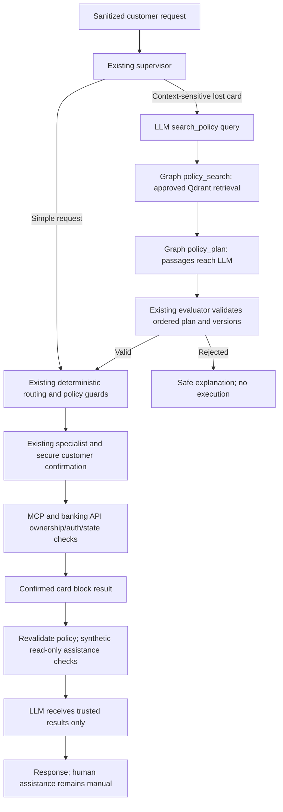

# Overseas lost-card policy planning

This journey extends the existing supervisor graph, Anthropic provider,
HybridPolicyRetriever, approved Qdrant collection, deterministic evaluator,
secure form and MCP execution. It adds no service or database. Azure deployment
configuration is unchanged.



## Run the demonstration

Use a synthetic customer with an active card. Rebuild the application images and
ingest the new approved `policies/POL-005-overseas-lost-card.md` using the existing
ingestion command and collection. For the standard local Compose configuration:

```powershell
docker compose --env-file .env --env-file .env.stack build cards-agent
docker compose --env-file .env --env-file .env.stack run --rm --no-deps --workdir /data --entrypoint python cards-agent -m card_chat.policy.pipeline.cli ingest
docker compose --env-file .env --env-file .env.stack up -d
```

For debug containers use the existing `compose.debug.yaml` override consistently.
See [runtime configuration](live-policy-runtime.md) for collection and embedding
alignment. No ingestion occurs implicitly during a customer request.

Say:

> I'm in Singapore. I've lost my debit card. I'm returning to Sydney tomorrow and
> urgently need access to my money. I don't want my bank account frozen.

Example model-generated query (wording varies):

```text
overseas lost card returning home within 48 hours digital availability emergency cash account freeze
```

The model receives complete passages with `policy_id`, `version`, `source`,
`section`, `text` and `score`. The mandatory travel passage includes:

> Do not freeze the customer's bank account. Card blocking does not freeze the
> account. For a customer returning home within 48 hours, prioritize checking
> digital card availability to restore access quickly.

Expected ordered plan, each entry including rationale, an exact quotation and
`POL-005` version `1.0.0`:

1. `block_card`, confirmation required.
2. `check_digital_card_eligibility`.
3. `check_emergency_cash_eligibility`, fallback when digital is unavailable.
4. `request_specialist_handoff`, human confirmation required.

The customer must select the card in the existing secure form, review and confirm.
No model-produced identifier is used. The model cannot freeze an account, issue a
digital card or transfer money. A proposed `freeze_account` action, missing
confirmation, invented citation, unauthorized block or stale version is rejected
before specialist routing. The existing MCP/API independently authenticates,
authorizes, checks ownership and enforces banking state for actual writes.

After the confirmed block, read-only simulation defaults report alternatives
unavailable and handoff as `human_required`. The final model receives those
results, without resending the policy documents. Example response:

> Your card was blocked. The assistance checks are synthetic and unavailable.
> Please contact specialist support. No digital card, cash or support case was created.

The existing API supplies the actual card-block success wording. Model failures
after execution preserve that success and append a safe deterministic explanation.
Duplicate confirmation reuses the stored final reply without repeating writes or
model calls.

## Configuration and trace

`POLICY_CONTEXT_TOKENS` defaults to 1250, bounded to 1000–1500. This is a conservative
character-based estimate (four characters/token), not an exact tokenizer count.
At most three complete passages are supplied; an oversized mandatory passage fails
closed. One semantic retrieval is allowed. No second-search loop is implemented.
Request-scoped evidence is reused between graph stages; versions and constraints
are checked again after the customer confirmation pause.

Optional application settings `POLICY_DEMO_DIGITAL_AVAILABLE=true` and
`POLICY_DEMO_CASH_AVAILABLE=true` simulate an available alternative. Defaults are
false. Later alternatives are skipped after a simulated available result. These
flags never assert actual customer eligibility. Standard Compose needs an explicit
environment injection to use these optional settings; Azure configuration was not
changed to expose demonstration flags.

Existing telemetry sinks receive `policy_planning` events for retrieval decision,
public-vocabulary-only search query, policy IDs/versions/scores, action validation,
synthetic outcomes and latency. Existing `model_usage` events record each call's
tokens. The detailed cited plan is available in the existing customer-scoped
workflow checkpoint under `policy_planning`, not exported as raw prose. No raw
customer query, rationale, full document or private identifier is exported.
Workflow latency includes the customer confirmation wait; retrieval latency does
not. Existing UI aggregate usage is not the authoritative count for this multi-call
journey; use per-call telemetry.

## Verification and limits

`tests/test_policy_planning.py` covers search, passage delivery, deterministic
rejection, missing/conflicting rules, context reuse, simple-request gating,
policy-dependent mocked plan order and the full SDK/graph/form/confirm/replay path.
The mocked model is a deterministic test double; it does not prove live model
reasoning. The optional live-model test requires explicit opt-in and credentials.

```powershell
$env:RUN_LIVE_POLICY_PLANNING = '1'
# Supply ANTHROPIC_API_KEY and MODEL_ID securely; this makes paid model calls.
.\.venv\Scripts\python.exe -m pytest -q tests/test_policy_planning.py::test_optional_live_model_policy_planning
```

Files added for this extension: `policies/POL-005-overseas-lost-card.md`,
`src/card_chat/policy/planning.py`, `tests/test_policy_planning.py` and this guide.
Files extended: `.env.example`, `src/card_chat/provider.py`, `agent.py`,
`observability.py`, `orchestration/graph.py`, `orchestration/state.py`,
`orchestration/supervisor.py`, `policy/adapters/evaluator.py`,
`src/card_servicing/telemetry.py`, `docs/architecture.md`,
`docs/live-policy-runtime.md`, `docs/model-privacy.md` and generated source links
in `docs/debugging-account-and-card.md`. Existing uncommitted next-step
recommendation changes were preserved and reused.

The context-sensitive gate intentionally recognizes lost/stolen card requests with
travel/access cues; it is not a universal intent classifier. No extra classification
call is added. The existing simple workflow and post-block offers remain available.
Digital access and emergency cash are simulations; specialist transfer remains
manual. Existing SQLite, in-memory state and persistent-volume scaling limitations
remain as documented in the Azure and architecture guides. No live Azure or live
banking deployment is implied by mocked tests.

## Executed verification (18 November 2026)

| Status | Evidence |
| --- | --- |
| PASS | Full Python regression run: 354 passed, 2 opt-in tests skipped. |
| PASS | Subsequent focused planning and debugging-guide checks, including the latest fallback/outage/content-hash cases: 24 passed, 1 live-model test skipped. |
| PASS | Real Docker-hosted Qdrant/FastEmbed HTTP integration: 1 passed; isolated test collection. |
| PASS | Local and Azure Compose CLI configuration validation. Azure validation used disposable placeholders for generated secrets. No containers or Azure resources were deployed. |
| PASS | Cards OpenAPI export consistency, generated debugging-guide consistency and `git diff --check`. |
| NOT TESTED | Paid live Anthropic test, live Azure deployment, full browser/Keycloak banking demonstration and rebuilding all Linux images. |
| NOT TESTED | Frontend checks: npm/Node were unavailable in the execution environment; frontend sources were unchanged. |

An earlier run failed the generated debugging-guide link check; links were
regenerated and verification passed. A subsequent run exposed an intermittent
existing SQLite card-selection assertion in
`test_additional_cards_are_explicit_and_retries_preserve_original_outcome[True]`.
The unchanged test passed its focused rerun and the final full suite. No banking
code or assertions were altered to hide this observation; SQLite timestamp/ID
ordering remains worth investigating separately.
