# Policy-grounded next steps

The live supervisor now supplies retrieved policy evidence to the model to
recommend the next customer journey. The model chooses the proposal and wording;
the application checks the proposal and controls every actual banking action.

```mermaid
flowchart LR
    E[Confirmed block or restricted issuance] --> R[Retrieve approved policy evidence]
    R --> P[Redact passages and project verified facts]
    P --> L[Model proposes next step with quotes]
    L --> V[Validate schema, citations and policy constraints]
    V --> Q[Ask customer or explain abstention]
    Q --> A[Customer accepts an offer]
    A --> C[Separate secure review and confirmation]
    C --> M[Authorized MCP banking write]
```



## What is implemented

- **After a successful block:** the model interprets POL-003 and other retrieved
  evidence to propose `offer_replacement` or `none`. This also runs when the
  customer used the secure form without an initial natural-language model turn.
- **When a blocked card prevents issuance:** the model interprets POL-001 to
  propose `offer_unblock` for an eligible temporary freeze, or `none`. Issuance
  stays restricted until the application's rules permit it.
- **Customer acceptance:** stored question metadata selects the existing Cards or
  FinCrime journey. Acceptance is not execution. Ownership, eligibility, fresh
  policy evidence, a reviewed proposal and confirmation remain necessary.
- **Explicit compound requests:** the existing reviewed block-and-replacement plan
  remains supported. The model does not add an unsolicited third banking action.

This is a bounded set of supported recommendations. New action types require
extending the contract and validation; policy prose cannot register arbitrary
MCP tools or bypass authorization. Other ordinary specialist prompts retain their
existing conversation projection.

## Grounding and execution boundaries

`PolicyNextStepPlanner` receives the evaluator's approved, current-version evidence,
not a precomputed question or recommendation. The live `evaluate_constraints`
interface omits deterministic proactive offers. Mandatory passages and semantic
retrieval hits are projected into at most twelve bounded policy excerpts, including
policy ID/version, relevant conditions and restrictions. The request is capped at
40,000 UTF-8 bytes. The model request exposes only three verified boolean facts:
blocked-card presence, temporary freeze and permanent compromise. Account/card
identifiers, names, session IDs, raw block reasons, private forms, banking results
and service tokens are excluded.

Reference text is exported as a redacted copy. Detected sensitive spans are
redacted even when they are ordinary policy vocabulary; the full outbound DLP gate
still runs. Policy content is reference data, not system instructions. The model
can return only the non-executing `recommend_policy_next_step` structured result.
It has no banking tools in this request.

The application checks the response schema, allowed action, current policy pins,
actual retrieved evidence IDs and exact quotations from model-visible passages.
It rejects ungrounded citations, private output, unsupported actions, unblocking a
permanently compromised card and replacement offers that contradict the explicit
temporary-freeze prohibition. It binds target card/account references itself.
Citation validation establishes provenance; deterministic guards independently
protect the banking write.

The model can abstain, including when guidance needs clarification. The application
does not manufacture an offer from the flag after a model abstention or failure.
Unavailable, timed-out or invalid recommendations produce no follow-up question.
A previously successful block stays successful and is never retried because the
recommendation failed. The model request has a bounded timeout and no SDK retries.
Replaying a stored operation returns its original result without a new model call.

A confirmed result and the actual reviewed secure-form arguments update graph
facts before recommendation. The earlier model proposal may have omitted a card
or reason; it is not used as the authority for what the API actually executed.

## Inspect what happened

In the LangGraph checkpoint, inspect:

- `retrieved_policies` and `pinned_policies` for the approved source/version.
- `policy_evaluation.recommendation` for action, model-generated wording, supporting
  quotes with policy/source/version, mode, stage and bounded usage counters.
- `pending_customer_question` for the server-bound offer awaiting acceptance.

`mode: model` identifies the hosted-provider path. `mode: stub` is an explicitly
configured offline simulation. Failures record `status: unavailable` and an error
class, without prompts, raw exception messages or customer values. Existing
`model_usage` telemetry records tokens for the recommendation request, and a
`policy_recommendation` event records its accepted/unavailable outcome. Successful
post-block model usage is included in the response's usage counters; attempted
provider requests are counted on failure too.

## Run the temporary-freeze experiment locally

Use a synthetic customer and active card. Ensure the stack is configured with
`STACK_MODEL_PROVIDER=anthropic`, a usable `MODEL_ID` and an injected
`ANTHROPIC_API_KEY`. `MODEL_PROVIDER=stub` remains available for local development,
but demonstrates a labeled simulation, not a hosted model reasoning over policy.
For the new source code, rebuild once:

```powershell
.\scripts\stack.ps1 -DebugComponent All -Build
```

With POL-003 v1.0.0 and `offer_on_temporary_freeze: false`, request a temporary
freeze, select the card and set reason `temporary freeze`, then confirm. A compliant
model should explain that no proactive replacement applies. Unfreeze the card
through the normal confirmed journey before repeating the experiment.

In `policies/POL-003-post-block-journey.md`, increment the version and set
`offer_on_temporary_freeze: true`. Update the prose and restrictions consistently;
keep exactly one approved active version of POL-003. Re-ingest with the same
embedding model, collection and policy directory as runtime:

```powershell
$dc = @('compose', '--env-file', '.env', '--env-file', '.env.stack',
        '-f', 'compose.yaml', '-f', 'compose.debug.yaml')
docker @dc run --rm --no-deps --workdir /data --entrypoint python cards-agent -m card_chat.policy.pipeline.cli ingest
docker @dc restart cards-agent
```

Start a **new conversation** and repeat the temporary freeze. The model now sees
the updated passages and applicability metadata and can offer replacement with
its own wording. Inspect the checkpoint citations/version to confirm the grounding.
Say no to finish, or accept and inspect the separate review before confirming.
No new banking write should happen just because an offer was displayed or accepted.
Existing workflows pin policy versions; changing an approved policy mid-workflow
requires restarting that workflow. Editing source without ingestion fails closed
because the indexed content hash no longer matches.

## Automated verification

`tests/test_policy_recommendations.py` captures actual Anthropic SDK HTTP JSON
through `httpx.MockTransport`; it makes no paid model calls. It verifies:

- Changed policy version/passages reach the request and generate different
  structured offers, including direct-form and chat-first entry paths.
- No raw customer identifiers or result payloads reach that request.
- Model wording is returned, citations are checkpointed and the application does
  not substitute a canned offer after abstention.
- Acceptance still requires a reviewed, confirmed banking action.
- Missing evidence, wrong citations, unsafe output, unsupported actions, explicit
  policy prohibitions, model outages and timeouts cannot execute another action.
- A successful block and its idempotent replay survive recommendation failure.

The existing HTTP, MCP, policy, privacy and orchestration suites remain in use.
Hosted-model output quality should also be tested with your configured Anthropic
model and synthetic data; mocked transport validates the integration and safety
boundaries without proving a live model's interpretation quality.

The provider uses a single non-executing tool schema with automatic tool selection
and parallel tool calls disabled. The application rejects text-only, wrong-tool,
multiple-call and truncated responses. This follows the
[Claude tool-definition interface](https://platform.claude.com/docs/en/agents-and-tools/tool-use/define-tools)
while keeping response and banking authorization validation local.

## Recorded verification

On 18 November 2026, the complete regression suite passed **341 tests** with the
opt-in external Qdrant test skipped in that run. That test was then run explicitly
against the healthy local Docker Qdrant service with real FastEmbed and passed
(**1 passed**); it created and removed only its unique synthetic collection.
The new recommendation file contributes 27 regression cases, including actual
Anthropic SDK HTTP-payload capture through mocked transport. No paid Anthropic
calls were made, so hosted-model interpretation quality remains a manual live
verification step. Debugging-guide freshness and `git diff --check` also passed.
