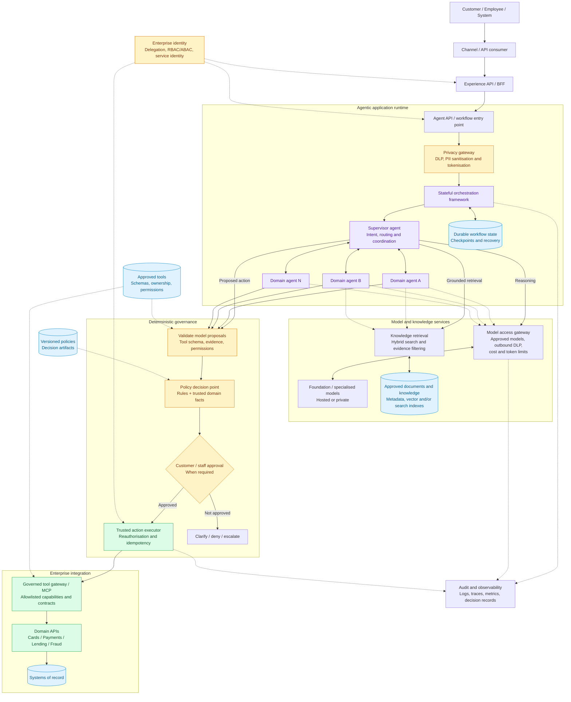
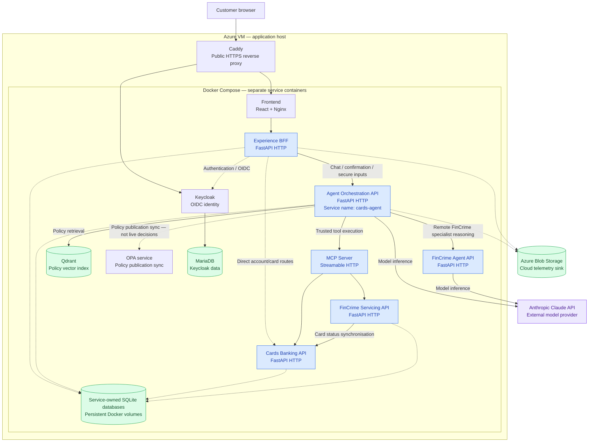
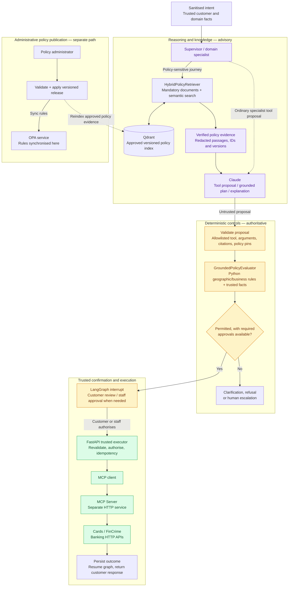

# Enterprise Agentic AI Reference Architecture & CardServicing Implementation

> **Architecture showcase | Four Mermaid diagrams | GitHub-ready**  
> **Scope:** A reusable enterprise reference pattern, followed by the current CardServicing implementation.  
> **Repository:** [`kishoreakaveeti/CardServicing`](https://github.com/kishoreakaveeti/CardServicing)  
> **Implementation baseline:** Repository `main` inspected 23 November 2026. Verify against code before treating any detail as a production guarantee.

## How to read this document

The diagrams progress from **what an enterprise team could reuse** to **what CardServicing actually runs**:

| Order | Diagram | Question it answers |
|---|---|---|
| 1 | Enterprise reference architecture | What is the reusable, domain-independent pattern? |
| 2 | CardServicing system and deployment | Which services exist, and where are they hosted? |
| 3 | Stateful multi-agent orchestration | How do the Supervisor and specialist agents coordinate? |
| 4 | Grounded decisions and trusted execution | How do policies, privacy, approvals, and banking writes interact? |

**Important vocabulary:** A box labelled **HTTP API** is a service boundary. A box labelled **agent** or **graph node** is a logical/runtime component and is **not** automatically a separately deployed service. Solid arrows show primary flows; dashed arrows show dependencies, cross-cutting concerns, or administrative paths. Diagrams 1 and 4 are logical patterns, not literal call-by-call sequence diagrams.

---

## 1. Enterprise Agentic AI — reusable reference architecture

**Audience:** Platform engineering, security, domain engineering, architecture practice.  
**Purpose:** A technology-agnostic blueprint for Cards, Payments, Lending, Fraud, Everyday Banking, or other domains. Components may be hosted together or split into services depending on enterprise needs.



**Design rules for adopting teams**

1. **Models propose; trusted applications decide and execute.** A model response is never equivalent to transaction authorisation.
2. **RAG supplies evidence, not enforcement.** Retrieved passages must be validated against source versions, integrity controls, and trusted rules.
3. **Agents are modular domain capabilities.** Different agents can use different models and may themselves contain subgraphs; each follows an explicit capability and data-sharing contract.
4. **Stateful orchestration and execution are separate.** The workflow can pause, resume, retry, and coordinate; the executor applies authorisation, idempotency, audit, and downstream contracts.
5. **Cross-cutting protections apply at boundaries.** Identity, privacy, telemetry, failure handling, and least-privilege tool access are platform requirements.

**Reference, not product claim:** The model gateway, unified audit platform, and policy decision point above represent enterprise architectural responsibilities. They do not imply that CardServicing currently has a standalone model gateway, live OPA decision-time enforcement, or end-to-end OpenTelemetry/Splunk integration.

---

## 2. CardServicing — current service and deployment architecture

**Audience:** Anyone wanting to understand deployed components and network/service boundaries.  
**Deployment shown:** Standalone Azure VM using Docker Compose, host-level Caddy, and externally hosted Claude and Azure Blob telemetry. Each named API below is a real HTTP service.



**Read this diagram carefully:**

- The container named **`cards-agent` is an HTTP application host**, not the Cards Specialist reasoning node. It contains the FastAPI entry point, privacy gateway, LangGraph workflow, and trusted execution logic.
- The **Supervisor Agent is not deployed separately**. It runs as a LangGraph node inside `cards-agent`.
- The **Cards Specialist is local** to that runtime. The FinCrime specialist's local graph node can call the **separate `fincrime-agent` HTTP container**.
- Some Experience BFF account/card endpoints call Cards Banking API **directly**, bypassing LangGraph and MCP. The diagram shows this path separately.
- `Stores` represents **multiple independently owned SQLite stores**, not a shared SQL database. Identity uses MariaDB. Qdrant has its own persistence.
- OPA is **deployed and synchronised during policy publication**, but **not consulted by the live Python geographic decision path**.
- Azure cloud diagnostics use a bounded Azure Blob telemetry adapter. A complete OpenTelemetry-to-Splunk export architecture is **future scope**, not an implemented component here.

**Code/deployment references:** [`compose.azure.yaml`](../compose.azure.yaml), [`infra/azure/Caddyfile`](../infra/azure/Caddyfile), [`src/card_chat/experience.py`](../src/card_chat/experience.py), [`src/card_chat/main.py`](../src/card_chat/main.py).

---

## 3. CardServicing — LangGraph multi-agent orchestration

**Audience:** Engineers and architects evaluating the agentic pattern.  
**Purpose:** Show the difference between the FastAPI host, the LangGraph engine, actual agents, supporting graph nodes, external model calls, and durable checkpoints.

```mermaid
flowchart TB
    BFF["Experience BFF<br/>Forwarded customer conversation"]

    subgraph Host["cards-agent container — FastAPI application"]
        HTTP["Agent API request handler"]
        Privacy["Microsoft Presidio<br/>Input sanitisation and opaque tokens"]
        Runtime["AgentOrchestrator<br/>Build state and invoke LangGraph"]
        Context["Model-safe context projection<br/>Eligible tools and verified facts"]
        Checkpoints[("Durable SQLite<br/>LangGraph checkpoints")]

        subgraph Graph["LangGraph StateGraph — in-process nodes"]
            Supervisor["Supervisor Agent<br/>Graph entry and coordinator"]
            Cards["Cards Specialist Agent<br/>Local node"]
            FinNode["FinCrime Specialist<br/>Local node"]
            Search["policy_search<br/>RAG query / retrieval node"]
            Plan["policy_plan<br/>Grounded planning node"]
            Confirm["human_confirmation<br/>Interrupt + resume"]
            Staff["fincrime_approval<br/>Staff approval interrupt"]

            Supervisor -->|"Cards handoff"| Cards
            Cards -->|"Handoff result"| Supervisor
            Supervisor -->|"FinCrime handoff"| FinNode
            FinNode -->|"Handoff result"| Supervisor
            Supervisor --> Search
            Search --> Plan
            Plan --> Supervisor
            Supervisor --> Confirm
            Confirm --> Supervisor
            Supervisor --> Staff
            Staff --> Supervisor
        end

        HTTP --> Privacy --> Runtime
        Runtime -->|"Invoke workflow"| Supervisor
        Runtime <--> Checkpoints
        Context -.-> Cards
        Context -.-> FinNode
    end

    BFF --> HTTP
    FinNode -->|"HTTP /turn when configured"| Remote["FinCrime Agent API<br/>Separate container"]
    Supervisor -.->|"Classification / reasoning"| Claude["Anthropic Claude API"]
    Cards -.->|"Reasoning when required"| Claude
    Remote -.->|"FinCrime inference"| Claude
    Search -->|"Policy retrieval"| Qdrant[("Qdrant vector index")]
    Search -.->|"Generate semantic query"| Claude
    Plan -.->|"Generate grounded plan"| Claude
    Runtime -.->|"Build bounded model context"| Context

    classDef agent fill:#ede9fe,stroke:#7c3aed,color:#4c1d95
    classDef graph fill:#fef3c7,stroke:#d97706,color:#78350f
    classDef service fill:#dbeafe,stroke:#2563eb,color:#1e40af
    class Supervisor,Cards,FinNode agent
    class Search,Plan,Confirm,Staff graph
    class HTTP,Remote service
```

**Runtime interpretation:**

1. The **Experience BFF** forwards the authenticated, delegated chat request to `cards-agent`. The **FastAPI handler**, not the BFF, performs the in-process Presidio sanitisation for the model-facing conversation.
2. `AgentOrchestrator.interpret_turn()` invokes the compiled LangGraph workflow. The graph starts at **`supervisor`**.
3. The Supervisor routes to Cards, FinCrime, policy search/planning, or approval nodes as required. Specialists return handoff results to the Supervisor.
4. Cards is an in-process specialist. FinCrime has an in-process **graph adapter** plus an independently hosted **HTTP specialist API**.
5. Checkpoints and LangGraph interrupts preserve workflow state across customer confirmation and staff approval. **The graph does not directly execute unapproved banking writes.**
6. Model-safe context projection occurs around the specialist/model invocation boundaries; it is not an extra network hop or separate container. Some straightforward operations build deterministic proposals instead of triggering another model call.

**Code references:** [`src/card_chat/agent.py`](../src/card_chat/agent.py), [`src/card_chat/orchestration/graph.py`](../src/card_chat/orchestration/graph.py), [`src/card_chat/orchestration/specialists.py`](../src/card_chat/orchestration/specialists.py), [`src/card_chat/model_context.py`](../src/card_chat/model_context.py).

---

## 4. CardServicing — grounded decisions, approval and trusted execution

**Audience:** Security, risk, platform, architecture, and engineering reviewers.  
**Purpose:** Show why retrieval and model output are **advisory** while business rules, authority checks, human approval, and execution are **application-controlled**.



**Critical trust boundaries:**

- **RAG is evidence, not authorisation.** The retriever combines mandatory approved policy records with semantic search, using policy ID/version/content-hash checks. Claude receives bounded, redacted evidence for appropriate planning or recommendations.
- **Model plans remain proposals.** Tool schemas, policy versions, permissions, customer ownership, and verified facts are checked by application code; the model cannot grant itself tool execution authority.
- **Live geographic decisions are Python-based.** The current `GroundedPolicyEvaluator.geographic_decision()` calls `evaluate_geography()` using approved rules and retrieved policy evidence. **OPA is not called for these live decisions.**
- **OPA is an administrative integration.** The current policy-release path synchronises geographic rules to the OPA service and reindexes approved policy evidence in Qdrant.
- **Human-in-the-loop is conditional.** Mutating actions use appropriate customer review and, for certain journeys, FinCrime staff approval. Do not interpret the diagram as meaning that every read-only operation requires human approval.
- **Trusted execution occurs outside the graph node.** The FastAPI application verifies and executes via its MCP client, the remote MCP service validates the tool contract and permissions, and domain APIs perform banking operations. The graph then receives the outcome and resumes.
- **PII does not flow freely to Claude.** In-process Microsoft Presidio sanitises input, sensitive values are replaced with opaque references where supported, and outbound payloads are independently checked. The current token vault is in memory; it is **not Azure Key Vault**.

**Code references:** [`src/card_chat/main.py`](../src/card_chat/main.py), [`src/card_chat/policy/adapters/retriever.py`](../src/card_chat/policy/adapters/retriever.py), [`src/card_chat/policy/adapters/evaluator.py`](../src/card_chat/policy/adapters/evaluator.py), [`src/card_chat/policy/geography.py`](../src/card_chat/policy/geography.py), [`src/card_chat/policy/adapters/opa_evaluator.py`](../src/card_chat/policy/adapters/opa_evaluator.py), [`src/card_chat/gateway.py`](../src/card_chat/gateway.py), [`src/card_chat/mcp_server.py`](../src/card_chat/mcp_server.py).

---

## Implementation status — distinguish current capabilities from target-state patterns

| Capability | Enterprise reference pattern | CardServicing implementation |
|---|---|---|
| HTTP experience and agent entry | Channel/BFF and agent entry boundary | **Implemented:** React/Nginx, Experience BFF, `cards-agent` FastAPI |
| Multi-agent orchestration | Supervisor coordinating domain agents | **Implemented:** LangGraph Supervisor, Cards specialist, FinCrime specialist/remote service |
| Checkpoint and human intervention | Durable state, pause and resume | **Implemented:** SQLite checkpointer and LangGraph interrupts |
| Model privacy controls | Sanitisation, safe context and outbound DLP | **Implemented:** in-process Presidio, tokenisation, outbound verification |
| Approved knowledge | Versioned RAG and provenance | **Implemented:** hybrid approved-policy retrieval, FastEmbed, Qdrant |
| Decision-time policy enforcement | Policy decision point, deterministic checks | **Implemented:** Python policy evaluator and geographic rules |
| OPA runtime decisions | Optional policy decision service | **Not wired for live geographic decisions:** OPA is deployed and receives policy publication sync |
| Tool and domain API access | Governed tool gateway and controlled executor | **Implemented:** trusted executor, remote MCP, Cards and FinCrime APIs |
| Enterprise observability | Standardised traces, metrics, audit and central sink | **Partially implemented:** correlation IDs and bounded telemetry to Azure Blob; no confirmed full OpenTelemetry-to-Splunk pipeline |
| Centralised model gateway | Governed routing across providers/models | **Reference extension:** current code invokes configured Anthropic/stub providers; no separate central model gateway |

## Suggested five-minute architecture narrative

**Minute 1 — Enterprise pattern:** “We separate model reasoning from policy authority and execution. Domain agents are pluggable, with common privacy, identity and tooling contracts.”

**Minute 2 — Actual deployment:** “This runs on an Azure VM using separately containerised HTTP services. The `cards-agent` name refers to the orchestration API host, not a standalone Cards Specialist agent.”

**Minutes 3–4 — Multi-agent runtime:** “LangGraph starts with a Supervisor, delegates to Cards or FinCrime, routes policy-grounded journeys, and checkpoints interrupted workflows. FinCrime reasoning can be hosted remotely.”

**Minute 5 — Trust and safety:** “RAG grounds the AI's proposals. Independent Python controls, customer review, optional staff approval, and a trusted MCP executor determine what actually reaches our banking APIs.”

> **Architectural principle:** **AI proposes. LangGraph coordinates. Application policy controls decide. Trusted executors act. Domain APIs commit.**

## Related implementation notes

- [`architecture.md`](architecture.md) — Detailed application architecture and model context paths.
- [`live-policy-runtime.md`](live-policy-runtime.md) — Current policy adapter composition and Qdrant-backed runtime.
- [`policy-grounded-next-steps.md`](policy-grounded-next-steps.md) — Model-grounded recommendations and validation.
- [`langgraph-multi-agent-architecture.md`](langgraph-multi-agent-architecture.md) — Agent state, routing and handoff implementation.

**How to publish:** Save this file as `docs/architecture_demo.md` in the repository. GitHub renders Mermaid fenced code blocks directly. No SVG or PNG assets are required.
