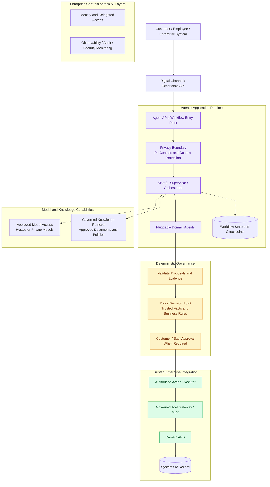
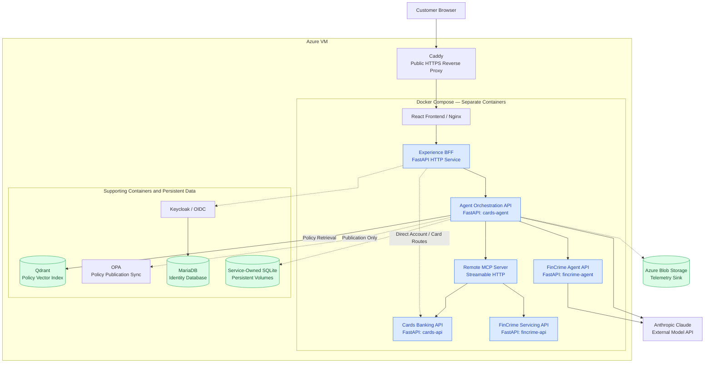
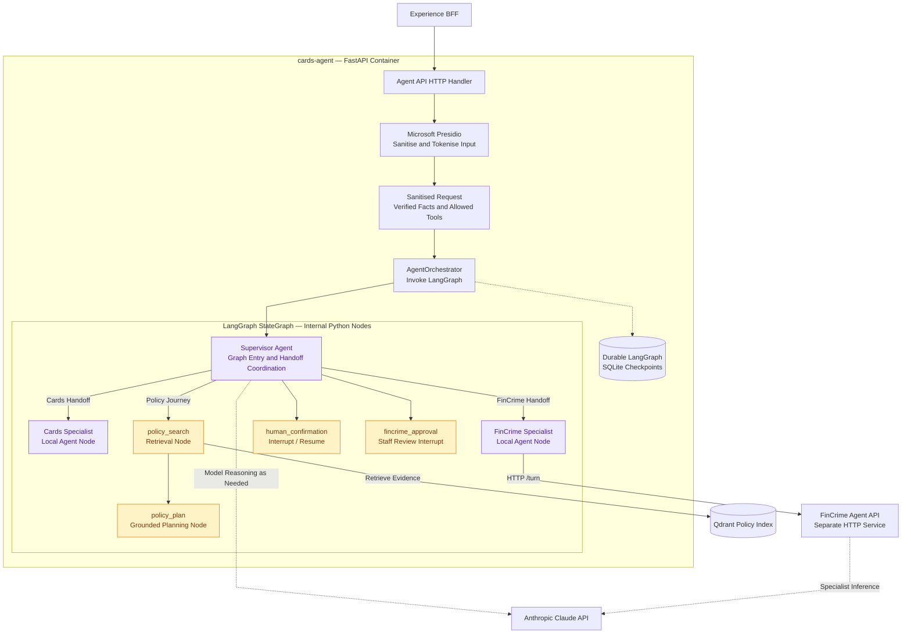
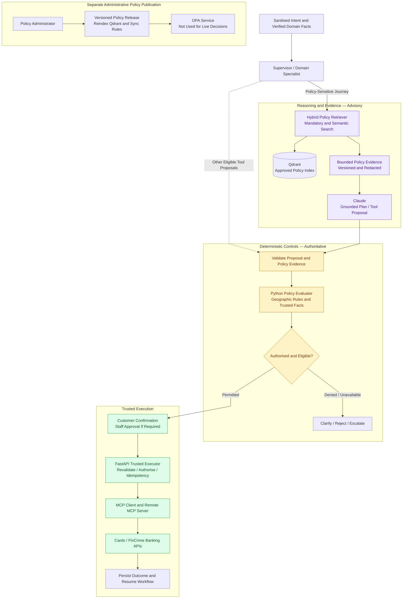

## 1. Enterprise Agentic AI Reference Architecture

## 2. CardServicing Deployment and Component Architecture

## 3. CardServicing LangGraph Multi-Agent Orchestration

## 4. CardServicing RAG, Policy Governance and Trusted Execution

